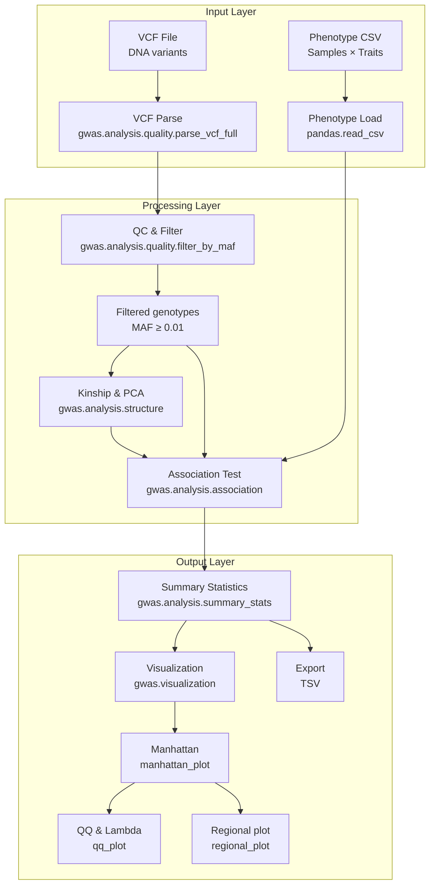

# Integration Guide: dna → gwas → visualization

## Overview

This guide demonstrates end-to-end analysis pipelines combining the **DNA**, **GWAS**, and **Visualization** modules. These three form the core of METAINFORMANT's genomic association workflows: sequence data → association testing → publication-quality plots.

## Architecture



## Core Pipeline Pattern

**Typical GWAS workflow** (sequence variants → phenotype associations):

```
1. DNA: Parse & filter variants (VCF parsing, MAF and missingness QC)
        ↓
2. GWAS: Association testing (linear, logistic or mixed models)
        ↓
3. GWAS: Fine-mapping (credible sets, colocalization)
        ↓
4. Visualization: Manhattan, QQ, regional plots (static + interactive)
```

## Minimal Example (Simple Pipeline)

```python-snippet
"""
Minimal DNA → GWAS → Visualization pipeline.
Assumes a VCF and a phenotype CSV (sample_id, trait, age, sex) already prepared.
"""

import pandas as pd

from metainformant.gwas.analysis import quality, summary_stats
from metainformant.gwas.analysis.association import run_linear_model_gwas
from metainformant.gwas.visualization import manhattan_plot, qq_plot
from metainformant.gwas.visualization.general import regional_plot

# ── Phase 1: DNA variant loading & QC ──────────────────────────────────────
# Parse the VCF (plain or gzipped) and drop rare variants (MAF < 1%)
vcf = quality.parse_vcf_full("data/cohort.vcf.gz")  # genotypes: samples × variants (0/1/2)
genotypes, kept = quality.filter_by_maf(vcf["genotypes"].T.tolist(), maf_threshold=0.01)  # variants × samples
variant_info = [vcf["variants"][i] for i in kept]

# ── Phase 2: GWAS association testing ─────────────────────────────────────
# Phenotype rows must follow the VCF sample order; covariates are covariates × samples
pheno = pd.read_csv("data/phenotypes.csv", index_col="sample_id").loc[vcf["samples"]]
covariates = [pheno["age"].tolist(), pheno["sex"].tolist()]
results = run_linear_model_gwas(  # one dict per variant: variant_id, chrom, pos, beta, se, p_value, ...
    genotypes,
    pheno["trait"].tolist(),
    variant_info=variant_info,
    covariates=covariates,
)

# ── Phase 3: Visualization ──────────────────────────────────────────────────
# manhattan_plot, qq_plot and regional_plot create the output directory when it is missing

# Manhattan plot (chromosome layout + −log10(p) coloring, significance lines)
manhattan_plot(results, output_path="output/gwas/manhattan.png")

# QQ plot for inflation check (λ genomic inflation factor is annotated)
qq_plot([r["p_value"] for r in results], output_path="output/gwas/qq.png")

# Regional plot around the top hit
top = min(results, key=lambda r: r["p_value"])
regional_plot(
    results,
    chrom=top["chrom"],
    start=max(0, top["pos"] - 500_000),
    end=top["pos"] + 500_000,
    output_path="output/gwas/regional.png",
)

# Save summary statistics for downstream use; genotypes (variants × samples, in the order of results)
# supply the MAF column
summary_stats.write_summary_statistics(results, variant_info, "output/gwas/gwas_results.tsv", genotypes=genotypes)
```

### Expected Outputs

| Step | Output file | Contents |
|------|------------|----------|
| GWAS | `output/gwas/gwas_results.tsv` | `CHR POS SNP REF ALT BETA SE P Q_FDR N MAF` per variant |
| Viz | `output/gwas/manhattan.png` | Genome-wide −log10(p) scatter |
| Viz | `output/gwas/qq.png` | Observed vs expected P-values |
| Viz | `output/gwas/regional.png` | Regional association plot around the top hit |

`write_summary_statistics` takes `CHR`, `POS`, `SNP`, `REF` and `ALT` from `variant_info` (`chrom`, `pos`, `id`, `ref`, `alt`) and `BETA`, `SE`, `P` and `N` from the results (`beta`, `se`, `p_value`, `n_samples` or `N`). It invents no value for what the results lack:

- `Q_FDR` is the result's own `q_value` (or `q_fdr` / `Q_FDR`) when it has one. Otherwise it is the Benjamini-Hochberg q-value over the p-values of all the `results` passed in, so pass the full set of tests, not a subset.
- `MAF` is the result's own `maf` (or `MAF`) when it has one. Otherwise it is computed from `genotypes=`, a variants × samples matrix of 0/1/2 alternate-allele counts in the same order as `results` (any other code counts as missing), and it is `NA` when `genotypes` is not given.
- Any other missing or non-finite number is written as `NA`, and an absent text field as `.`.

---

## Full-Featured Pipeline (Production)

For a production-quality run with caching, logging, population-structure correction, fine-mapping and eQTL colocalization:

```python-snippet
"""
Production dna→gwas→visualization pipeline with:
  - Config-driven plot styling (the "output.visualization" section of the YAML config)
  - Caching (the expensive association step is memoized with core.io.cache.JsonCache)
  - Kinship matrix + linear mixed model for population structure correction
  - Wakefield approximate-Bayes-factor credible set for the top locus (V = se**2)
  - Colocalization with an eQTL scan of the same locus
  - Static, summary-panel and interactive figures
"""

from pathlib import Path

import pandas as pd

from metainformant.core import io
from metainformant.core.io.cache import JsonCache
from metainformant.core.utils import config
from metainformant.core.utils.logging import setup_logger
from metainformant.gwas.analysis import quality, structure
from metainformant.gwas.analysis.association import association_test_linear
from metainformant.gwas.analysis.mixed_model import run_mixed_model_gwas
from metainformant.gwas.finemapping import colocalization, credible_sets
from metainformant.gwas.visualization import manhattan_plot, qq_plot
from metainformant.gwas.visualization.config import style_from_config
from metainformant.gwas.visualization.general import regional_plot
from metainformant.gwas.visualization.interactive.composite import gwas_summary_panel
from metainformant.gwas.visualization.interactive.interactive import interactive_manhattan

# ---------------------------------------------------------------------------
# Setup
# ---------------------------------------------------------------------------
cfg = config.load_mapping_from_file("config/gwas_pipeline.yaml")  # YAML config; plot style under output.visualization
style = style_from_config(cfg)
out_dir = Path(io.ensure_directory("output/pipeline"))
log = setup_logger("pipeline", log_file=str(out_dir / "pipeline.log"), level="INFO")
cache = JsonCache(out_dir / "cache", ttl_seconds=7 * 24 * 3600)  # one JSON file per key

# ---------------------------------------------------------------------------
# 1. DNA: Load & filter variants
# ---------------------------------------------------------------------------
vcf = quality.parse_vcf_full("data/cohort.vcf.gz")  # genotypes: samples × variants
genotypes, kept = quality.filter_by_maf(vcf["genotypes"].T.tolist(), maf_threshold=0.005)  # variants × samples
variant_info = [vcf["variants"][i] for i in kept]
log.info("Kept %d of %d variants", len(kept), len(vcf["variants"]))

# ---------------------------------------------------------------------------
# 2. GWAS: Prepare phenotype, covariates and kinship (all in VCF sample order)
# ---------------------------------------------------------------------------
pheno_df = pd.read_csv("data/phenotypes.csv", index_col="sample_id").loc[vcf["samples"]]
phenotype = pheno_df["trait"].tolist()
covariates = [pheno_df[col].tolist() for col in ("age", "sex")]  # covariates × samples

# Kinship matrix (genetic relationship matrix) and principal components take samples × variants
sample_major = [list(sample) for sample in zip(*genotypes)]
kinship = structure.compute_kinship_matrix(sample_major, method="vanraden")["kinship_matrix"]
pca = structure.compute_pca(sample_major, n_components=4)

# ---------------------------------------------------------------------------
# 3. GWAS: Association test (linear mixed model to control population stratification)
# ---------------------------------------------------------------------------
assoc_results = cache.get("assoc_results")
if assoc_results is None:
    log.info("Running mixed-model association")
    assoc_results = run_mixed_model_gwas(
        genotypes, phenotype, kinship, variant_info=variant_info, covariates=covariates
    )
    cache.set("assoc_results", assoc_results)
log.info("GWAS complete: %d variants tested", len(assoc_results))

# ---------------------------------------------------------------------------
# 4. GWAS: Fine-mapping of the top locus (Wakefield approximate Bayes factor credible set)
# ---------------------------------------------------------------------------
top = min(assoc_results, key=lambda r: r["p_value"])
locus = [
    i for i, r in enumerate(assoc_results)
    if r["chrom"] == top["chrom"] and abs(r["pos"] - top["pos"]) <= 500_000
]
gwas_z = [assoc_results[i]["beta"] / assoc_results[i]["se"] for i in locus]
gwas_se = [assoc_results[i]["se"] for i in locus]
# The Bayes factors need the scale of the effect estimates, which z-scores alone do not carry:
# standard_errors= gives V = se**2 (sample_size= is the alternative), and the prior variance defaults to 0.15**2
credible = credible_sets.compute_credible_set(gwas_z, coverage=0.95, standard_errors=gwas_se)
credible_ids = [assoc_results[locus[i]]["variant_id"] for i in credible["snps_in_set"]]
log.info("Credible set: %d variants around %s", len(credible_ids), top["variant_id"])

# ---------------------------------------------------------------------------
# 5. Optional: eQTL colocalization (if expression data are available)
# ---------------------------------------------------------------------------
expr = pd.read_csv("data/expression.csv", index_col="sample_id").loc[vcf["samples"]]  # samples × genes
gene_id = "GENE1"
eqtl_z, eqtl_se = [], []
for i in locus:
    fit = association_test_linear(genotypes[i], expr[gene_id].tolist())
    eqtl_z.append(fit["beta"] / fit["se"])
    eqtl_se.append(fit["se"])
coloc = colocalization.eqtl_coloc(
    gwas_z=gwas_z,
    eqtl_z=eqtl_z,
    gene_id=gene_id,
    gwas_standard_errors=gwas_se,
    eqtl_standard_errors=eqtl_se,
)
log.info("Colocalization PP.H4 for %s: %.3f", gene_id, coloc["pp_h4"])

# ---------------------------------------------------------------------------
# 6. Visualization: static figures, summary panel and interactive Manhattan plot
# ---------------------------------------------------------------------------
manhattan_plot(assoc_results, output_path=out_dir / "manhattan.png", style=style, label_top_n=3)
qq_plot([r["p_value"] for r in assoc_results], output_path=out_dir / "qq.png", style=style)
regional_plot(
    assoc_results,
    chrom=top["chrom"],
    start=max(0, top["pos"] - 500_000),
    end=top["pos"] + 500_000,
    output_path=out_dir / "regional.png",
    style=style,
)

# Multi-panel summary figure (Manhattan, QQ, PCA, kinship and top-hit panels)
gwas_summary_panel(assoc_results, pca_data=pca, kinship_matrix=kinship, output_file=out_dir / "summary_panel.png")

# Interactive HTML for exploration (Plotly when installed, otherwise a table of the top hits).
# The analysis results can be passed as they are: the chromosome is read from "chrom" (or "chromosome", "chr", ...).
interactive_manhattan(assoc_results, output_file=out_dir / "manhattan_interactive.html")

log.info("Pipeline complete — see %s for outputs", out_dir)
```

---

---

## Data Flow Patterns

### Pattern A: Variant-By-Name Pipeline

```python-snippet
# Often you need to go from VCF → GWAS → Plot in one continuous flow:
import pandas as pd
from metainformant.gwas.analysis.association import run_linear_model_gwas
from metainformant.gwas.analysis.quality import filter_by_maf, parse_vcf_full
from metainformant.gwas.visualization import manhattan_plot, qq_plot

# Step 1: Parse the VCF (genotypes come back sample × variant)
vcf = parse_vcf_full("large_cohort.vcf.gz")

# Step 2: Transpose to variant × sample and drop rare variants (MAF < 0.005)
genotypes, kept = filter_by_maf(vcf["genotypes"].T.tolist(), maf_threshold=0.005)
variant_info = [vcf["variants"][i] for i in kept]

# Step 3: GWAS (one linear-model test per variant)
pheno = pd.read_csv("pheno.csv")["trait"].tolist()
results = run_linear_model_gwas(genotypes, pheno, variant_info=variant_info)

# Step 4: Visualize
manhattan_plot(results, output_path="manhattan.png")
qq_plot([r["p_value"] for r in results], output_path="qq.png")
```

### Pattern B: Cache-Forward Recovery

Long GWAS runs can fail mid-way. Cache each finished stage so a rerun resumes after it:

```python-snippet
from metainformant.core.io.cache import JsonCache

ckpt = JsonCache("cache/gwas_ckpt", ttl_seconds=7 * 24 * 3600)   # one JSON file per key

if ckpt.get("assoc") is None:
    vcf = parse_vcf_full("cohort.vcf.gz")
    ckpt.set("assoc", run_linear_model_gwas(vcf["genotypes"].T.tolist(), pheno, variant_info=vcf["variants"]))

if ckpt.get("viz_completed") is None:
    manhattan_plot(ckpt.get("assoc"), output_path="manhattan.png")
    ckpt.set("viz_completed", True)
```

### Pattern C: Distributed Processing (cloud/parallel)

Large cohorts and variant sets are easier to handle one chromosome at a time:

```python-snippet
# For chromosomes 1–22 in parallel (independent), given genotypes (variants × samples),
# variant_info, phenotype and covariates prepared as in the minimal example:
from metainformant.core.execution.parallel import thread_map
from metainformant.gwas.analysis.association import run_linear_model_gwas
from metainformant.gwas.visualization import manhattan_plot

def gwas_chromosome(chrom: int):
    idx = [i for i, v in enumerate(variant_info) if v["chrom"] == str(chrom)]
    return run_linear_model_gwas(
        [genotypes[i] for i in idx],
        phenotype,
        variant_info=[variant_info[i] for i in idx],
        covariates=covariates,
    )

# thread_map shares the genotype lists between workers without copying them. The association tests
# are CPU-bound pure Python, so for a real speed-up run each chromosome in its own process with
# process_map (it needs a top-level picklable function and sends each worker its own copy of the data).
results_by_chrom = thread_map(gwas_chromosome, range(1, 23), max_workers=8)

# To scale beyond one machine, deploy the pipeline to a GCP VM with
# metainformant.cloud (CloudConfig, GCPDeployer).

# Concatenate & visualize all chromosomes
full_results = [r for chrom_results in results_by_chrom for r in chrom_results]
manhattan_plot(full_results, output_path="manhattan.png")
```

---

## Data Contract: Inter-Module Exchange Format

The modules exchange plain Python data, with no custom container class. `parse_vcf_full` returns a dictionary (`genotypes`, `variants`, `samples`, `metadata`), the association functions return one result dictionary per variant, and the visualization functions take that list of dictionaries:

```python
# One result per variant, as returned by run_linear_model_gwas (80 samples tested, 3 with missing values)
result = {
    "variant_index": 42,
    "variant_id": "rs42",    # variant_info["id"]
    "chrom": "1",            # variant_info["chrom"]
    "pos": 43000,            # variant_info["pos"]
    "status": "success",     # "error" for a degenerate design: constant genotype, fewer than 3 complete cases, ...
    "beta": 1.10,            # effect size
    "se": 0.172,             # standard error
    "t_stat": 6.4,
    "p_value": 1.2e-08,      # raw two-sided P-value from Student's t (n_samples minus fitted parameters = degrees of freedom)
    "r_squared": 0.35,
    "n_samples": 77,         # complete cases the test used
    "n_missing_dropped": 3,  # samples left out for a missing genotype, phenotype or covariate value
    "test_type": "linear",
    "converged": True,
}
# Pass variant_info= to the association functions to get variant_id, chrom and pos;
# without it the results carry only the statistics and cannot be placed on a Manhattan plot.
```

`run_logistic_model_gwas` returns `z_stat`, `odds_ratio`, `n_cases` and `n_controls` in place of `t_stat` and `r_squared`; its `converged` is the fit's own convergence flag. `run_mixed_model_gwas` returns `variant_index`, `variant_id`, `chrom`, `pos`, `beta`, `se`, `t_stat`, `p_value` and `test_type`.

`manhattan_plot` accepts the key aliases `chrom`/`chromosome`, `pos`/`position` and `p_value`/`pval`. `interactive_manhattan` reads the chromosome from `chromosome`, `chrom`, `chr`, `CHROM` or `CHR` (the first one present), the position from `position`, `pos` or `POS`, and the p-value from `p_value`, `pvalue` or `P`. A result without a chromosome, a position or a positive finite p-value is skipped, never placed on a default chromosome, and the returned dictionary counts the skipped results in `n_skipped`.

### Conversion Utilities

```python-snippet
import pandas as pd

from metainformant.gwas.analysis import summary_stats

# GWAS results → DataFrame (for pandas-based filtering or export)
results_df = pd.DataFrame(results)

# DataFrame → list of result dictionaries (what the plot functions expect)
records = results_df.to_dict("records")

# GWAS results + variant info → standard summary-statistics TSV
summary_stats.write_summary_statistics(results, variant_info, "gwas_results.tsv")
```

---

## Common Workflows & Recipes

### 1. Standard GWAS (logistic regression with PCA covariates)

```python
import pandas as pd

from metainformant.gwas.analysis import quality, structure, summary_stats
from metainformant.gwas.analysis.association import run_logistic_model_gwas
from metainformant.gwas.analysis.correction import lambda_gc_from_p_values
from metainformant.gwas.visualization import manhattan_plot

vcf = quality.parse_vcf_full("cohort.vcf.gz")
genotypes = vcf["genotypes"].T.tolist()  # variants × samples
pheno = pd.read_csv("phenotypes.csv", index_col="sample_id").loc[vcf["samples"]]
case_control = pheno["case_control"].tolist()  # 0/1 labels in VCF sample order

# Principal components for population structure (samples × variants in, samples × PCs out)
pcs = structure.compute_pca(vcf["genotypes"].tolist(), n_components=10)["pcs"]
covariates = [list(pc) for pc in zip(*pcs)][:3]  # first three PCs, as covariates × samples

# Logistic association test with the PCs as covariates
results = run_logistic_model_gwas(genotypes, case_control, variant_info=vcf["variants"], covariates=covariates)
print(f"λ_GC = {lambda_gc_from_p_values([r['p_value'] for r in results]):.3f}")

# Export (genotypes supply the MAF column; Q_FDR is the Benjamini-Hochberg q-value over all tests)
summary_stats.write_summary_statistics(results, vcf["variants"], "gwas_output.tsv", genotypes=genotypes)
manhattan_plot(results, output_path="manhattan.pdf")
```

For related individuals, use `run_mixed_model_gwas` with a kinship matrix from `structure.compute_kinship_matrix` instead of the logistic test (see the full-featured pipeline above).

### 2. eQTL Colocalization (DNA + RNA + GWAS)

```python
import pandas as pd

from metainformant.gwas.analysis import quality
from metainformant.gwas.analysis.association import run_linear_model_gwas
from metainformant.gwas.finemapping import colocalization
from metainformant.gwas.visualization.general import regional_plot

# Step 1: DNA variants (same as standard GWAS) → per-variant results
vcf = quality.parse_vcf_full("cohort.vcf.gz")
genotypes = vcf["genotypes"].T.tolist()  # variants × samples
pheno = pd.read_csv("phenotypes.csv", index_col="sample_id").loc[vcf["samples"]]
gwas_results = run_linear_model_gwas(genotypes, pheno["trait"].tolist(), variant_info=vcf["variants"])

# Step 2: RNA expression (normalized, samples × genes) in VCF sample order
expr = pd.read_csv("expression_tpm.csv", index_col="sample_id").loc[vcf["samples"]]

# Step 3: eQTL statistics for one gene: regress its expression on each variant's genotype
gene_id = "GENE1"
eqtl_results = run_linear_model_gwas(genotypes, expr[gene_id].tolist(), variant_info=vcf["variants"])

# Step 4: Colocalization on the matched z-scores and standard errors (one per variant, same order);
# the standard errors fix the scale of the Wakefield Bayes factors
coloc = colocalization.eqtl_coloc(
    gwas_z=[r["beta"] / r["se"] for r in gwas_results],
    eqtl_z=[r["beta"] / r["se"] for r in eqtl_results],
    gene_id=gene_id,
    gwas_standard_errors=[r["se"] for r in gwas_results],
    eqtl_standard_errors=[r["se"] for r in eqtl_results],
)
print(f"Colocalization PP.H4: {coloc['pp_h4']:.3f} (colocalized: {coloc['is_colocalized']})")

# Step 5: Regional visualization around the top GWAS hit (regional_plot creates output/eqtl)
top = min(gwas_results, key=lambda r: r["p_value"])
regional_plot(
    gwas_results,
    chrom=top["chrom"],
    start=max(0, top["pos"] - 500_000),
    end=top["pos"] + 500_000,
    output_path="output/eqtl/regional.png",
)
```

### 3. PheWAS (Phenotype-Wide Association Scan)

```python-snippet
import pandas as pd
from metainformant.gwas.analysis.quality import parse_vcf_full
from metainformant.phenotype.gwas_integration.phewas import run_phewas

# Load genotype matrix (sample × variant, additive dosage)
vcf = parse_vcf_full("cohort.vcf.gz")
G = vcf["genotypes"]

# Load wide phenotype table: samples × ~1500 ICD codes / labs / measurements (rows in VCF sample order)
P = pd.read_csv("phenotypes_wide.tsv", sep="\t", index_col="sample_id").loc[vcf["samples"]]

# Test one variant (first column of G) against every phenotype, adjusting for age and sex
results = run_phewas(
    genotype=G[:, 0].tolist(),
    phenotypes={name: P[name].tolist() for name in P.columns.drop(["age", "sex"])},
    covariates=P[["age", "sex"]].values.tolist(),
)

# Results are sorted by p-value
for hit in results[:10]:
    print(hit["phenotype"], hit["beta"], hit["p_value"])
```

---

## Visualization Gallery

### Manhattan with Annotation Overlay

```python
from metainformant.gwas.visualization import manhattan_plot

# gwas_results: the list of per-variant dictionaries from run_linear_model_gwas
fig = manhattan_plot(
    gwas_results,
    significance_threshold=5e-8,
    suggestive_threshold=1e-5,
    gene_annotations=[{"chrom": "19", "pos": 44_908_684, "gene_name": "APOE"}],  # arrow + label at the nearest point
    highlight_regions=[{"chrom": "19", "start": 44_400_000, "end": 45_400_000, "label": "APOE locus"}],
    label_top_n=5,  # label the strongest hits with their variant IDs
)
fig.savefig("figures/manhattan_annotated.pdf", bbox_inches="tight")
```

### Multi-Trait Multi-Panel Dashboard

The plot functions draw on a supplied `ax`, so panels compose with ordinary matplotlib subplots:

```python
import matplotlib.pyplot as plt

from metainformant.gwas.visualization import manhattan_plot, qq_plot

fig, axes = plt.subplots(2, 2, figsize=(14, 8))

manhattan_plot(gwas_bmi, ax=axes[0, 0])
qq_plot([r["p_value"] for r in gwas_bmi], ax=axes[0, 1])
manhattan_plot(gwas_height, ax=axes[1, 0])
qq_plot([r["p_value"] for r in gwas_height], ax=axes[1, 1])

axes[0, 0].set_title("BMI Manhattan")
axes[0, 1].set_title("BMI QQ")
axes[1, 0].set_title("Height Manhattan")
axes[1, 1].set_title("Height QQ")
fig.suptitle("BMI & Height GWAS Results (N=50K)")
fig.tight_layout()
fig.savefig("figures/multi_trait_dashboard.png", dpi=300, bbox_inches="tight")
```

### Interactive Manhattan (Plotly)

```python-snippet
from metainformant.gwas.visualization.interactive.interactive import interactive_manhattan

# Standalone HTML file with hover tooltips; without Plotly installed it writes a table of the top hits instead.
# The analysis results can be passed as they are (chromosome from "chrom", position from "pos", p-value from "p_value").
summary = interactive_manhattan(
    gwas_results,
    output_file="figures/gwas_manhattan_interactive.html",  # missing directories are created
    gene_annotations=[{"variant_id": "rs429358", "gene": "APOE"}],
    significance_threshold=5e-8,
)
# n_skipped counts results without a chromosome, a position or a positive p-value; interactive is False without Plotly
print(summary["status"], summary["n_variants"], summary["n_skipped"], summary["interactive"])
```

---

## Troubleshooting Integration Issues

| Symptom | Likely cause | Fix |
|---------|--------------|-----|
| `ValueError: Genotypes and phenotypes must have same length` | Genotype matrix has the wrong orientation, or the phenotype table is not in VCF sample order | `run_linear_model_gwas` and `run_mixed_model_gwas` take variants × samples; `compute_kinship_matrix` and `compute_pca` take samples × variants. Index phenotypes with `.loc[vcf["samples"]]` |
| `FileNotFoundError` (or `status: "failed"` with `[Errno 2]`) while saving a figure | The plot function does not create its output directory. `manhattan_plot`, `qq_plot` and `regional_plot` from `metainformant.gwas.visualization` do; `genomic.genome.manhattan_plot` and `statistical.statistical.qq_plot`, for example, do not | Call `io.ensure_directory(...)` on the output directory first (the [gallery conventions](gwas/visualization_gallery.md#conventions) say which functions create it) |
| Manhattan plot puts every variant at one position | Results carry no `chrom` and `pos` because `variant_info` was not passed | Pass `variant_info=` to the association function |
| Interactive Manhattan has fewer points than there are results | `interactive_manhattan` skips results that lack a chromosome, a position or a positive p-value, rather than placing them on a default chromosome | Read `n_skipped` in the returned dictionary, and pass `variant_info=` to the association function so that results carry `chrom` and `pos` |
| Memory pressure on large cohorts | Genotypes are held as nested Python lists after `.tolist()` | Filter first with `filter_by_maf`, or process one chromosome at a time (Pattern C) |
| QQ plot shows heavy inflation (λ > 1.1) | Population stratification not fully corrected | Add principal components as covariates (`structure.compute_pca`) or switch to `run_mixed_model_gwas` with a kinship matrix |

---

## Performance Benchmarking

Guide for timing experiments (compare `dna→gwas→viz` across cohort sizes on your own hardware):

```python
import time

import matplotlib.pyplot as plt
import numpy as np
import pandas as pd

from metainformant.gwas.analysis import structure
from metainformant.gwas.analysis.mixed_model import run_mixed_model_gwas
from metainformant.gwas.visualization import manhattan_plot

def time_pipeline(n_variants, n_samples):
    # Generate synthetic data (for benchmarking only): additive 0/1/2 genotypes, variants × samples
    rng = np.random.default_rng(0)
    maf = rng.uniform(0.05, 0.5, size=(n_variants, 1))
    G = (
        (rng.random((n_variants, n_samples)) < maf).astype(int)
        + (rng.random((n_variants, n_samples)) < maf).astype(int)
    ).tolist()
    y = (np.array(G[0]) * 0.5 + rng.normal(size=n_samples)).tolist()
    variant_info = [{"chrom": "1", "pos": 1000 * (i + 1), "id": f"rs{i}"} for i in range(n_variants)]

    t0 = time.time()
    kinship = structure.compute_kinship_matrix([list(sample) for sample in zip(*G)])["kinship_matrix"]
    results = run_mixed_model_gwas(G, y, kinship, variant_info=variant_info)
    t1 = time.time()
    fig = manhattan_plot(results)
    plt.close(fig)
    t2 = time.time()

    return {
        "variants": n_variants,
        "samples":  n_samples,
        "gwas_sec":  t1 - t0,
        "viz_sec":   t2 - t1,
        "total_sec": t2 - t0,
    }

df = pd.DataFrame([
    time_pipeline(500, 100),
    time_pipeline(1_000, 200),
    time_pipeline(5_000, 500),
])
print(df.to_string())
```

Timings depend on your hardware, library versions and genotype density, so measure them with the function above before sizing a run.

---

## End-to-End Checklist

Before considering the pipeline production-ready, verify each step:

- [ ] **DNA**: VCF passes GATK ValidateVariants (no malformed records)
- [ ] **DNA**: Post-filter MAF distribution and missingness histograms saved
- [ ] **GWAS**: Lambda genomic inflation (`lambda_gc_from_p_values`) between 0.95–1.05, or corrected with `genomic_control`
- [ ] **GWAS**: QQ plot shows uniform distribution under null; no runaway deflation
- [ ] **GWAS**: Top loci reach genome-wide significance (P < 5×10⁻⁸) and replicate in independent cohort (if available)
- [ ] **GWAS**: Credible sets (`compute_credible_set` with `standard_errors=` or `sample_size=`, so that `variance_model` is not `"z_scale"`) hold ≤10 variants per locus (`n_snps`); `coverage_achieved` reaches the requested 95% by construction
- [ ] **GWAS**: Colocalization PP.H4 > 0.8 for trait-gene pairs claimed as shared
- [ ] **Viz**: Manhattan x-axis labeled by chromosome with alternating colors for readability
- [ ] **Viz**: All figures exported in both PNG (screen) and PDF (print) formats
- [ ] **Viz**: Source data TSV files accompany every figure (data availability requirement)
- [ ] **Reproducibility**: Script records git commit hash, config file, and random seeds
- [ ] **Caching**: Intermediate files (GRM, PCs, filtered genotypes) stored under `cache/` directory

---

## References in this Guide

This guide intentionally couples real code snippets to the official module documentation:

| Section | Linked Guide |
|---------|-------------|
| DNA variant filtering | [dna/variants.md](dna/variants.md) |
| GWAS mixed-model LMM | [gwas/README.md](gwas/README.md) — see `run_mixed_model_gwas()` |
| Manhattan plot | [visualization/genomics.md](visualization/genomics.md) |
| Fine-mapping | [gwas/README.md](gwas/README.md) — fine-mapping overview |
| Composite figures | [visualization/plots.md](visualization/plots.md) — multi-panel layouts |
| Interactive dashboards | [visualization/examples.md](visualization/examples.md) — interactive Plotly dashboards |
| Core caching | [core/cache.md](core/cache.md) |
| Parallel execution | [core/parallel.md](core/parallel.md) |

---

## Next Steps

Now that you have a complete dna→gwas→visualization pipeline, consider:

1. **Multi-omics integration**: Add RNA expression through the [multiomics module](multiomics/index.md) for joint analysis across layers (joint PCA, joint NMF, canonical correlation).
2. **Cloud scaling**: Offload chromosome-parallel GWAS to [cloud/DEPLOYMENT.md](cloud/DEPLOYMENT.md) for biobank-scale datasets.
3. **MCP deployment**: Make the pipeline callable as an MCP tool for Claude/Cursor — see the [mcp guide](mcp/index.md).
4. **Database archiving**: Log every run via [core/db.md](core/db.md) for audit trails.
5. **Results sharing**: Share the interactive HTML outputs, and see the [visualization examples gallery](visualization/examples.md) for more plots.

Questions? Open an issue or consult the [FAQ.md](FAQ.md).
