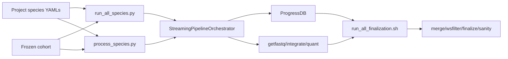

# Workflow orchestration

MetaInformAnt uses thin, domain-specific entrypoints over typed source
modules. The RNA production contract is implemented by the Hymenoptera project
launcher and the shared `StreamingPipelineOrchestrator`.

## RNA entrypoints



With `--cohort` (the launcher's only mode) the producer runs from the cohort's
frozen selection table; `metadata` and `select` run only without `--cohort`
and with `--refresh-metadata`.

Inspect the cohort:

```bash
export AMALGKIT_DATA_ROOT=/Volumes/external_drive/Data/amalgkit
uv run python scripts/rna/run_all_species.py \
  --config-dir projects/hymenoptera_amalgkit/config/amalgkit \
  --data-root "$AMALGKIT_DATA_ROOT" --dry-run
```

Execute the complete campaign:

```bash
bash projects/hymenoptera_amalgkit/scripts/run_full_campaign.sh
```

The launcher holds the campaign writer lock (`<data-root>/.campaign.flock`)
for its whole run; its producer and finalization passes inherit it, and a
second launcher or producer against the same data root exits 73.

## Other domains

Other module scripts remain domain-specific thin wrappers. Their documentation
is located under `docs/<module>/` and each script exposes `--help`. The core
workflow utilities are reusable building blocks, but a domain entrypoint must
declare its data root, configuration, outputs, and completion evidence.

## Completion

An orchestration process is not an analysis result. The RNA campaign is complete
only when current stage receipts, sample-ID reconciliation, valid matrices,
and the regenerated evidence manifest agree. See the [RNA validation protocol](rna/VALIDATION.md)
and [Hymenoptera reproducibility checklist](../projects/hymenoptera_amalgkit/docs/manuscript/reproducibility_checklist.md).
