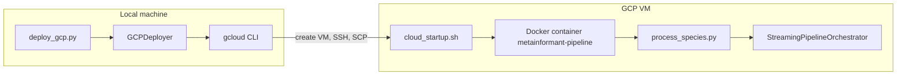

# GCP Cloud Deployment Guide

Deploy the MetaInformAnt amalgkit RNA-seq pipeline to a Google Cloud Platform VM.

> `YOUR_PROJECT_ID` and `my-results-bucket` in the commands below are placeholders: replace them with your own GCP project ID and bucket name.

## Architecture



## Quick Start

### 1. Install gcloud CLI

```bash
bash scripts/cloud/install_gcloud.sh
# Or manually (the script's fallback on systems without apt-get):
# curl -fsSLO https://dl.google.com/dl/cloudsdk/channels/rapid/downloads/google-cloud-cli-linux-x86_64.tar.gz
# tar xzf google-cloud-cli-linux-x86_64.tar.gz && ./google-cloud-sdk/install.sh --quiet
```

The script targets Linux only. On other systems, install the CLI from Google's [installation guide](https://cloud.google.com/sdk/docs/install).

### 2. Authenticate

```bash
gcloud auth login
gcloud config set project YOUR_PROJECT_ID
```

### 3. Deploy

```bash
# Deploy with defaults (n2-standard-32, Spot, 28 workers, 32 threads, 1000 GB boot disk)
python scripts/cloud/deploy_gcp.py deploy --project YOUR_PROJECT_ID

# Or customize:
python scripts/cloud/deploy_gcp.py deploy \
    --project YOUR_PROJECT_ID \
    --machine-type n2-standard-32 \
    --workers 24 --threads 32 \
    --max-gb 350.0 \
    --gcs-bucket my-results-bucket
# Add --no-spot for on-demand pricing, or --dry-run to print the gcloud command only.
```

### 4. Monitor

```bash
python scripts/cloud/deploy_gcp.py status  --project YOUR_PROJECT_ID
python scripts/cloud/deploy_gcp.py logs    --project YOUR_PROJECT_ID
python scripts/cloud/deploy_gcp.py startup-log --project YOUR_PROJECT_ID
```

### 5. Download Results

```bash
# download_results.sh reads the project, zone and VM from the environment and
# falls back to a hard-coded project when GCP_PROJECT is unset, so export it first.
export GCP_PROJECT=YOUR_PROJECT_ID
# export GCP_ZONE=us-central1-a GCP_VM=metainformant-pipeline   # only if you changed --zone or --name

bash scripts/cloud/download_results.sh --output output/amalgkit

# Or via the Python CLI, which runs the same script:
python scripts/cloud/deploy_gcp.py download --output output/amalgkit
```

> **Note:** The script copies `/opt/MetaInformAnt/projects` on the VM to a temporary directory, removes `*.fastq.gz`, `*.sra` and `index` entries from that copy, downloads the rest with `gcloud compute scp`, and deletes the temporary copy. Raw FASTQ files are not transferred.

### 6. Post-Quant Processing (Local)

After downloading results, run the downstream steps locally:

```bash
# Run the merge -> wsfilter -> finalize -> sanity chain on the per-species data tree
bash projects/hymenoptera_amalgkit/scripts/run_all_finalization.sh \
  --data-root "$AMALGKIT_DATA_ROOT"
```

`scripts/rna/run_all_species.py` is the producer (acquisition and quantification) and does not run these downstream steps.

### 7. Cleanup

```bash
python scripts/cloud/deploy_gcp.py destroy --project YOUR_PROJECT_ID
```

`destroy` asks for confirmation and then deletes the VM together with all its disks, so download the results first.

## Cost

The code contains one price figure: a comment in `cloud_config.py` puts the default `n2-highcpu-96` machine at about $3.40/hr on demand and about $0.80/hr as a Spot VM. For other machine types use the [GCP pricing calculator](https://cloud.google.com/products/calculator), and see [ECONOMICS.md](ECONOMICS.md) for the provisioning trade-offs. The module has no cost estimator, budget alert or automatic shutdown.

> **Note:** `CloudConfig` defaults to `n2-highcpu-96` (96 vCPUs) and `deploy_gcp.py deploy` to `n2-standard-32` (32 vCPUs). Check the project's vCPU limit in the [GCP Console](https://console.cloud.google.com/iam-admin/quotas) before deploying, and request an increase if the machine type needs more vCPUs than the quota allows.

## File Structure

```text
src/metainformant/cloud/
  __init__.py         # Package exports (CloudConfig, GCPDeployer)
  cloud_config.py     # VM config dataclass (machine, spot, workers...)
  gcp_deployer.py     # VM lifecycle (create, SSH, status, download, delete)

scripts/cloud/
  deploy_gcp.py        # CLI orchestrator (deploy/status/logs/startup-log/download/stop/start/destroy)
  download_results.sh  # Result download (copy on the VM -> scp -> cleanup)
  install_gcloud.sh    # gcloud CLI installer for Linux
  cloud_startup.sh     # VM boot script (Docker + pipeline auto-start)
  prep_genomes.py      # Download transcriptomes + build kallisto indices
  vm_setup.sh          # Native tool install (no Docker)
  sync_cloud_down.sh   # rsync loop that pulls project data from the VM
  categorize_errors.py # Group failure messages from the VM's progress database
  print_table.py       # Per-species sample-state table from the VM's progress database

scripts/rna/
  run_all_species.py       # Thin orchestrator: species order + args -> StreamingPipelineOrchestrator
  process_species.py       # Single-species producer wrapper
  check_pipeline_status.py # Status report that get_pipeline_status() runs on the VM

tests/cloud/
  test_cloud.py                   # CloudConfig, deployer construction, scripts
  test_gcp_deployer_depth.py      # GCPDeployer paths against a stub gcloud
  test_download_results_depth.py  # download_results script and fallback branches

Dockerfile                # Full pipeline container image
.dockerignore             # Keeps image small
```

## End-to-End Workflow

```
1. Deploy     ->  deploy_gcp.py deploy --project ...
2. Monitor    ->  deploy_gcp.py status / logs
3. Download   ->  export GCP_PROJECT=...; bash scripts/cloud/download_results.sh --output output/amalgkit
4. Post-quant ->  run_all_finalization.sh --data-root "$AMALGKIT_DATA_ROOT"
5. Cleanup    ->  deploy_gcp.py destroy
```

## Manual VM Setup (Without Docker)

If Docker builds are slow or unnecessary, install tools natively (`scripts/cloud/vm_setup.sh` automates most of this, but it installs amalgkit without the version pin):

```bash
# SSH into VM (default instance name and zone)
gcloud compute ssh metainformant-pipeline --zone us-central1-a

# /opt/MetaInformAnt is owned by root (the startup script cloned it), so work as root there
sudo -i
cd /opt/MetaInformAnt

# Install tools (the "rna" extra pins amalgkit to v0.16.60; kallisto and the SRA Toolkit must also be on PATH)
apt-get install -y python3-pip r-base
pip3 install --break-system-packages -e ".[rna]"
wget -qO /usr/local/bin/fastp https://github.com/OpenGene/fastp/releases/download/v0.24.0/fastp && chmod +x /usr/local/bin/fastp

# Build genome indices (optional: the orchestrator builds a missing index itself)
python3 scripts/cloud/prep_genomes.py

# Start pipeline
mkdir -p output/amalgkit
nohup python3 scripts/rna/run_all_species.py --max-gb 350.0 --workers 12 --threads 16 > output/amalgkit/pipeline.log 2>&1 &
```
