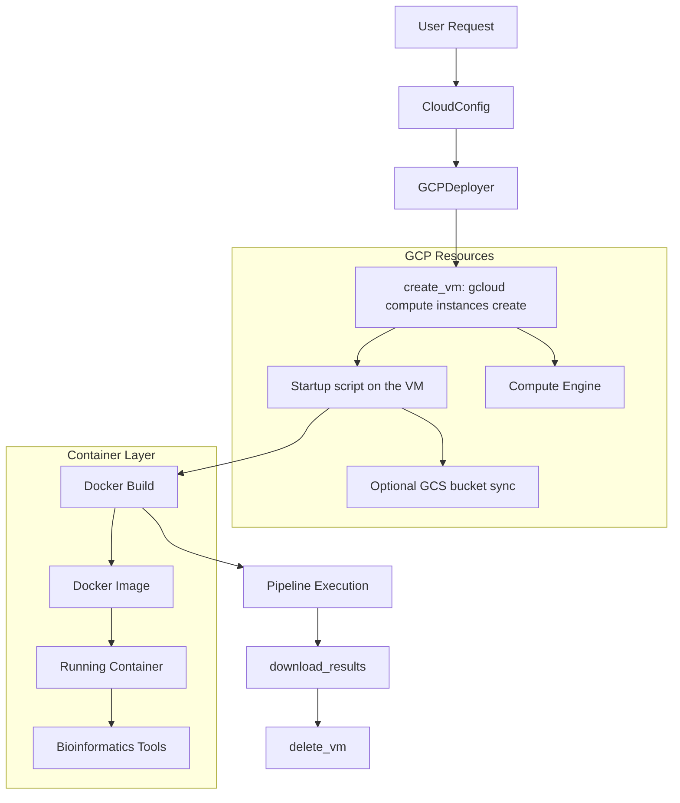

# Cloud Module

Google Cloud deployment of the METAINFORMANT amalgkit RNA-seq pipeline.

## Overview

`metainformant.cloud` creates and manages a Google Cloud Compute Engine VM that runs the amalgkit RNA-seq pipeline. It has two classes: `CloudConfig` (a dataclass of VM and pipeline settings) and `GCPDeployer`, which shells out to the `gcloud` CLI (no Python SDK is used).


## Table of Contents

- [Architecture](#architecture)
- [Key Components](#key-components)
  - [CloudConfig (`cloud_config.py`)](#cloudconfig-cloud_configpy)
  - [GCPDeployer (`gcp_deployer.py`)](#gcpdeployer-gcp_deployerpy)
  - [Command-line interface](#command-line-interface)
- [Genome Preparation](#genome-preparation)
  - [Reference Genome Indexing](#reference-genome-indexing)
- [Workflow Example: RNA-seq on Cloud](#workflow-example-rna-seq-on-cloud)
- [Cost Optimization](#cost-optimization)
  - [Spot VMs](#spot-vms)
- [Troubleshooting](#troubleshooting)
- [See Also](#see-also)

## Architecture



`create_vm` attaches `scripts/cloud/cloud_startup.sh` as the instance startup script and passes the pipeline settings as instance metadata. On boot the script:

- installs Docker and mounts any local NVMe SSDs (RAID 0 on `/opt/MetaInformAnt`);
- clones the repository (shallow, branch `repo_branch`) into `/opt/MetaInformAnt` and builds the Docker image;
- starts a container named `metainformant-pipeline` with `--restart unless-stopped`, `--cpus` set to `threads`, `--memory=90g`, `/opt/MetaInformAnt/projects` and `/opt/MetaInformAnt/config` bind-mounted at `/app/projects` and `/app/config`, and `PIPELINE_MAX_GB`, `PIPELINE_WORKERS` and `PIPELINE_THREADS` taken from the metadata;
- runs `scripts/rna/process_species.py --species apis_mellifera --config-dir projects/hymenoptera_amalgkit/config/amalgkit --data-root "$AMALGKIT_DATA_ROOT"` in that container, so the species is fixed in the script;
- if a GCS bucket is configured, installs a cron job that runs `gsutil -m rsync -r /opt/MetaInformAnt/projects/ gs://<bucket>/projects/` every 30 minutes.

The script logs to `/var/log/metainformant-startup.log`. As written, it has two limits. It never defines `AMALGKIT_DATA_ROOT` and runs under `set -u`, so it stops at the `docker run` line unless that variable is already set in its environment. And `projects/hymenoptera_amalgkit` is a git submodule that the shallow `git clone` does not populate, so the config directory above is empty until the submodule is initialised.

## Key Components

### CloudConfig (`cloud_config.py`)

Configuration management for cloud deployments:

```python
from metainformant.cloud import CloudConfig

config = CloudConfig(
    project="my-gcp-project",  # placeholder: replace with your GCP project ID
    zone="us-central1-a",
    machine_type="n2-standard-32",
    disk_size_gb=500,
    workers=28,
    threads=32,
    spot=True,
)

errors = config.validate()  # [] when valid
```

Names such as `my-gcp-project`, `my-analysis-001`, `my-results-bucket` and `MY_PROJECT` on this page are placeholders: replace them with your own GCP project ID, instance name and bucket.

**Configuration Fields:**

| Field | Type | Description |
|-------|------|-------------|
| `project` | str | GCP project ID (required; default `""` fails `validate()`) |
| `zone` | str | GCP zone (default: `us-central1-a`) |
| `instance_name` | str | VM instance name (default: `metainformant-pipeline`) |
| `machine_type` | str | Compute Engine machine type (default: `n2-highcpu-96`) |
| `disk_size_gb` | int | Boot disk size in GB (default: 500) |
| `local_ssd_count` | int | Number of NVMe local SSDs to attach (default: 0) |
| `spot` | bool | Use Spot provisioning for cost savings (default: `True`) |
| `max_gb` | float | Sample size cap for the pipeline (default: 20.0): samples whose `total_bases` exceed `max_gb` x 10^9 are skipped |
| `workers` | int | Parallel download/quantification workers (default: 80) |
| `threads` | int | Total CPU threads for the pipeline (default: 96); the startup script also uses it as the container's `--cpus` limit |
| `gcs_bucket` | str | Optional GCS bucket for result sync (default: `""`) |
| `repo_url` | str | Git URL the VM clones (default: the MetaInformAnt repository) |
| `repo_branch` | str | Git branch to check out (default: `main`) |
| `docker_image` | str | Name of the Docker image built on the VM (default: `metainformant-pipeline`) |
| `service_account_email` | str | Optional service account for the VM (default: `""`) |
| `config_dir` | str | Declared with default `config/amalgkit`; not read by `GCPDeployer` or `deploy_gcp.py` |
| `output_dir` | str | Declared with default `output/amalgkit`; not read by `GCPDeployer` or `deploy_gcp.py` |
| `image_family` | str | Boot image family (default: `debian-12`) |
| `image_project` | str | Boot image project (default: `debian-cloud`) |

**Methods and properties:**

| Member | Description |
|--------|-------------|
| `validate()` | List of validation errors: project required, `workers` and `threads` at least 1, `disk_size_gb` at least 100 |
| `to_metadata()` | The pipeline settings as the instance metadata (`pipeline-max-gb`, `pipeline-workers`, ...) the startup script reads |
| `startup_script_path` | Path of `scripts/cloud/cloud_startup.sh` inside the repository checkout |

### GCPDeployer (`gcp_deployer.py`)

VM lifecycle management and monitoring through the `gcloud` CLI:

```python
from metainformant.cloud import CloudConfig, GCPDeployer

config = CloudConfig(project="my-gcp-project", instance_name="my-analysis-001", spot=True)
deployer = GCPDeployer(config)

# Print the gcloud command instead of running it
plan = deployer.create_vm(dry_run=True)
print(plan["command"])
```

With a real project, the same deployer drives the VM:

```python-snippet
deployer.create_vm()                  # create the VM; the startup script launches the pipeline
deployer.wait_for_ssh(max_wait=300)   # True once SSH answers
print(deployer.get_vm_status())       # instance description from gcloud
print(deployer.get_pipeline_status()) # remote pipeline progress over SSH
print(deployer.tail_logs(lines=100))  # docker logs of the pipeline container
deployer.download_results("output/cloud_run")
deployer.delete_vm()                  # delete the VM and its disks
```

**Methods:**

| Method | Description |
|--------|-------------|
| `GCPDeployer.gcloud_installed()` | Static: True when the `gcloud` CLI is on `PATH` |
| `create_vm(dry_run=False)` | Create the VM with the startup script and metadata; returns the instance details, or `{"dry_run": True, "command": ...}` when `dry_run=True`. Raises `ValueError` for an invalid config, `FileNotFoundError` without the startup script, and `subprocess.CalledProcessError` when `gcloud` fails |
| `delete_vm()` | Delete the VM and all its disks; returns True on success and False when `gcloud` exits non-zero |
| `stop_vm()` / `start_vm()` | Stop (keeping the disk) or start the VM; return True on success and False when `gcloud` exits non-zero |
| `get_vm_status()` | Instance description as a dict; `{"status": "NOT_FOUND"}` whenever `gcloud describe` exits non-zero (for example when the VM does not exist or the project is wrong) |
| `get_pipeline_status()` | Run the remote status check over SSH and return its text |
| `tail_logs(lines=50)` | Tail the pipeline container's logs over SSH |
| `get_startup_log()` | Read the VM startup script log (`journalctl`) over SSH |
| `wait_for_ssh(max_wait=300)` | Block until SSH works; returns False after `max_wait` seconds |
| `download_results(local_dir="output/amalgkit")` | Create `local_dir`, then run `bash scripts/cloud/download_results.sh --output <local_dir>`; returns True, or False if the 2 hour timeout expires, and raises `subprocess.CalledProcessError` when the script exits non-zero. The script takes the project, zone and VM from the `GCP_PROJECT`, `GCP_ZONE` and `GCP_VM` environment variables (defaults `cryptoptera`, `us-central1-a`, `metainformant-pipeline`), not from `CloudConfig`. Only when the script file is missing does the method fall back to direct `gcloud compute scp` calls, which use the config's project, zone and instance name |
| `sync_to_gcs()` | Run `gsutil -m rsync -r /opt/MetaInformAnt/projects/ gs://<bucket>/amalgkit/` on the VM over SSH (False without `gcs_bucket`, or when the command fails) |
| `full_deploy()` | Create the VM, wait for SSH and print a summary; returns `{"vm": ..., "ssh_ready": ..., "status": ...}` |

### Command-line interface

`scripts/cloud/deploy_gcp.py` wraps the deployer:

```text
python scripts/cloud/deploy_gcp.py deploy --project MY_PROJECT [--dry-run]
python scripts/cloud/deploy_gcp.py status --project MY_PROJECT
python scripts/cloud/deploy_gcp.py logs --project MY_PROJECT [--lines 100]
python scripts/cloud/deploy_gcp.py startup-log --project MY_PROJECT
python scripts/cloud/deploy_gcp.py download [--output output/amalgkit]   # needs GCP_PROJECT in the environment
python scripts/cloud/deploy_gcp.py stop | start | destroy   # each with --project MY_PROJECT
```

Its `deploy` defaults (`n2-standard-32`, 1000 GB disk, 28 workers, 32 threads) differ from the `CloudConfig` defaults above; `--max-gb` defaults to 20.0 in both. `deploy` also takes `--zone`, `--name`, `--machine-type`, `--disk-gb`, `--local-ssd-count`, `--max-gb`, `--workers`, `--threads`, `--gcs-bucket` and `--no-spot`, and `--dry-run` prints the `gcloud` command without running it.

`status`, `logs`, `startup-log`, `download`, `stop`, `start` and `destroy` also accept `--project`, `--zone` and `--name`. Every `gcloud` call passes `--project`, so give these commands the same `--project`, `--zone` and `--name` that `deploy` used. `destroy` asks for confirmation (`[y/N]`) before deleting the VM and all its disks. With `download_results.sh` present, `download` has no use for `--project`, `--zone` and `--name`: the script reads `GCP_PROJECT`, `GCP_ZONE` and `GCP_VM` from the environment (see the `download_results` row above), so export those first.

## Genome Preparation

### Reference Genome Indexing

`metainformant.cloud` does not prepare genomes itself. Reference genome download and indexing live in `metainformant.gwas.data.download`; run them wherever the data should live (for example on the VM):

```python-snippet
from metainformant.gwas.data.download import download_reference_genome, prepare_reference_genome

# Download the genome from NCBI, then decompress and index it
genome_dir = download_reference_genome("GCA_003254395.2", "/data/genomes/")  # Apis mellifera
fasta_path = prepare_reference_genome(genome_dir)
```

**Indexing tools:** `prepare_reference_genome` runs BWA (`bwa index`) and the SAMtools FASTA index (`samtools faidx`). Kallisto transcriptome indexes for the RNA workflow are built by the streaming orchestrator itself when an index is missing (`metainformant.rna.engine.workflow_planning.prepare_reference_genome` downloads `genome.files.transcriptome_fasta` from `genome.ftp_url` and runs `kallisto index -i`), ahead of time for every species config by `scripts/cloud/prep_genomes.py`, or with the helpers in `metainformant.rna.amalgkit.genome_prep` (`build_kallisto_index`, `orchestrate_genome_setup`).

## Workflow Example: RNA-seq on Cloud

```python-snippet
from metainformant.cloud import CloudConfig, GCPDeployer

config = CloudConfig(
    project="my-gcp-project",
    instance_name="rna-pipeline-20250115",
    gcs_bucket="my-results-bucket",  # optional: results are also synced to GCS
    workers=28,
    threads=32,
)
deployer = GCPDeployer(config)

# 1. Create the VM and wait for SSH. The startup script then clones the
#    repository, builds the Docker image and starts the pipeline on its own.
deployment = deployer.full_deploy()

# 2. Check progress whenever you like
print(deployer.get_pipeline_status())
print(deployer.tail_logs(lines=100))

# 3. Download results (quantification output, not raw FASTQ files). The download
#    script reads GCP_PROJECT, GCP_ZONE and GCP_VM from the environment, so export
#    them for this project and instance name first.
deployer.download_results("output/cloud_run/")

# 4. Clean up (deletes the VM and its disks)
deployer.delete_vm()
```

The startup script fixes the species (`apis_mellifera`) and the config directory (`projects/hymenoptera_amalgkit/config/amalgkit`); `CloudConfig` only sets the resource limits (`max_gb`, `workers`, `threads`) that it passes through instance metadata. To process every configured species, run `scripts/rna/run_all_species.py` on the VM; `scripts/cloud/vm_setup.sh` does that natively, without Docker.

## Cost Optimization

### Spot VMs

`spot=True` (the default) adds `--provisioning-model SPOT --instance-termination-action STOP` to the instance creation, so Google may stop the VM when it needs the capacity. A stopped VM keeps its disk, and `start_vm()` starts it again. The startup script launches the pipeline container with `--restart unless-stopped`. Use `spot=False` (or `--no-spot` on the command line) for on-demand pricing.

```python
from metainformant.cloud import CloudConfig

config = CloudConfig(project="my-gcp-project", spot=True)
print(config.machine_type, config.spot)  # n2-highcpu-96 True
```

The comment in `cloud_config.py` puts the default `n2-highcpu-96` machine at about $3.40/hr on demand and about $0.80/hr as a Spot VM; see [ECONOMICS.md](ECONOMICS.md) for the cost breakdown. The module has no built-in cost estimator.

## Troubleshooting

| Failure | Cause | Fix |
|---------|-------|-----|
| `ValueError: Invalid config: GCP project ID is required (--project)` | `project` is empty | Set `CloudConfig(project=...)` or pass `--project` |
| `FileNotFoundError: Startup script not found` | Running outside a repository checkout | Use a checkout that contains `scripts/cloud/cloud_startup.sh` |
| `PERMISSION_DENIED` | Missing IAM roles | Grant `compute.instanceAdmin.v1` + `storage.objectAdmin` |
| `Quota 'CPUS_ALL_REGIONS' exceeded` | The machine type needs more vCPUs than the project quota allows | Request a quota increase, or pass a smaller `--machine-type` |
| VM runs but the pipeline never starts | Startup script failed (for example Docker install or repository clone) | `deployer.get_startup_log()`, or read `/var/log/metainformant-startup.log` on the VM |
| `AMALGKIT_DATA_ROOT: unbound variable` in the startup log | The script uses the variable under `set -u` without defining it | Provide `AMALGKIT_DATA_ROOT` in the script's environment, or edit the `--data-root` argument |
| Container exits with `no runnable configuration found for 'apis_mellifera'` | `projects/hymenoptera_amalgkit` (a submodule) is empty after the shallow clone | Initialise the submodule under `/opt/MetaInformAnt`, or use `config/amalgkit` as `--config-dir` |
| `wait_for_ssh` returns False | Firewall blocking, or the VM is still booting | Allow TCP:22 in VPC firewall rules; wait and retry |

---

**Next:** [RNA Pipeline](../rna/) | [GWAS Pipeline](../gwas/) | [Orchestration Guide](../rna/ORCHESTRATION.md)

---

## See Also

- **Documentation**: [index.md](index.md) — Overview, defaults, links to the guides
- **API Reference**: [SPEC.md](SPEC.md) — Type signatures, failure behavior, instance metadata keys, CLI and script reference
- **Troubleshooting**: [TROUBLESHOOTING.md](TROUBLESHOOTING.md) — Issues met during the first deployment and their fixes
- **Economics**: [ECONOMICS.md](ECONOMICS.md) — Spot versus standard provisioning, disk sizing, cost-related pipeline settings
- **GWAS Pipeline**: [../gwas/index.md](../gwas/index.md) — No cloud runner yet; the startup script launches the amalgkit RNA-seq pipeline
- **Mothership**: [README.md](../README.md) — Project homepage
