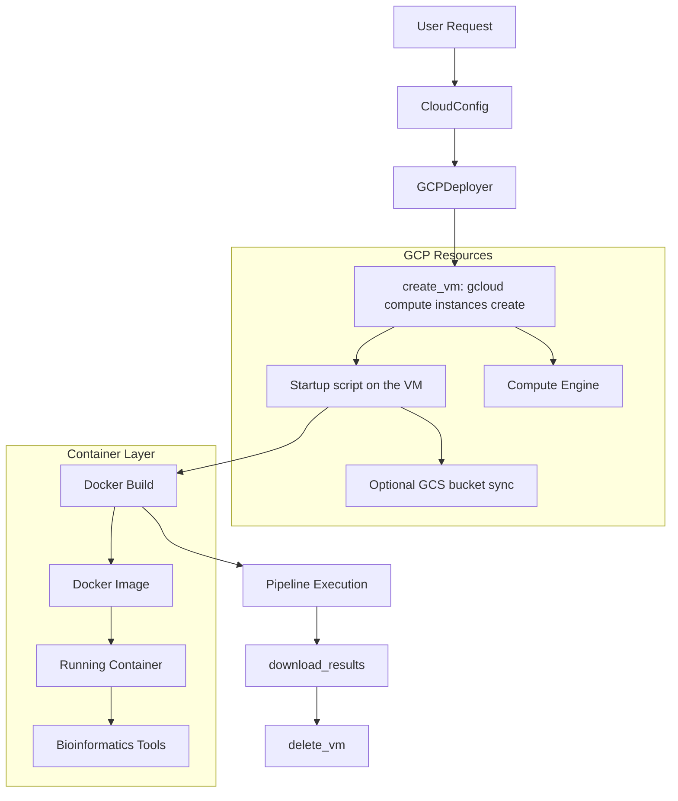

# Cloud Module

Cloud deployment and infrastructure automation for METAINFORMANT bioinformatics workflows.

## Overview

`metainformant.cloud` creates and manages a Google Cloud Compute Engine VM that runs the amalgkit RNA-seq pipeline. It has two classes: `CloudConfig` (a dataclass of VM and pipeline settings) and `GCPDeployer`, which shells out to the `gcloud` CLI (no Python SDK is used).


## Table of Contents

- [Architecture](#architecture)
- [Key Components](#key-components)
  - [CloudConfig (`cloud_config.py`)](#cloudconfig-cloud_configpy)
  - [GCPDeployer (`gcp_deployer.py`)](#gcpdeployer-gcp_deployerpy)
  - [Command-line interface](#command-line-interface)
- [Genome Preparation](#genome-preparation)
  - [Reference Genome Indexing](#reference-genome-indexing)
- [Workflow Example: RNA-seq on Cloud](#workflow-example-rna-seq-on-cloud)
- [Cost Optimization](#cost-optimization)
  - [Spot VMs](#spot-vms)
- [Troubleshooting](#troubleshooting)
- [See Also](#see-also)

## Architecture



`create_vm` attaches `scripts/cloud/cloud_startup.sh` as the instance startup script and passes the pipeline settings as instance metadata. On boot the script installs Docker, mounts any local NVMe SSDs, clones the repository, builds the Docker image and starts the amalgkit RNA-seq pipeline container (`scripts/rna/process_species.py`). If a GCS bucket is configured it also installs a cron job that syncs results every 30 minutes.

## Key Components

### CloudConfig (`cloud_config.py`)

Configuration management for cloud deployments:

```python
from metainformant.cloud import CloudConfig

config = CloudConfig(
    project="my-gcp-project",
    zone="us-central1-a",
    machine_type="n2-standard-32",
    disk_size_gb=500,
    workers=28,
    threads=32,
    spot=True,
)

errors = config.validate()  # [] when valid
```

**Configuration Fields:**

| Field | Type | Description |
|-------|------|-------------|
| `project` | str | GCP project ID (required; default `""` fails `validate()`) |
| `zone` | str | GCP zone (default: `us-central1-a`) |
| `instance_name` | str | VM instance name (default: `metainformant-pipeline`) |
| `machine_type` | str | Compute Engine machine type (default: `n2-highcpu-96`) |
| `disk_size_gb` | int | Boot disk size in GB (default: 500) |
| `local_ssd_count` | int | Number of NVMe local SSDs to attach (default: 0) |
| `spot` | bool | Use Spot provisioning for cost savings (default: `True`) |
| `max_gb` | float | Maximum sample size in GB for the pipeline (default: 20.0) |
| `workers` | int | Parallel download/quantification workers (default: 80) |
| `threads` | int | Total CPU threads for the pipeline (default: 96) |
| `gcs_bucket` | str | Optional GCS bucket for result sync (default: `""`) |
| `repo_url` | str | Git URL the VM clones (default: the MetaInformAnt repository) |
| `repo_branch` | str | Git branch to check out (default: `main`) |
| `docker_image` | str | Name of the Docker image built on the VM (default: `metainformant-pipeline`) |
| `service_account_email` | str | Optional service account for the VM (default: `""`) |
| `config_dir` | str | Local config directory (default: `config/amalgkit`) |
| `output_dir` | str | Local output directory (default: `output/amalgkit`) |
| `image_family` | str | Boot image family (default: `debian-12`) |
| `image_project` | str | Boot image project (default: `debian-cloud`) |

**Methods and properties:**

| Member | Description |
|--------|-------------|
| `validate()` | List of validation errors: project required, `workers` and `threads` at least 1, `disk_size_gb` at least 100 |
| `to_metadata()` | The pipeline settings as the instance metadata (`pipeline-max-gb`, `pipeline-workers`, ...) the startup script reads |
| `startup_script_path` | Path of `scripts/cloud/cloud_startup.sh` inside the repository checkout |

### GCPDeployer (`gcp_deployer.py`)

VM lifecycle management and monitoring through the `gcloud` CLI:

```python
from metainformant.cloud import CloudConfig, GCPDeployer

config = CloudConfig(project="my-gcp-project", instance_name="my-analysis-001", spot=True)
deployer = GCPDeployer(config)

# Print the gcloud command instead of running it
plan = deployer.create_vm(dry_run=True)
print(plan["command"])
```

With a real project, the same deployer drives the VM:

```python-snippet
deployer.create_vm()                  # create the VM; the startup script launches the pipeline
deployer.wait_for_ssh(max_wait=300)   # True once SSH answers
print(deployer.get_vm_status())       # instance description from gcloud
print(deployer.get_pipeline_status()) # remote pipeline progress over SSH
print(deployer.tail_logs(lines=100))  # docker logs of the pipeline container
deployer.download_results("output/cloud_run")
deployer.delete_vm()                  # delete the VM and its disks
```

**Methods:**

| Method | Description |
|--------|-------------|
| `GCPDeployer.gcloud_installed()` | Static: True when the `gcloud` CLI is on `PATH` |
| `create_vm(dry_run=False)` | Create the VM with the startup script and metadata; returns the instance details, or `{"dry_run": True, "command": ...}` when `dry_run=True`. Raises `ValueError` for an invalid config and `FileNotFoundError` without the startup script |
| `delete_vm()` | Delete the VM and all its disks; returns True on success |
| `stop_vm()` / `start_vm()` | Stop (keeping the disk) or start the VM; return True on success |
| `get_vm_status()` | Instance description as a dict (`{"status": "NOT_FOUND"}` when it does not exist) |
| `get_pipeline_status()` | Run the remote status check over SSH and return its text |
| `tail_logs(lines=50)` | Tail the pipeline container's logs over SSH |
| `get_startup_log()` | Read the VM startup script log (`journalctl`) over SSH |
| `wait_for_ssh(max_wait=300)` | Block until SSH works; returns False after `max_wait` seconds |
| `download_results(local_dir="output/amalgkit")` | Download quantification results with `scripts/cloud/download_results.sh` (direct `gcloud compute scp` fallback) |
| `sync_to_gcs()` | Run a `gsutil rsync` to the configured bucket on the VM (False without `gcs_bucket`) |
| `full_deploy()` | Create the VM, wait for SSH and print a summary; returns `{"vm": ..., "ssh_ready": ..., "status": ...}` |

### Command-line interface

`scripts/cloud/deploy_gcp.py` wraps the deployer:

```text
python scripts/cloud/deploy_gcp.py deploy --project MY_PROJECT [--dry-run]
python scripts/cloud/deploy_gcp.py status
python scripts/cloud/deploy_gcp.py logs [--lines 100]
python scripts/cloud/deploy_gcp.py startup-log
python scripts/cloud/deploy_gcp.py download [--output output/amalgkit]
python scripts/cloud/deploy_gcp.py stop | start | destroy
```

Its `deploy` defaults (`n2-standard-32`, 1000 GB disk, 28 workers, 32 threads) differ from the `CloudConfig` defaults above. `status`, `logs`, `startup-log`, `download`, `stop`, `start` and `destroy` also accept `--project`, `--zone` and `--name`.

## Genome Preparation

### Reference Genome Indexing

`metainformant.cloud` does not prepare genomes itself. Reference genome download and indexing live in `metainformant.gwas.data.download`; run them wherever the data should live (for example on the VM):

```python-snippet
from metainformant.gwas.data.download import download_reference_genome, prepare_reference_genome

# Download the genome from NCBI, then decompress and index it
genome_dir = download_reference_genome("GCA_003254395.2", "/data/genomes/")  # Apis mellifera
fasta_path = prepare_reference_genome(genome_dir)
```

**Indexing tools:** `prepare_reference_genome` runs BWA (`bwa index`) and the SAMtools FASTA index (`samtools faidx`). Kallisto transcriptome indexes for the RNA workflow are built by `metainformant.rna.amalgkit.genome_prep` (`build_kallisto_index`, `orchestrate_genome_setup`).

## Workflow Example: RNA-seq on Cloud

```python-snippet
from metainformant.cloud import CloudConfig, GCPDeployer

config = CloudConfig(
    project="my-gcp-project",
    instance_name="rna-pipeline-20250115",
    gcs_bucket="my-results-bucket",  # optional: results are also synced to GCS
    workers=28,
    threads=32,
)
deployer = GCPDeployer(config)

# 1. Create the VM and wait for SSH. The startup script then clones the
#    repository, builds the Docker image and starts the pipeline on its own.
deployment = deployer.full_deploy()

# 2. Check progress whenever you like
print(deployer.get_pipeline_status())
print(deployer.tail_logs(lines=100))

# 3. Download results (quantification output, not raw FASTQ files)
deployer.download_results("output/cloud_run/")

# 4. Clean up (deletes the VM and its disks)
deployer.delete_vm()
```

The pipeline reads its species and data root from the repository on the VM (`scripts/rna/process_species.py` with `projects/hymenoptera_amalgkit/config/amalgkit`); `CloudConfig` only sets the resource limits (`max_gb`, `workers`, `threads`) it passes through instance metadata.

## Cost Optimization

### Spot VMs

`spot=True` (the default) adds `--provisioning-model SPOT --instance-termination-action STOP` to the instance creation, so Google may stop the VM when it needs the capacity. A stopped VM keeps its disk, and `start_vm()` starts it again. The startup script launches the pipeline container with `--restart unless-stopped`. Use `spot=False` (or `--no-spot` on the command line) for on-demand pricing.

```python
from metainformant.cloud import CloudConfig

config = CloudConfig(project="my-gcp-project", spot=True)
print(config.machine_type, config.spot)  # n2-highcpu-96 True
```

The comment in `cloud_config.py` puts the default `n2-highcpu-96` machine at about $3.40/hr on demand and about $0.80/hr as a Spot VM; see [ECONOMICS.md](ECONOMICS.md) for the cost breakdown. The module has no built-in cost estimator.

## Troubleshooting

| Failure | Cause | Fix |
|---------|-------|-----|
| `ValueError: Invalid config: GCP project ID is required` | `project` is empty | Set `CloudConfig(project=...)` or pass `--project` |
| `FileNotFoundError: Startup script not found` | Running outside a repository checkout | Use a checkout that contains `scripts/cloud/cloud_startup.sh` |
| `PERMISSION_DENIED` | Missing IAM roles | Grant `compute.instanceAdmin.v1` + `storage.objectAdmin` |
| `INSUFFICIENT_CPU` | Quota exhausted | Request quota increase or use different zone |
| VM runs but the pipeline never starts | Startup script failed (for example Docker install or repository clone) | `deployer.get_startup_log()`, or read `/var/log/metainformant-startup.log` on the VM |
| `wait_for_ssh` returns False | Firewall blocking, or the VM is still booting | Allow TCP:22 in VPC firewall rules; wait and retry |

---

**Next:** [RNA Pipeline](../rna/) | [GWAS Pipeline](../gwas/) | [Orchestration Guide](../rna/ORCHESTRATION.md)

---

## See Also

- **Documentation**: [index.md](index.md) — Architecture, deployment guides, cost optimization
- **API Reference**: [SPEC.md](SPEC.md) — Full type signatures, error codes, JSON schemas
- **Troubleshooting**: [TROUBLESHOOTING.md](TROUBLESHOOTING.md) — Common errors + fixes, logs to inspect, escalation paths
- **Economics**: [ECONOMICS.md](ECONOMICS.md) — Cost breakdown, preemptible VM strategy
- **GWAS Pipeline**: [../gwas/index.md](../gwas/index.md) — No cloud runner yet; the startup script launches the amalgkit RNA-seq pipeline
- **Mothership**: [README.md](../README.md) — Project homepage
