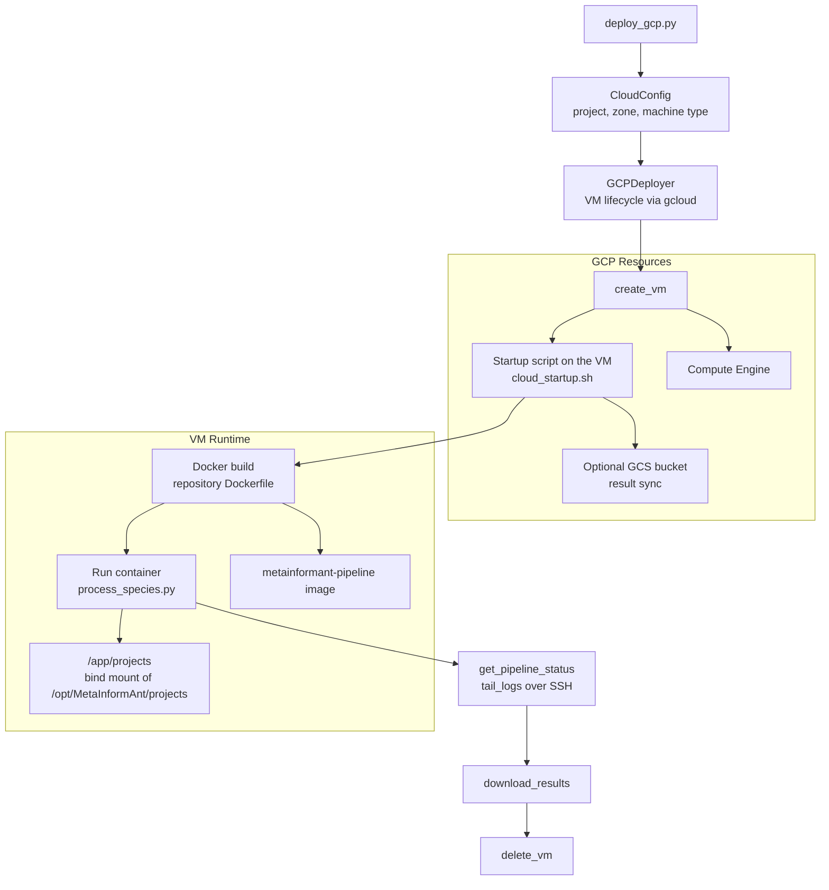

# Cloud Deployment Module

GCP Compute Engine deployment of the METAINFORMANT amalgkit RNA-seq pipeline.

> **Historical infrastructure notice.** The Hymenoptera GCP environment was
> decommissioned on 2026-04-15. The commands and cost guidance below are
> retained as historical operational documentation; current verification uses
> the selected local `AMALGKIT_DATA_ROOT` and does not imply cloud availability.

## Overview

The cloud module creates one Compute Engine VM that runs the amalgkit RNA-seq pipeline:

* **VM lifecycle management** — create, stop, start and delete the instance with `GCPDeployer`, a wrapper over the `gcloud` CLI
* **Docker-based execution** — the startup script builds the repository `Dockerfile` on the VM and runs the pipeline in a container
* **Spot provisioning** — Spot is the default; `--no-spot` selects on-demand pricing
* **State monitoring** — pipeline status, Docker log tailing and startup-log reading over SSH
* **Result transfer** — `download_results.sh`, plus an optional periodic `gsutil rsync` to a GCS bucket

**Historical focus:** Amalgkit RNA-seq production for 27 configured Hymenoptera
species with a 10,312-sample target. Current completion must be read from a
generated data-root report.

**Scope:** The module does not distribute work across VMs, cache genomes, raise budget alerts or schedule runs, and it has no GWAS or multi-omics runner. It supports GCP only; the AWS EC2 fleet and controller helpers live in `metainformant.rna.engine` (`aws_*.py`), not in `metainformant.cloud`.

---

## Architecture



## When to Use Cloud

Use the module when the amalgkit RNA-seq pipeline needs a larger machine than the local one. It deploys exactly one workload, on one VM: the startup script runs `process_species.py` for the species `apis_mellifera`. To process every configured species on a VM, run `scripts/rna/run_all_species.py` there (`scripts/cloud/vm_setup.sh` does this without Docker). Local runs of the same pipeline use `scripts/rna/run_all_species.py` and `projects/hymenoptera_amalgkit/scripts/run_full_campaign.sh` (see [RNA workflows](../rna/workflow.md)).

## Quick Start

`YOUR_PROJECT_ID` is a placeholder: replace it with your GCP project ID.

```bash
# 1. Install gcloud CLI (Linux)
bash scripts/cloud/install_gcloud.sh

# 2. Authenticate
gcloud auth login
gcloud config set project YOUR_PROJECT_ID

# 3. Deploy pipeline
python scripts/cloud/deploy_gcp.py deploy --project YOUR_PROJECT_ID

# 4. Monitor
python scripts/cloud/deploy_gcp.py status --project YOUR_PROJECT_ID

# 5. Download results (download_results.sh reads GCP_PROJECT, GCP_ZONE and GCP_VM from the environment)
export GCP_PROJECT=YOUR_PROJECT_ID
python scripts/cloud/deploy_gcp.py download --output output/amalgkit

# 6. Clean up
python scripts/cloud/deploy_gcp.py destroy --project YOUR_PROJECT_ID
```

## Guides

| Guide | Description |
|-------|-------------|
| [DEPLOYMENT.md](DEPLOYMENT.md) | Step-by-step deployment with `deploy_gcp.py`, file layout, manual VM setup |
| [ARCHITECTURE.md](ARCHITECTURE.md) | Module design, the pipeline on the VM, container mounts, result download |
| [ECONOMICS.md](ECONOMICS.md) | Spot versus standard provisioning, disk sizing, cost-related pipeline settings |
| [TROUBLESHOOTING.md](TROUBLESHOOTING.md) | Issues met during the first deployment and their fixes |

## Configuration

### Defaults

`CloudConfig` and `deploy_gcp.py deploy` use different defaults:

| Setting | `CloudConfig` | `deploy_gcp.py deploy` |
|---------|---------------|------------------------|
| Machine type | `n2-highcpu-96` | `n2-standard-32` |
| Boot disk | 500 GB, `pd-standard` | 1000 GB, `pd-standard` |
| Local SSDs | 0 | 0 (`--local-ssd-count`) |
| Pricing | Spot | Spot (`--no-spot` for on-demand) |
| Workers | 80 | 28 |
| Threads | 96 | 32 |
| Sample size cap (`max_gb`) | 20.0: samples above 20.0 x 10^9 bases are skipped | 20.0 |
| Zone | `us-central1-a` | `us-central1-a` |
| Boot image | `debian-12` from `debian-cloud` | same (no flag) |
| Network | gcloud defaults, network tag `metainformant-pipeline`, no firewall rule created | same |

The machine type is passed to `gcloud` unchanged, so any Compute Engine machine type name works. The only price figures in the code are the comment on the default machine in `cloud_config.py`: about $3.40/hr on demand and about $0.80/hr as a Spot VM. For other machine types use the [GCP pricing calculator](https://cloud.google.com/products/calculator).

## Source Code

| File | Purpose |
|------|---------|
| `src/metainformant/cloud/cloud_config.py` | CloudConfig dataclass (settings + validation) |
| `src/metainformant/cloud/gcp_deployer.py` | GCPDeployer: VM lifecycle, SSH status and log checks, result download |
| `scripts/cloud/deploy_gcp.py` | CLI entry point — user-facing orchestrator |
| `scripts/cloud/prep_genomes.py` | Download reference transcriptomes and build kallisto indexes |
| `scripts/cloud/cloud_startup.sh` | VM init: install Docker, mount local SSDs, clone the repository, build the image, start the container |

## Related Documentation

- [LINUX_TRANSFER.md](../LINUX_TRANSFER.md) — Linux/WSL file transfer patterns
- [RNA workflows](../rna/workflow.md) — Amalgkit pipeline (cloud consumer)
- [Architecture](../architecture.md) — System-wide design
- [SPEC.md](SPEC.md) — Full technical API reference

## External Links

- [GCP Pricing Calculator](https://cloud.google.com/products/calculator)
- [Amalgkit cross-species publication](https://pubmed.ncbi.nlm.nih.gov/32900997/) — Methodology background

## Detailed Documentation

```{toctree}
:maxdepth: 2
:caption: Cloud Module Documentation

README
SPEC
AGENTS
DEPLOYMENT
ARCHITECTURE
ECONOMICS
TROUBLESHOOTING
PAI
```
