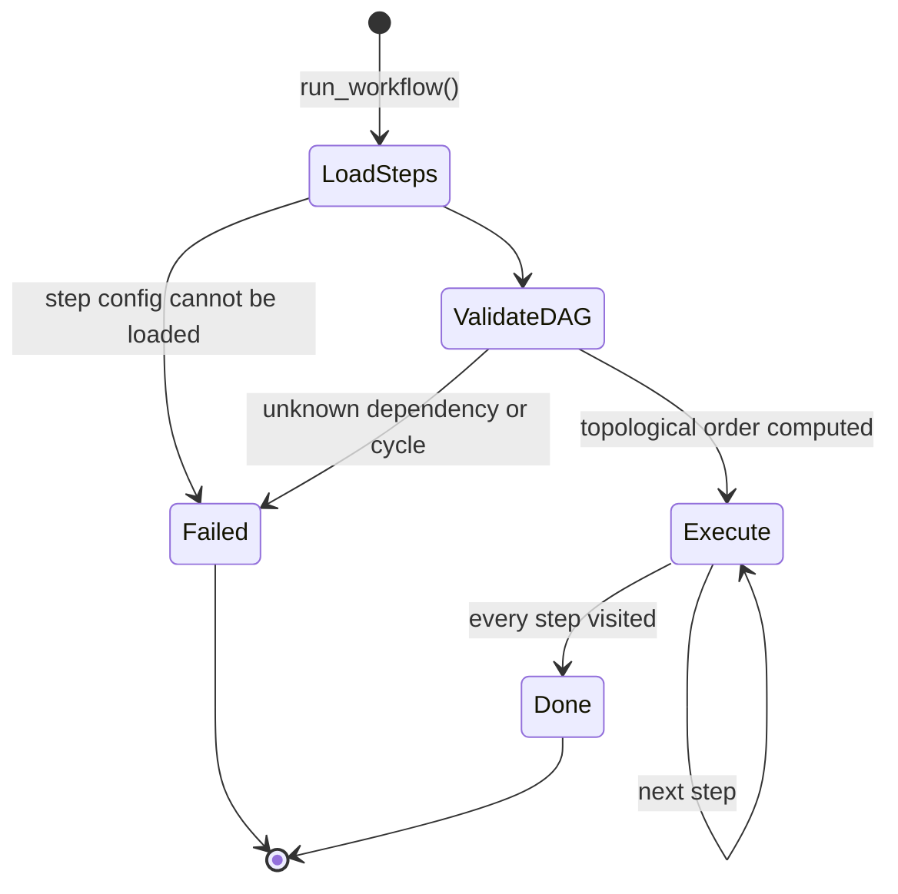
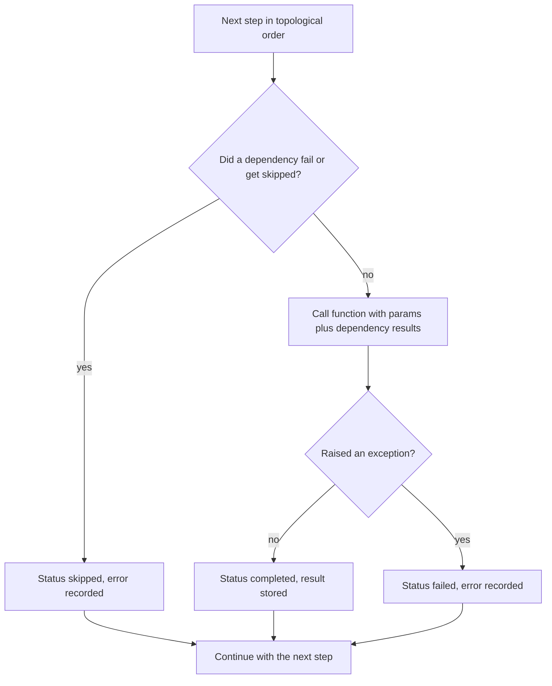

# Core Workflow Orchestration

## Overview

The `metainformant.core.execution.workflow` module provides config-driven workflow execution in METAINFORMANT. It contains:

- `BaseWorkflowOrchestrator`: a dependency-aware (DAG) step runner
- `WorkflowStep`: one step, with status, result, error and timing
- Config helpers: `validate_config_file`, `create_sample_config`, `download_and_process_data` and `run_config_based_workflow`

## BaseWorkflowOrchestrator

### Overview

`BaseWorkflowOrchestrator` is a concrete class (it is not abstract and has no hooks to override). It handles:

- **Step registration** from code (`add_step`) or from the `steps` section of its config
- **Dependency validation** (unknown dependencies and cycles) and topological ordering
- **Step execution** with error capture, timing and logging
- **Failure propagation**: the dependents of a failed step are skipped
- **Result aggregation** into one dictionary

### Class Signature

```python
from pathlib import Path
from typing import Any, Callable, Dict, List, Optional, Union


class BaseWorkflowOrchestrator:
    """DAG-based workflow orchestrator with topological execution ordering."""

    def __init__(self, config: Dict[str, Any], working_dir: Optional[Path] = None):
        """Store the config; working_dir defaults to Path("output")."""

    def add_step(
        self,
        name: str,
        function: Union[Callable, str],
        config: Optional[Dict[str, Any]] = None,
        depends_on: Optional[List[str]] = None,
    ) -> "BaseWorkflowOrchestrator":
        """Register a step; returns self so calls can be chained."""

    def run_workflow(self) -> Dict[str, Any]:
        """Load config steps, validate the DAG, run every step in order."""

    def get_step_status(self) -> Dict[str, str]:
        """Map each step name to pending, running, completed, failed or skipped."""
```

The orchestrator keeps `working_dir` as an attribute but does not create or write to it. Registered steps are available as `workflow.steps`, a dictionary of `WorkflowStep` objects.

`WorkflowStep(name, function, config, depends_on=None)` exposes `status`, `result`, `error`, `start_time`, `end_time`, `execute(**kwargs)`, `duration()` and `reset()`.

### Usage Pattern

```python
from typing import Any, Dict

from metainformant.core.execution.workflow import BaseWorkflowOrchestrator


def validate(input_file: str, **_: Any) -> Dict[str, Any]:
    """Validation logic; `input_file` comes from the step's config."""
    return {"valid": True, "input_file": input_file}


def process(validate: Dict[str, Any], **_: Any) -> Dict[str, Any]:
    """The result of the "validate" step arrives as the keyword argument `validate`."""
    return {"processed_files": 5 if validate["valid"] else 0}


workflow = BaseWorkflowOrchestrator(config={})
workflow.add_step("validate", validate, config={"input_file": "data/input.txt"})
workflow.add_step("process", process, depends_on=["validate"])

results = workflow.run_workflow()
print(results["success"])                 # True
print(results["execution_order"])         # ['validate', 'process']
print(results["results"]["process"])      # {'processed_files': 5}
print(workflow.get_step_status())         # {'validate': 'completed', 'process': 'completed'}
```

Steps can also come from the `steps` section of the config. Each entry names a function as `"module.path:function_name"`, optional `depends_on` and optional `params` (passed to the function as keyword arguments). Steps added with `add_step` take precedence over config entries with the same name.

```python
from typing import Any, Dict

from metainformant.core.execution.workflow import BaseWorkflowOrchestrator


def fetch_data(source: str, **_: Any) -> Dict[str, Any]:
    return {"source": source, "records": 100}


def clean_data(fetch: Dict[str, Any], **_: Any) -> int:
    return fetch["records"] - 3


config = {
    "steps": {
        # "__main__" is the running script; use an importable module in real projects
        "fetch": {"function": "__main__:fetch_data", "params": {"source": "data/raw"}},
        "clean": {"function": "__main__:clean_data", "depends_on": ["fetch"]},
    }
}

results = BaseWorkflowOrchestrator(config).run_workflow()
print(results["results"]["clean"])  # 97
```

## Workflow Execution Flow

### Complete Workflow Lifecycle



`run_workflow()` returns in both cases. A load or validation failure gives `success: False`, empty `results` and `execution_order`, and the reasons in `errors`. After `Done`, `success` is `False` if any step failed or was skipped.

### Step Execution Details



The orchestrator does not stop at the first failure: steps that do not depend on a failed step still run. Steps run one after another in topological order (ties follow registration order); there is no parallel execution.

## Result Structure

### Workflow Results

`run_workflow()` returns a dictionary:

```python
{
    "success": True,                   # False if any step failed or was skipped, or the DAG is invalid
    "results": {                       # step name -> value returned by each completed step
        "validate": {"valid": True, "input_file": "data/input.txt"},
        "process": {"processed_files": 5},
    },
    "errors": [],                      # "Step 'x' failed: ...", "Step 'y' skipped due to failed dependency", ...
    "execution_order": ["validate", "process"],
    "total_duration": 0.002,           # seconds, from a monotonic clock
}
```

### Step Results

A step function may return any value. It is stored unchanged in `results["results"][step_name]` and passed to every dependent step as the keyword argument named after the step. There is no required result dictionary, and the workflow result has no per-step `status` list: use `get_step_status()` for that.

## Configuration Management

### Config Loading Pattern

Workflows use the standard METAINFORMANT configuration loading pattern:

```python
from pathlib import Path
from typing import Any, Dict

from metainformant.core.utils.config import apply_env_overrides, load_mapping_from_file


def load_workflow_config(config_path: str | Path, prefix: str = "WORKFLOW") -> Dict[str, Any]:
    """Load workflow configuration with environment overrides."""
    # Load base config (YAML, TOML or JSON)
    config = load_mapping_from_file(config_path)

    # Apply environment variable overrides
    config = apply_env_overrides(config, prefix=prefix)

    return config
```

`apply_env_overrides` reads only three variables, `{prefix}_THREADS` (stored as the integer `threads`), `{prefix}_WORK_DIR` (`work_dir`) and `{prefix}_LOG_DIR` (`log_dir`); all other keys are left as they are.

### Config Validation

`validate_config_file` checks a config file (or an already loaded dictionary) before a run:

```python
from metainformant.core.execution.workflow import create_sample_config, validate_config_file

# Write a sample config: sample_type is "basic" (default), "scientific" or "advanced"
create_sample_config("output/sample/workflow.json", sample_type="basic")

is_valid, errors = validate_config_file("output/sample/workflow.json")
print(is_valid, errors)  # True []

is_valid, errors = validate_config_file({"steps": {"fetch": {}}})
print(is_valid, errors)  # False ["Step 'fetch' missing 'function' field"]
```

A valid config contains a `steps` section (a dictionary whose entries each have a `function`) or `downloads` and `processing` sections (every download needs a `url`). Pass `schema_path` to also validate against a JSON schema.

### Running a Config File

`run_config_based_workflow(config_path)` validates the file, then runs it:

- With a `steps` section it runs `BaseWorkflowOrchestrator(config).run_workflow()` and returns that result.
- Otherwise it treats the file as a download/processing config, writes outputs under `output/<config file name without suffix>/` and adds `success` and `config_path` to the result.
- An invalid file returns `{"success": False, "error": ..., "config_path": ...}`.

```python
import json
from pathlib import Path

from metainformant.core.execution.workflow import run_config_based_workflow

Path("output/demo").mkdir(parents=True, exist_ok=True)
config = {
    "steps": {
        "cwd": {"function": "os:getcwd"},
        "python": {"function": "platform:python_version"},
    }
}
Path("output/demo/workflow.json").write_text(json.dumps(config))

result = run_config_based_workflow("output/demo/workflow.json")
print(result["success"], result["execution_order"])  # True ['cwd', 'python']
```

### Download and Processing Configs

`download_and_process_data(config_data, output_dir, verbose=False)` handles the `downloads` and `processing` style:

- Every download is fetched with `io.download_file` and recorded under `results["downloads"][name]` as `{"status": "success", "path": ...}` or `{"status": "failed", "error": ...}`; a failure is also listed in `results["errors"]`.
- Processing entries are **not executed**: no implementation is registered for a `type` such as `"normalize"`. Each one is recorded under `results["processing"][name]` as `{"status": "not_executed", "reason": ..., "config": ...}` and added to `results["errors"]`, so a config with a `processing` section never reports success.
- The results are also saved as `processing_results.json` in `output_dir`.

```python
from pathlib import Path

from metainformant.core.execution.workflow import download_and_process_data

Path("output/demo").mkdir(parents=True, exist_ok=True)
source = Path("output/demo/source.json")
source.write_text('{"genes": 3}')

results = download_and_process_data(
    {
        "downloads": {"genes": {"url": source.resolve().as_uri(), "filename": "genes.json"}},
        "processing": {"normalization": {"type": "normalize", "method": "log2"}},
    },
    output_dir="output/demo/run",
)
print(results["downloads"]["genes"]["status"])           # success
print(results["processing"]["normalization"]["status"])  # not_executed
print(len(results["errors"]))                            # 1
```

## Error Handling and Logging

### Error Propagation

`WorkflowStep.execute` records the failure and re-raises; the orchestrator catches it. The failing step gets status `failed` and its `error` attribute holds the exception text. `errors` receives `Step '<name>' failed: <message>`, and each step that depended on it receives `Step '<name>' skipped due to failed dependency`:

```python
from typing import Any

from metainformant.core.execution.workflow import BaseWorkflowOrchestrator


def load(**_: Any) -> str:
    raise RuntimeError("input file missing")


def report(load: str, **_: Any) -> str:
    return f"report on {load}"


def versions(**_: Any) -> str:
    return "independent step still runs"


workflow = BaseWorkflowOrchestrator(config={})
workflow.add_step("load", load)
workflow.add_step("report", report, depends_on=["load"])
workflow.add_step("versions", versions)

results = workflow.run_workflow()
print(results["success"])             # False
print(results["errors"])              # ["Step 'load' failed: input file missing", "Step 'report' skipped due to failed dependency"]
print(workflow.get_step_status())     # {'load': 'failed', 'report': 'skipped', 'versions': 'completed'}
print(sorted(results["results"]))     # ['versions']
```

Only the exception message is kept; the traceback is not stored in the result.

### Logging Integration

The orchestrator logs through `metainformant.core.utils.logging`: INFO when a step starts and when it completes (with its duration), WARNING for skipped steps and ERROR for failed ones. Step functions can use the same logger:

```python
from typing import Any

from metainformant.core.utils.logging import get_logger

logger = get_logger(__name__)


def analyze(threshold: float = 0.05, **_: Any) -> dict:
    """Step function with logging."""
    logger.info(f"Analyzing with threshold {threshold}")
    return {"significant": 12}
```

## Step Function Standards

### Required Interface

A step function is called as `function(**{**step_config, **dependency_results})`: the keyword arguments are the step's `params` merged with one entry per dependency, named after the dependency step (a dependency result replaces a parameter of the same name). Accept `**kwargs` for anything the function does not use:

```python
from typing import Any


def execute_step_name(param_a: int = 1, **kwargs: Any) -> Any:
    """Execute workflow step.

    Args:
        param_a: A value from the step's config
        **kwargs: Results of the steps this one depends on, keyed by step name

    Returns:
        Any value; it is stored under results["results"][step_name]
    """
    return param_a * 2
```

### Step Function Best Practices

```python
from pathlib import Path
from typing import Any, Dict


def execute_data_processing(
    input_file: str | None = None, output_file: str = "processed_data.txt", **kwargs: Any
) -> Dict[str, Any]:
    """Process input data according to configuration."""

    # 1. Validate inputs: raising marks the step failed and skips its dependents
    if not input_file or not Path(input_file).exists():
        raise FileNotFoundError("Input file not found or not specified")

    # 2. Execute step logic
    processed_data = Path(input_file).read_text().upper()

    # 3. Write output and return a summary for downstream steps
    Path(output_file).write_text(processed_data)
    return {
        "output_file": output_file,
        "records_processed": len(processed_data.splitlines()),
    }
```

## Advanced Patterns

### Conditional Step Execution

Steps are registered in code, so a condition decides what is added:

```python
from typing import Any

from metainformant.core.execution.workflow import BaseWorkflowOrchestrator


def validate(**_: Any) -> str:
    return "validated"


def process(**_: Any) -> str:
    return "processed"


def report(**_: Any) -> str:
    return "reported"


config = {"enable_processing": True, "enable_analysis": False}

workflow = BaseWorkflowOrchestrator(config)
workflow.add_step("validate", validate)
if config.get("enable_processing", True):
    workflow.add_step("process", process, depends_on=["validate"])
workflow.add_step("report", report, depends_on=["process"] if config["enable_processing"] else ["validate"])

print(workflow.run_workflow()["execution_order"])  # ['validate', 'process', 'report']
```

### Step Dependencies and Parallelization

Dependencies are declared with `depends_on`, and the orchestrator derives the order from them (a `depends_on` entry naming a step that was never added is reported as `Step 'x' depends on unknown step 'y'`, and a cycle as `Cycle detected in workflow DAG involving steps: [...]`). Independent steps are still run one after another; to parallelize work inside a step use `metainformant.core.execution.parallel`:

```python
from typing import Any

from metainformant.core.execution import parallel
from metainformant.core.execution.workflow import BaseWorkflowOrchestrator


def parallel_analysis(items: list, **_: Any) -> list:
    """One step that fans out over threads."""
    return parallel.thread_map(lambda x: x * x, items, max_workers=4)


def merge_results(parallel_analysis: list, **_: Any) -> int:
    return sum(parallel_analysis)


workflow = BaseWorkflowOrchestrator(config={})
workflow.add_step("parallel_analysis", parallel_analysis, config={"items": [1, 2, 3, 4]})
workflow.add_step("merge_results", merge_results, depends_on=["parallel_analysis"])
print(workflow.run_workflow()["results"]["merge_results"])  # 30
```

### Workflow Composition

A step can run another orchestrator. `run_workflow()` reports failure in its result instead of raising, so check `success` and raise if the parent step should fail too:

```python
from typing import Any, Dict

from metainformant.core.execution.workflow import BaseWorkflowOrchestrator


def run_preprocessing(**_: Any) -> Dict[str, Any]:
    sub = BaseWorkflowOrchestrator(config={})
    sub.add_step("normalize", lambda **_: "normalized")
    outcome = sub.run_workflow()
    if not outcome["success"]:
        raise RuntimeError(f"preprocessing failed: {outcome['errors']}")
    return outcome


def integrate(preprocessing: Dict[str, Any], **_: Any) -> str:
    return f"integrated {sorted(preprocessing['results'])}"


workflow = BaseWorkflowOrchestrator(config={})
workflow.add_step("preprocessing", run_preprocessing)
workflow.add_step("integration", integrate, depends_on=["preprocessing"])
print(workflow.run_workflow()["results"]["integration"])  # integrated ['normalize']
```

## Integration with Core Utilities

### Path Management

The orchestrator does not touch paths, so validate and resolve them inside step functions:

```python
from pathlib import Path
from typing import Any

from metainformant.core.io import paths


def prepare_output(work_dir: str = "output/analysis", **_: Any) -> str:
    """Step that checks and creates its working directory."""
    resolved = paths.expand_and_resolve(work_dir)

    # Ensure the work directory is within the allowed output tree
    if not paths.is_within(resolved, Path("output")):
        raise ValueError("Work directory must be within output/")

    resolved.mkdir(parents=True, exist_ok=True)
    return str(resolved)
```

### Configuration Management

```python
from metainformant.core.execution.workflow import BaseWorkflowOrchestrator
from metainformant.core.utils import config as config_utils


def build_orchestrator(config_path: str, name: str) -> BaseWorkflowOrchestrator:
    # Load config, then let WORKFLOW_THREADS-style variables override it
    config = config_utils.load_mapping_from_file(config_path)
    config = config_utils.apply_env_overrides(config, prefix=name.upper())
    return BaseWorkflowOrchestrator(config)
```

### Progress Tracking

The orchestrator has no progress hook; it logs each step as it runs (see above). Long step functions can show their own progress with `metainformant.core.utils.progress`:

```python
from typing import Any

from metainformant.core.utils import progress


def process_samples(samples: list, **_: Any) -> int:
    """Step that reports progress over its own items."""
    done = 0
    for sample in progress.progress_bar(samples, desc="Processing samples"):
        done += 1  # real work goes here
    return done
```

## Testing Workflow Orchestrators

### Unit Testing Pattern

```python
from pathlib import Path
from typing import Any

from metainformant.core.execution.workflow import BaseWorkflowOrchestrator


def _step(**_: Any) -> dict:
    return {"test": True}


def test_workflow_execution(tmp_path: Path):
    """Test workflow execution."""
    workflow = BaseWorkflowOrchestrator(config={}, working_dir=tmp_path / "output")
    workflow.add_step("test_step", _step)

    results = workflow.run_workflow()

    assert results["success"] is True
    assert results["execution_order"] == ["test_step"]
    assert results["results"]["test_step"] == {"test": True}
    assert workflow.get_step_status() == {"test_step": "completed"}
```

### Integration Testing

```python
from pathlib import Path
from typing import Any

from metainformant.core.execution.workflow import BaseWorkflowOrchestrator


def copy_text(input_file: str, output_file: str, **_: Any) -> str:
    Path(output_file).write_text(Path(input_file).read_text())
    return output_file


def test_workflow_with_real_steps(tmp_path: Path):
    """Test workflow with actual step implementations."""
    input_file = tmp_path / "input.txt"
    output_file = tmp_path / "output.txt"
    input_file.write_text("test data")

    workflow = BaseWorkflowOrchestrator(config={}, working_dir=tmp_path)
    workflow.add_step(
        "copy",
        copy_text,
        config={"input_file": str(input_file), "output_file": str(output_file)},
    )
    results = workflow.run_workflow()

    assert results["success"]
    assert output_file.read_text() == "test data"
```

## Migration Guide

### From Direct Function Calls

**Before:**
```python
def run_analysis(input_file, output_file):
    # Direct implementation
    pass

result = run_analysis("input.txt", "output.txt")
```

**After:**
```python
from metainformant.core.execution.workflow import BaseWorkflowOrchestrator

def run_analysis(input_file, output_file, **_):
    # Same implementation; extra keyword arguments are accepted
    return output_file

workflow = BaseWorkflowOrchestrator(config={})
workflow.add_step("analyze", run_analysis, config={"input_file": "input.txt", "output_file": "output.txt"})
results = workflow.run_workflow()
```

### From Script-Only Workflows

**Before:**
```bash
#!/bin/bash
# Complex bash workflow
step1
step2
step3
```

**After:**
```python
import subprocess
import sys
from typing import Any

from metainformant.core.execution.workflow import BaseWorkflowOrchestrator

def run_command(command: list, **_: Any) -> dict:
    completed = subprocess.run(command, capture_output=True, text=True, check=True)
    return {"stdout": completed.stdout, "stderr": completed.stderr}

workflow = BaseWorkflowOrchestrator(config={})
workflow.add_step("step1", run_command, config={"command": [sys.executable, "-c", "print('step 1')"]})
workflow.add_step(
    "step2",
    run_command,
    config={"command": [sys.executable, "-c", "print('step 2')"]},
    depends_on=["step1"],
)
workflow.run_workflow()
```

## Best Practices

### Design Principles

1. **Single Responsibility**: Each step should do one thing well
2. **Idempotency**: Steps should be safe to re-run
3. **Error Isolation**: A failing step skips only its own dependents; independent steps still run
4. **Result Consistency**: Standardize return value structures between steps that exchange data
5. **Configuration First**: Use config dictionaries, not hardcoded values

### Implementation Guidelines

1. **Validate Early**: Check inputs and configuration before execution (`validate_config_file`)
2. **Log Liberally**: Use structured logging throughout
3. **Handle Errors Gracefully**: Raise exceptions with meaningful messages; they end up in `errors`
4. **Document Thoroughly**: Include docstrings for all public methods
5. **Test Extensively**: Cover success, failure, and edge cases

### Performance Considerations

1. **Resource Management**: Clean up temporary files and connections
2. **Progress Feedback**: Provide progress indicators for long-running steps
3. **Memory Efficiency**: Process large datasets in chunks when possible
4. **Parallelization**: Steps run sequentially; use `core.execution.parallel` inside a step for independent work
5. **Caching**: Cache expensive computations when appropriate

## Related Documentation

- **[Orchestration Guide](../ORCHESTRATION.md)** - Overall orchestration paradigm
- **[Configuration Guide](config.md)** - Configuration management
- **[Logging Guide](logging.md)** - Logging best practices
- **[Testing Guide](../testing.md)** - Testing workflow orchestrators
- **[RNA Workflow](../rna/workflow.md)** - Example domain workflow implementation
