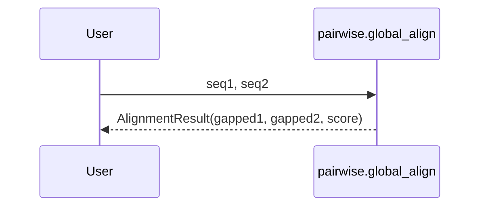

### DNA: Pairwise Alignment

Functions in `metainformant.dna.alignment.pairwise`: `global_align` (Needleman-Wunsch) and `local_align` (Smith-Waterman), both `(seq1, seq2, match=1, mismatch=-1, gap=-2)`, returning an `AlignmentResult` with `aligned_seq1`, `aligned_seq2`, `score`. `local_align` also sets `start_positions`, the `(seq1_start, seq2_start)` of the aligned region.



Example

```python
from metainformant.dna.alignment import pairwise

res = pairwise.global_align("ACGT", "AGT")
print(res.score, res.aligned_seq1, res.aligned_seq2)  # 1.0 ACGT A-GT
```
