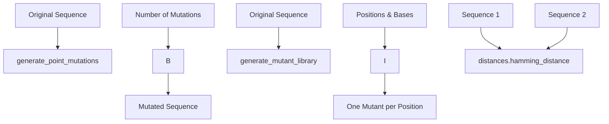

### DNA: Mutations

Functions in `metainformant.dna.variation.mutations`: `generate_point_mutations`, `generate_mutant_library`, `calculate_mutation_rate`, `classify_mutations`, `calculate_substitution_matrix`, `analyze_mutation_spectrum`, `simulate_sequence_evolution`. The Hamming distance is `hamming_distance` in `metainformant.dna.alignment.distances`.



Example

```python-snippet
import random

from metainformant.dna.alignment import distances
from metainformant.dna.variation import mutations

# Generate random point mutations: exactly 3 distinct positions change
random.seed(42)  # the module draws from Python's global random generator
seq = "ATCGATCGATCG"
random_mutated = mutations.generate_point_mutations(seq, num_mutations=3)

# Apply specific changes: one mutant per (position, new base) pair
mutants = mutations.generate_mutant_library("ATCGATCG", positions=[0, 3], mutations=["G", "A"])
# ["GTCGATCG", "ATCAATCG"]: each mutant carries only its own change

# Calculate Hamming distance (number of differing positions)
dist = distances.hamming_distance("ATCG", "ATGG")  # 1

# Mutation rate: the fraction of differing sites
rate = mutations.calculate_mutation_rate("ATCG", "ATGG")  # 0.25
```

Features:
- **Exact count**: `generate_point_mutations` changes exactly `num_mutations` distinct positions (`ValueError` if the number is negative or exceeds the sequence length) and replaces each base with a different one
- **Uppercase output**: `generate_point_mutations` converts its input to uppercase
- **Unused parameter**: `mutation_rate` in `generate_point_mutations` is accepted for backward compatibility and has no effect
- **Reproducible**: there is no `seed` argument; call `random.seed(...)` before generating
- **Mutant library**: `generate_mutant_library` gives one single-substitution mutant per position/base pair, silently skips positions outside the sequence, and raises `ValueError` when the two lists differ in length
- **Distance calculation**: Hamming distance between sequences (`distances.hamming_distance`, equal lengths and A/C/G/T only)

Mutation types:
- **Point mutations**: Single nucleotide changes
- **Substitutions**: Replace existing base with different base
- **Classification**: `classify_mutations(ancestral, derived)` counts `transitions`, `transversions`, `synonymous`, `nonsynonymous` and `total` changes between equal-length sequences, reading codons from position 0

Related: Used in evolutionary analyses and [phylogeny](./phylogeny.md) simulations.
