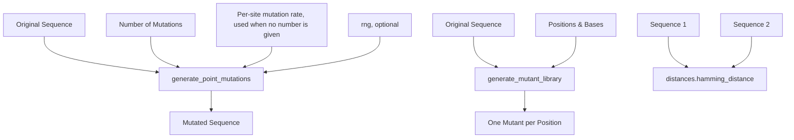

### DNA: Mutations

Functions in `metainformant.dna.variation.mutations`: `generate_point_mutations`, `generate_mutant_library`, `calculate_mutation_rate`, `classify_mutations`, `calculate_substitution_matrix`, `analyze_mutation_spectrum`, `simulate_sequence_evolution`. The Hamming distance is `hamming_distance` in `metainformant.dna.alignment.distances`.



Example

```python-snippet
import random

from metainformant.dna.alignment import distances
from metainformant.dna.variation import mutations

seq = "ATCGATCGATCG"

# Exact count: 3 distinct positions change. A private generator makes the result
# reproducible without touching Python's global random state
random_mutated = mutations.generate_point_mutations(seq, num_mutations=3, rng=random.Random(42))

# Per-site rate: without num_mutations, each position mutates independently with
# probability mutation_rate, so the number of changes varies from call to call
rate_mutated = mutations.generate_point_mutations(seq, mutation_rate=0.1, rng=random.Random(42))

# Apply specific changes: one mutant per (position, new base) pair
mutants = mutations.generate_mutant_library("ATCGATCG", positions=[0, 3], mutations=["G", "A"])
# ["GTCGATCG", "ATCAATCG"]: each mutant carries only its own change

# Calculate Hamming distance (number of differing positions)
dist = distances.hamming_distance("ATCG", "ATGG")  # 1

# Mutation rate: the fraction of differing sites
rate = mutations.calculate_mutation_rate("ATCG", "ATGG")  # 0.25
```

Features:
- **Exact count**: with `num_mutations` given, `generate_point_mutations` changes exactly that many distinct positions, sampled uniformly (`ValueError` if the number is negative or exceeds the sequence length). `mutation_rate` is not used in this mode, and it is not validated either
- **Per-site rate**: without `num_mutations` (the default `None`), every position mutates independently with probability `mutation_rate` (default 0.001), so the number of mutations is binomial; `ValueError` if the rate is outside [0, 1] or NaN
- **Substitution**: in both modes a mutated base is replaced by a nucleotide chosen uniformly among the A/C/G/T bases that differ from it
- **Uppercase output**: `generate_point_mutations` converts its input to uppercase
- **Reproducible**: `generate_point_mutations` takes a keyword-only `rng` (a `random.Random`) that supplies every random draw and leaves Python's global `random` state untouched. Without `rng` it draws from the global generator, so `random.seed(...)` before the call makes the result reproducible
- **Sequence evolution**: `simulate_sequence_evolution(sequence, generations, mutation_rate=0.001, *, rng=None)` applies the per-site mutation probability independently in every generation. A rate of 0 leaves every generation unchanged; a rate of 1 changes every position in every generation. A private `random.Random` supplied as `rng` reproduces counts, positions and replacement bases without touching global state; with `rng=None`, `random.seed(...)` controls the lineage.
- **Mutant library**: `generate_mutant_library` gives one single-substitution mutant per position/base pair, silently skips positions outside the sequence, and raises `ValueError` when the two lists differ in length
- **Distance calculation**: Hamming distance between sequences (`distances.hamming_distance`, equal lengths and A/C/G/T only)

Mutation types:
- **Point mutations**: Single nucleotide changes
- **Substitutions**: Replace existing base with different base
- **Classification**: `classify_mutations(ancestral, derived)` counts `transitions`, `transversions`, `synonymous`, `nonsynonymous`, `ambiguous` and `total` changes between equal-length sequences, reading codons from position 0. Differences involving a non-ACGT base count as `ambiguous`, so `transitions + transversions + ambiguous == total`; incomplete or ambiguous codons receive no synonymous/nonsynonymous classification

Related: Used in evolutionary analyses and [phylogeny](./phylogeny.md) simulations.
