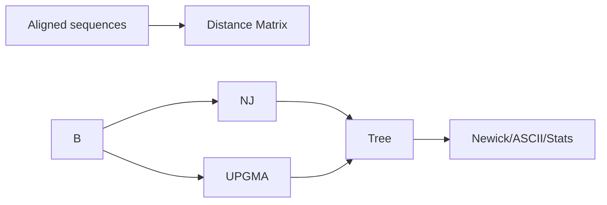

### DNA: Phylogeny

Functions: `neighbor_joining_tree`, `upgma_tree`, `to_newick`, `to_ascii`, `bootstrap_support`, `basic_tree_stats`.



Example

```python
from pathlib import Path
from metainformant.dna import phylogeny
from metainformant.dna.sequence.core import read_fasta

seqs = read_fasta(str(Path("tests/dna/data/dna/toy.fasta")))
tree = phylogeny.neighbor_joining_tree(seqs)
newick = phylogeny.to_newick(tree)

# Optional: ASCII rendering and basic stats
ascii_tree = phylogeny.to_ascii(tree)
stats = phylogeny.basic_tree_stats(tree)

# Optional: bootstrap support. A new tree is returned; `tree` is not modified.
supported = phylogeny.bootstrap_support(tree, seqs, n_replicates=100, method="nj")
support = {node: kids["bootstrap"] for node, kids in supported.items() if isinstance(kids, dict)}
```

`bootstrap_support(tree, sequences, n_replicates=100, method="nj")`:
- Resamples the alignment columns with replacement (with a fixed seed, so repeated calls give the same values), rebuilds a tree for each replicate with `neighbor_joining_tree` (`method="nj"`) or `upgma_tree` (any other `method`), and counts how often each clade of `tree` reappears.
- Returns a new tree, a deep copy whose internal-node dictionaries carry a `"bootstrap"` entry: an integer from 0 to 100, the percentage of replicates that recovered the clade (a replicate that fails to build still counts in the denominator). The input `tree` is never modified, and `to_newick`, `to_ascii` and `basic_tree_stats` ignore the entries.
- With empty `sequences` or a zero-length alignment it returns an unchanged copy of the tree with no support values.
