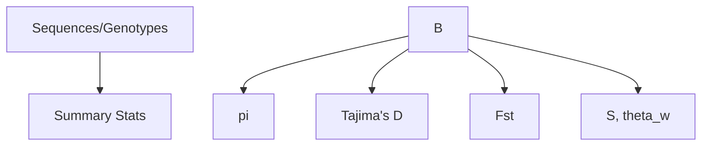

### DNA: Population Genetics

Population genetic analysis and diversity metrics for DNA sequences.

**Functions**: `allele_frequencies`, `observed_heterozygosity`, `nucleotide_diversity`, `tajimas_d`, `fu_and_li_d_star_from_sequences`, `fu_and_li_f_star_from_sequences`, `fay_wu_h_from_sequences`, `normalized_fay_wu_h`, `hudson_fst`, `segregating_sites`, `wattersons_theta`.



## Overview

This module provides population genetics statistics for DNA sequence data, including:
- **Diversity metrics**: Nucleotide diversity (π), segregating sites
- **Neutrality tests**: Tajima's D, Fu and Li's D* and F*, and Fay and Wu's H (raw and normalized)
- **Population differentiation**: F-statistics (Hudson's Fst)
- **Allele frequencies**: From genotype matrices
- **Heterozygosity**: Observed heterozygosity from diploid genotypes

## Functions

### `allele_frequencies(genotype_matrix)`

Compute the alternate-allele frequency of each locus from a genotype matrix.

**Parameters**:
- `genotype_matrix`: List of lists where each row is a locus and each column an individual; values are diploid 0/1/2 alternate-allele counts

**Returns**: One frequency per locus (row): the row sum divided by twice the number of individuals

**Example**:
```python
from metainformant.dna import population

genotypes = [
    [0, 1, 2],  # Locus 1: three individuals
    [2, 2, 1],  # Locus 2
]
freqs = population.allele_frequencies(genotypes)
# Returns: [0.5, 0.833...]
```

### `observed_heterozygosity(genotypes)`

Calculate the proportion of heterozygous individuals among diploid genotypes.

**Parameters**:
- `genotypes`: Iterable of tuples (a1, a2) with alleles 0/1

**Returns**: Float in [0, 1] representing proportion of heterozygotes

**Example**:
```python
genotypes = [(0, 0), (0, 1), (1, 1), (1, 0)]
h_obs = population.observed_heterozygosity(genotypes)
# Returns: 0.5 (2 of 4 are heterozygous)
```

### `nucleotide_diversity(seqs)`

Calculate average pairwise nucleotide difference per site (π).

**Parameters**:
- `seqs`: Sequence of DNA sequences (strings)

**Returns**: Average pairwise diversity per site (float)

**Note**: If sequences have different lengths, truncates to shortest length.

**Example**:
```python
seqs = ["AAAA", "AAAT", "AATT"]
pi = population.nucleotide_diversity(seqs)
# Returns average pairwise differences per site
```

### `tajimas_d(seqs)`

Calculate Tajima's (1989) D for departure from neutral equilibrium:
D = (k − η/a_n) / √Var, where k is the mean number of differences between two
sequences (per sequence, not per site), η the number of mutations and
a_n = Σ_{i=1}^{n−1} 1/i.

**Parameters**:
- `seqs`: At least 4 aligned DNA sequences (strings)

**Returns**: Tajima's D (float); 0.0 when no column is polymorphic

**Raises**: `ValueError` for fewer than 4 sequences or sequences of different lengths

**Interpretation**:
- D > 0: Suggests balancing selection or population contraction
- D < 0: Suggests directional selection or population expansion
- D ≈ 0: Consistent with neutral equilibrium

Judge a departure by its p-value (`analysis.calculate_tajima_d` returns one from
the normal approximation) or by coalescent simulation, not by the sign alone.

**Example**:
```python
seqs = ["AAAA", "AAAA", "AACT", "AAAT"]
d = population.tajimas_d(seqs)  # 0.5916: k = 7/6, eta = 2, n = 4
```

### `fu_and_li_d_star_from_sequences(seqs)` and `fu_and_li_f_star_from_sequences(seqs)`

Fu and Li's (1993) D* and F*, which need no outgroup, contrast mutations whose
allele is carried by exactly one sequence (η_s) with all mutations
(D* = (n/(n−1) η − a_n η_s) / √Var) or with the mean pairwise difference
(F* = (k − (n−1)/n η_s) / √Var). Both return 0.0 without polymorphism and share
the input rules of `tajimas_d`.

### `fay_wu_h_from_sequences(seqs, outgroup=None)` and `normalized_fay_wu_h(seqs, outgroup)`

`fay_wu_h_from_sequences` returns the raw per-site H = π − θ_H; without an
outgroup the most frequent allele is taken as ancestral. `normalized_fay_wu_h`
returns Zeng et al.'s (2006) standardized H = (θ_π − θ_L) / √Var from the
spectrum polarized by the outgroup, and `analysis.calculate_fay_wu_h(seqs, outgroup)`
derives its p-value from it. Without an outgroup that p-value is `None`, because
H's null distribution needs derived-allele frequencies.

#### Method notes

All four statistics are standardized linear functions of the site frequency
spectrum. Their variances come from Fu's (1995) covariance of the spectrum under
the standard neutral model (Achaz 2009), which reproduces the published closed
forms for D, D* and normalized H and gives the exact variance for F*. Only
columns where every sequence has A, C, G or T are used; at a column with more
than two alleles, each allele other than the ancestral one counts as a mutation.

### `hudson_fst(pop1, pop2)`

Calculate Hudson's Fst estimator for two populations.

**Parameters**:
- `pop1`: Sequence of DNA sequences from population 1
- `pop2`: Sequence of DNA sequences from population 2

**Returns**: Fst value in [0, 1] where:
- 0 = no differentiation
- 1 = complete differentiation (fixed differences)

**Example**:
```python
pop1 = ["AAAA", "AAAA", "AAAT"]
pop2 = ["TTTT", "TTTT", "TTTA"]
fst = population.hudson_fst(pop1, pop2)
# Returns: 1.0 for fixed differences
```

### `segregating_sites(seqs)`

Count the number of sites with more than one allele among sequences.

**Parameters**:
- `seqs`: Sequence of DNA sequences (strings)

**Returns**: Integer count of segregating (polymorphic) sites

**Example**:
```python
seqs = ["AAAA", "AAAT", "AATT"]
S = population.segregating_sites(seqs)
# Returns: 2 (sites at positions 2 and 3 are polymorphic)
```

### `wattersons_theta(seqs)`

Calculate Watterson's theta for the whole alignment: θ_W = S / a₁.

**Parameters**:
- `seqs`: Sequence of DNA sequences (strings)

**Returns**: Watterson's theta for the alignment (float); divide by the number of sites for a per-site value

**Formula**: θ_W = S / a₁ where:
- S = number of segregating sites
- a₁ = Σᵢ₌₁ⁿ⁻¹ 1/i (harmonic sum)

**Example**:
```python
seqs = ["AAAA", "AAAA", "AACT", "AAAT"]
theta_w = population.wattersons_theta(seqs)  # 2 / (1 + 1/2 + 1/3) = 1.0909
```

## Usage Examples

### Basic Population Analysis

```python
from metainformant.dna import population

# Load sequences (from FASTA, etc.)
sequences = ["ATCGATCG", "ATCGTTCG", "ATCGATCG", "ATCGTTCG"]

# Calculate diversity metrics
pi = population.nucleotide_diversity(sequences)
print(f"Nucleotide diversity (π): {pi:.6f}")

# Count segregating sites
S = population.segregating_sites(sequences)
print(f"Segregating sites: {S}")

# Calculate Watterson's theta
theta_w = population.wattersons_theta(sequences)
print(f"Watterson's theta: {theta_w:.6f}")

# Calculate Tajima's D
d = population.tajimas_d(sequences)
print(f"Tajima's D: {d:.6f}")
```

### Population Differentiation

```python
# Compare two populations
pop1 = ["AAAA", "AAAT", "AAAA"]
pop2 = ["TTTT", "TTTA", "TTTT"]

fst = population.hudson_fst(pop1, pop2)
print(f"Fst between populations: {fst:.4f}")
```

### Genotype Analysis

```python
# From genotype matrix (0/1 encoding)
genotype_matrix = [
    [0, 1, 0],  # Individual 1
    [0, 1, 1],  # Individual 2
    [1, 0, 1],  # Individual 3
    [1, 1, 0],  # Individual 4
]

# Calculate allele frequencies
freqs = population.allele_frequencies(genotype_matrix)
print(f"Allele frequencies: {freqs}")

# Calculate observed heterozygosity
genotypes = [(0, 0), (0, 1), (1, 1), (1, 0)]
h_obs = population.observed_heterozygosity(genotypes)
print(f"Observed heterozygosity: {h_obs:.4f}")
```

## Integration with Other Modules

### With Math Module

For more advanced population genetics calculations, combine with `math.popgen`:

```python
from metainformant.dna import population
from metainformant.math.population_genetics.coalescent import tajimas_D

# tajimas_D takes the mean pairwise difference per sequence, so scale the
# per-site pi by the alignment length (valid for gap-free alignments).
seqs = ["AAAA", "AAAA", "AACT", "AAAT"]
k = population.nucleotide_diversity(seqs) * len(seqs[0])
S = population.segregating_sites(seqs)

d = tajimas_D(k, S, len(seqs))  # equals population.tajimas_d(seqs)
```

### With GWAS Module

Population genetics statistics complement GWAS analysis:

```python
from metainformant.dna import population
from metainformant.gwas import parse_vcf_full

# Parse VCF and extract sequences
vcf_data = parse_vcf_full("variants.vcf")
# ... convert to sequences ...

# Calculate population diversity
pi = population.nucleotide_diversity(sequences)
```

## Notes and Limitations

1. **Sequence Length**: Sequence-based statistics require aligned sequences of equal length and raise `ValueError` otherwise.

2. **Neutrality p-values**: The p-values in `analysis` use the normal approximation, which is rough for small samples; simulate the null distribution when the decision matters.

3. **Genotype Encoding**: Genotype matrices hold diploid 0/1/2 alternate-allele counts.

4. **Input Validation**: Functions handle edge cases (empty inputs, single sequences) but may not validate all input types.

## References

- Tajima, F. (1989). Statistical method for testing the neutral mutation hypothesis by DNA polymorphism. *Genetics*, 123(3), 585-595.
- Fu, Y.-X., & Li, W.-H. (1993). Statistical tests of neutrality of mutations. *Genetics*, 133(3), 693-709.
- Fu, Y.-X. (1995). Statistical properties of segregating sites. *Theoretical Population Biology*, 48(2), 172-197.
- Fay, J. C., & Wu, C.-I. (2000). Hitchhiking under positive Darwinian selection. *Genetics*, 155(3), 1405-1413.
- Zeng, K., Fu, Y.-X., Shi, S., & Wu, C.-I. (2006). Statistical tests for detecting positive selection by utilizing high-frequency variants. *Genetics*, 174(3), 1431-1439.
- Achaz, G. (2009). Frequency spectrum neutrality tests: one for all and all for one. *Genetics*, 183(1), 249-258.
- Hudson, R. R., Slatkin, M., & Maddison, W. P. (1992). Estimation of levels of gene flow from DNA sequence data. *Genetics*, 132(2), 583-589.
- Watterson, G. A. (1975). On the number of segregating sites in genetical models without recombination. *Theoretical Population Biology*, 7(2), 256-276.
