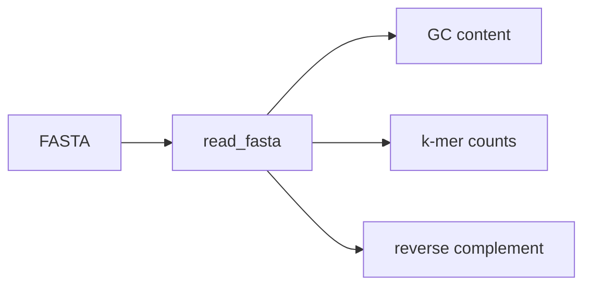

### DNA: Sequences

Functions: `read_fasta`, `reverse_complement`, `gc_content` (in `metainformant.dna.sequence.core`) and `count_kmers`, `kmer_frequencies` (in `metainformant.dna.sequence.kmer`).



`read_fasta` returns a dict of sequence ID to upper-case sequence (the ID is the first word of the header line) and raises `FileNotFoundError` for a missing file and `ValueError` for a malformed or empty one. `gc_content` returns a fraction between 0 and 1 and raises `ValueError` for an empty or invalid sequence. `count_kmers(seq, k)` returns a dict of k-mer to count, and `kmer_frequencies(seq, k)` the same k-mers as fractions of all k-mers observed.

Examples

```python
from pathlib import Path
from metainformant.dna.sequence.core import gc_content, read_fasta, reverse_complement
from metainformant.dna.sequence.kmer import count_kmers

fasta = Path("tests/dna/data/dna/toy.fasta")
id_to_seq = read_fasta(str(fasta))

rc = {k: reverse_complement(v) for k, v in id_to_seq.items()}
gc = {k: gc_content(v) for k, v in id_to_seq.items()}
k2 = count_kmers(next(iter(id_to_seq.values())), k=2)
```
