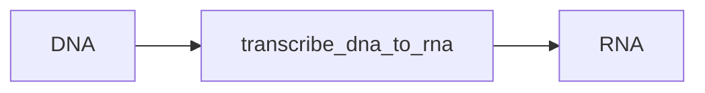

### DNA: Transcription

Functions: `transcribe_dna_to_rna` (wraps `transcribe`), `transcribe_reverse_complement`, `transcribe_with_introns`, `find_transcription_start_sites`, `calculate_transcription_efficiency`



Example

```python
from metainformant.dna import transcription

# DNA to RNA transcription (T -> U)
dna = "ATCGATCG"
rna = transcription.transcribe_dna_to_rna(dna)  # "AUCGAUCG"

# Transcribe the opposite strand: reverse complement first, then T -> U
rna = transcription.transcribe_reverse_complement("ATCGGC")  # "GCCGAU"

# Remove an intron first; (start, end) is 0-based and half-open
rna = transcription.transcribe_with_introns("AAATTTCCCGGG", [(6, 9)])  # "AAAUUUGGG"
```

Features:
- **DNA to RNA only**: the module has no reverse-transcription (RNA to DNA) function
- **Uppercase output**: the input is converted to uppercase before the T → U replacement
- **Strict validation**: only A, C, G, T and N (in either case) are accepted; any other character, including U, raises `ValueError`
- **Complete sequences**: Processes entire sequence without position restrictions; an empty string returns an empty string

Transcription rules:
- **DNA to RNA**: T → U (thymine to uracil)
- **Preserved**: A, G, C and N remain unchanged

Helpers:
- `find_transcription_start_sites(dna_seq, promoter_pattern="TATA")`: the position 30 bases past the end of each promoter match, kept only when that position lies inside the sequence
- `calculate_transcription_efficiency(dna_seq)`: a simplified heuristic score from 0.0 to 1.0 (TATA box in the first 100 bases, GC content of those bases, CAAT box in the first 200); sequences shorter than 50 bases score 0.0

Related: Often used with [translation](./translation.md) for gene expression analysis.
