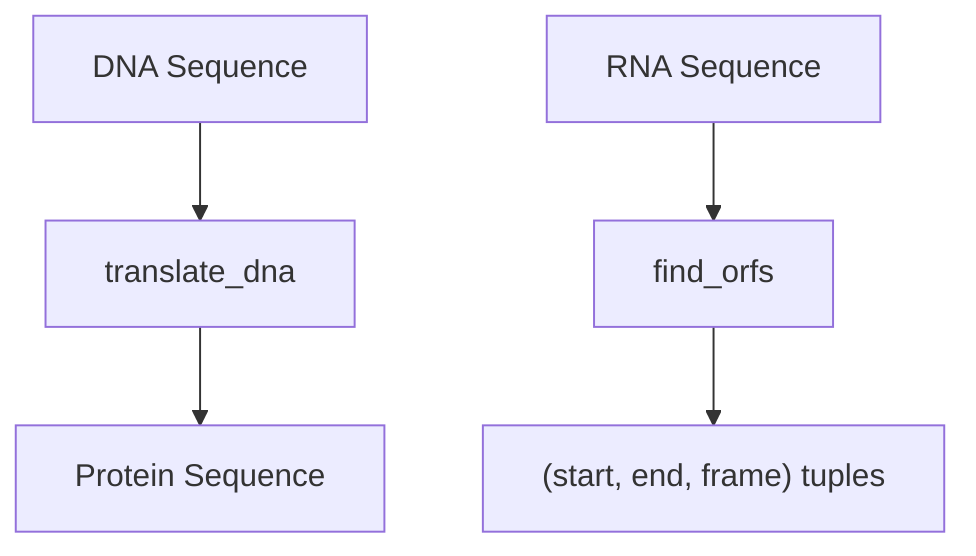

### DNA: Translation

Functions: `translate_dna`, `translate`, `find_orfs`, `six_frame_translation`



Example

```python
from metainformant.dna import translation

# Simple DNA translation
dna = "ATGAAATTTAAATAG"
protein = translation.translate_dna(dna)  # "MKFK*"

# Stop at first stop codon
protein = translation.translate_dna(dna, to_stop=True)  # "MKFK"

# Find open reading frames in RNA (forward frames)
rna = "AUGAAAUUUUAAAUGGGCCCCUAGAUGAAAUUUAAA"
orfs = translation.find_orfs(rna, min_length=3)
# [(0, 12, "+1"), (12, 24, "+1"), (24, 36, "+1")]
for start, end, frame in orfs:
    print(frame, start, end, translation.translate(rna[start:end]))
```

Each ORF is a `(start, end, frame)` tuple:

- **start**: 0-based index of the `AUG` start codon
- **end**: exclusive end of the first in-frame stop codon, or the sequence
  length when no in-frame stop follows (the last ORF above has no stop)
- **frame**: `"+1"`, `"+2"` or `"+3"`, the start position modulo 3 plus one

Every in-frame `AUG` opens an ORF, so nested starts that share a stop codon
are each reported, and `min_length` counts codons including the stop. For
both strands of a DNA sequence use `metainformant.dna.sequence.core.find_orfs`,
which also reports frames `-1` to `-3` in forward-strand coordinates.
`six_frame_translation` translates all six frames without calling ORFs.

Applications:
- **Gene prediction**: Identify potential protein-coding regions
- **Annotation**: Characterize genomic sequences
- **Proteomics**: Translate DNA sequences for protein analysis

Related: Works with [transcription](./transcription.md) and [codon](./codon.md) analysis.
