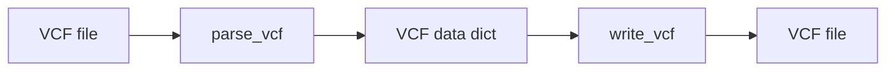

### DNA: Variants

Functions: `parse_vcf`, `write_vcf`



Example

```python-snippet
from metainformant.dna.variation import variants

# Parse a VCF file: plain text, or gzip when the path ends in .gz
vcf_data = variants.parse_vcf("variants.vcf.gz")
print(f"Samples: {vcf_data['samples']}")
print(f"Variants: {vcf_data['total_variants']}")

# Write the parsed data back; a path ending in .gz is written gzip-compressed and parse_vcf reads it again
variants.write_vcf(vcf_data, "output/variants.copy.vcf.gz")
```

`parse_vcf(path)` returns a dictionary:
- **`metadata`**: the `##key=value` header lines as a `{key: value}` dictionary; a repeated key keeps its last value
- **`samples`**: the sample names from the `#CHROM` header line
- **`variants`**: one dictionary per record, with `chrom`, `pos` (int), `id`, `ref`, `alt` (list), `qual` (float, or `None` for `.`), `filter` (list), `info` (INFO entries; flags are `True`), `format` and `samples` (one dictionary per sample, keyed by the FORMAT fields)
- **`total_variants`**: the number of records in `variants`

Compression, errors and writing:
- **Compression follows the path**: `parse_vcf` and `write_vcf` read and write gzip when the name ends in `.gz` and plain text for any other name. A gzip file under another name (for example `calls.vcf.bgz`, or an uppercase `.GZ`) is read as text and fails with `UnicodeDecodeError`.
- **Missing and malformed input**: a missing file raises `FileNotFoundError`. A record with fewer than eight tab-separated fields is skipped, and a record with a non-numeric `POS` or `QUAL` is skipped with a logged warning.
- **Output layout**: `write_vcf(vcf_data, output_path)` creates missing parent directories, then writes the metadata lines, a `#CHROM` header (followed by `FORMAT` and the sample names when `samples` is not empty) and one line per variant.

Note: `parse_vcf` loads every record into memory as dictionaries. `metainformant.gwas.analysis.quality.parse_vcf_full` returns a dictionary with a `genotypes` matrix instead and also reads `.vcf.gz`. For comprehensive VCF analysis, consider specialized libraries like pyvcf or cyvcf2.

Related: Part of variant analysis workflow, complements [population genetics](./population.md) analyses. For comprehensive **Variant Calling**, see [calling](./calling.md).
