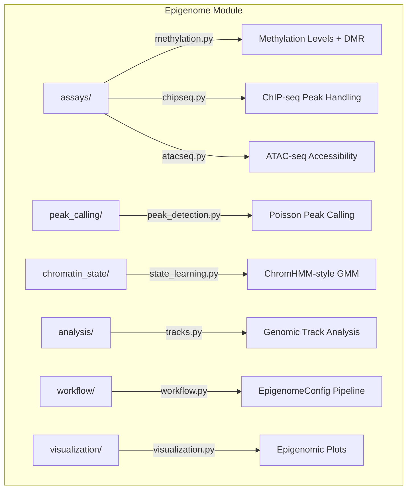

# EPIGENOME

## Overview
Epigenome analysis module for METAINFORMANT.

## Contents
- **[index.md](index.md)**: module overview
- **[methylation.md](methylation.md)**: methylation levels, DMRs and CpG islands
- **[chip_seq.md](chip_seq.md)**: ChIP-seq peaks, overlap and enrichment
- **[atac_seq.md](atac_seq.md)**: ATAC-seq peaks and TF binding-site scans
- **[peak_calling.md](peak_calling.md)**: peak calling, merging and filtering
- **[chromatin.md](chromatin.md)**: chromatin states
- **[workflow.md](workflow.md)**: end-to-end workflows and integration

## Structure



## Usage
Import module:
```python-snippet
from metainformant.epigenome import ...
```
