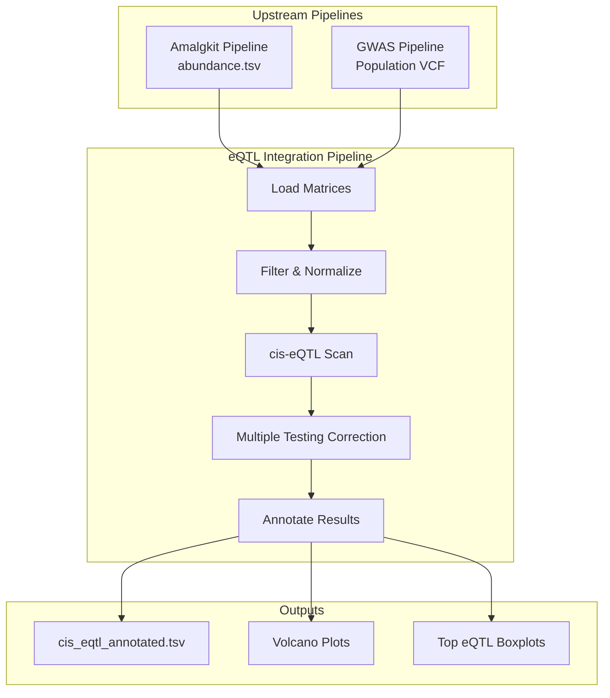

# eQTL Integration Pipeline

The eQTL (expression Quantitative Trait Loci) Integration Pipeline bridges the gap between genomic variation and transcriptomic expression, linking the **[Amalgkit RNA-seq Pipeline](../rna/README.md)** with the **[GWAS DNA Pipeline](../gwas/README.md)**. 

By analyzing how genetic variants (from VCFs) correlate with gene expression levels (from Amalgkit quantification), this pipeline identifies genetic markers that regulate gene transcription.

> **Note**: eQTL is a **cross-cutting integration pipeline**. The scan statistics live in `metainformant.gwas.finemapping.eqtl`, the plots in `metainformant.gwas.visualization.eqtl_visualization`, and the multi-omics helpers in `metainformant.multiomics.analysis.integration`. The `metainformant.eqtl` package holds the input builders (`metainformant.eqtl.workflow.synthetic`), the transcriptome SNP-calling wrappers and the pipeline orchestration. Scripts are in `scripts/eqtl/`.

## Documentation

| Doc | Description |
|-----|-------------|
| [Pipeline Guide](./pipeline_guide.md) | Step-by-step walkthrough of transcriptome SNP calling |
| [Configuration Reference](./configuration.md) | All YAML config options |
| This page | Overview, architecture, and integration scripts |

## Pipeline Architecture



## Workflows

The repository provides end-to-end execution scripts in the `scripts/eqtl/` directory highlighting both synthetic and real-world usage.

### 1. Real Expression with Synthetic Genotypes (`scripts/eqtl/run_eqtl_real.py`)

This workflow scans **real, quantified Amalgkit transcriptomic data** (for example *Apis mellifera*) against **synthetic genotypes at synthetic gene positions**. No genotype data are matched to these RNA-seq samples, and no GFF/GTF annotation is read, so the associations demonstrate the workflow end to end and are not biological findings.

| Input | Provenance |
|-------|------------|
| Expression | **Real**: Amalgkit/kallisto TPM of the quantified RNA-seq samples |
| Genotypes | **Synthetic**: random dosages (`create_synthetic_genotypes`, three variants per gene) |
| Gene positions | **Synthetic**: the chromosome accession is parsed from each transcript ID (`NC_...`), and the TSS positions are invented, evenly spaced 10 kb apart in the order of the IDs (`parse_gene_positions`) |

```bash
uv run python scripts/eqtl/run_eqtl_real.py
```

**Key Steps:**
1. Loads real Kallisto expression data from Amalgkit `work/quant/` subdirectories.
2. Filters out low-expression genes (mean TPM < threshold).
3. Assigns synthetic gene positions (chromosome accession from the transcript ID, invented TSS positions).
4. Creates synthetic genotype variants around those positions (MAF about 0.25), with IDs `var_<full gene id>_<i>`.
5. Runs cis-eQTL scanning (500kb windows).
6. Generates summary statistics, volcano plots, and effect size boxplots.

**Outputs** (under `output/eqtl/amellifera/`). The synthetic gene positions, the scan, the summaries and the plots say so in their names; the tables derived from the synthetic inputs (`variant_positions.tsv`, `cis_eqtl_annotated.tsv`, `top_100_eqtls.tsv`, `top_effect_sizes.tsv`) keep their plain names, so read them with the provenance of the scan in mind:

| File | Content |
|------|---------|
| `results/real_expression_matrix.tsv`, `results/gene_expression_stats.tsv` | Real expression and its per-gene statistics |
| `results/synthetic_genotype_matrix.tsv`, `results/variant_positions.tsv` | Synthetic genotypes and their positions |
| `results/gene_positions_synthetic.tsv` | The synthetic gene positions |
| `results/cis_eqtl_results_synthetic_genotypes.tsv` | The cis-eQTL scan (`cis_eqtl_annotated.tsv` and `top_100_eqtls.tsv` are derived from it; `top_effect_sizes.tsv` holds the effect sizes of the top hits) |
| `results/summary_stats_synthetic_genotypes.json`, `results/run_summary_synthetic_genotypes.json` | Summaries with the provenance keys below |
| `plots/volcano_plot_synthetic_genotypes.png`, `plots/summary_plot_synthetic_genotypes.png`, `plots/top_eqtl_boxplot_synthetic_genotypes.png` | Plots |

**Provenance keys.** `summary_stats_synthetic_genotypes.json` holds `data_source` (a sentence naming the real expression and the synthetic genotypes and gene positions), `expression_data`, `genotype_data` and `gene_position_data`; `run_summary_synthetic_genotypes.json` holds `analysis_type`, `expression_data`, `genotype_data`, `gene_position_data` and `note`. The value of `expression_data` starts with `real`, and those of `genotype_data` and `gene_position_data` start with `synthetic`. The run also logs the three provenance lines and a warning that the associations are not biological findings.

The result tables (the scan, the annotated and top-hit tables and the effect sizes) are written with `NA` for missing values: a fit that could not be made (NaN statistics, `status` `"error"`) shows as `NA`, never as a number. `summary_stats_synthetic_genotypes.json` reports `n_tests` (tests with a p-value) and `n_tests_failed`.

For a real eQTL analysis supply real genotypes (for example from [transcriptome SNP calling](#3-transcriptome-snp-calling-scriptseqtlrna_snp_pipelinepy)) and a gene table with real TSS positions from an annotation.

### 2. Synthetic Demo (`scripts/eqtl/run_eqtl_demo.py`)

A fully synthetic pipeline designed for rapid testing, methods development, and CI/CD validation. It simulates 50 samples, 100 genes, and 500 variants (`create_synthetic_data`), and about 30% of the genes receive a "true" eQTL effect on their first cis variant. Its result tables are written with `NA` for missing values as well.

```bash
uv run python scripts/eqtl/run_eqtl_demo.py
```

### 3. Transcriptome SNP Calling (`scripts/eqtl/rna_snp_pipeline.py`)

Extracts SNP variants directly from RNA-seq data by re-downloading FASTQs, aligning with HISAT2, and calling variants with bcftools. Produces per-sample VCFs and population genetics summaries.

```bash
# With CLI args
uv run python scripts/eqtl/rna_snp_pipeline.py --species amellifera --n-samples 3

# With YAML config
uv run python scripts/eqtl/rna_snp_pipeline.py --config config/eqtl/eqtl_amellifera.yaml
```

See [Pipeline Guide](./pipeline_guide.md) and [Configuration Reference](./configuration.md) for details.

## Core Submodules

Under the hood, the eQTL workflows rely on the highly optimized functions located in:

- `metainformant.gwas.finemapping.eqtl`: Core statistical scanning, matrix operations, effect size calculation, `eqtl_summary_stats()`, `write_eqtl_results()` (tab-separated, `NA` for missing values) and `load_transcriptome_variants()` for VCF→matrix conversion. Variant, gene and genotype-index IDs must be unique (`cis_eqtl_scan()` raises `ValueError` otherwise), and a fit that cannot be made carries NaN statistics, `status` and `error` instead of a p-value of 1.
- `metainformant.eqtl`: `workflow.synthetic` (synthetic and real input builders), `workflow.variant_calling` and `pipeline` (transcriptome SNP calling), `variant_stats` (bcftools statistics).
- `metainformant.gwas.visualization.eqtl_visualization`: Plotting utilities for volcano plots, summary grids, and genotype/expression boxplots.
- `metainformant.multiomics.analysis.integration`: Helper functions to convert and harmonize VCFs and expression `DataFrames`.

## Related

- **[Amalgkit Total Pipeline](../rna/README.md)**: Upstream transcriptomics.
- **[GWAS Total Pipeline](../gwas/README.md)**: Upstream genomic variants.
- **[Multiomics](../multiomics/README.md)**: Advanced omics integration (Joint PCA, NMF).
