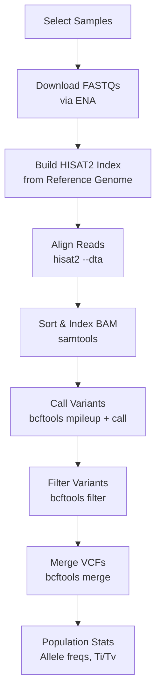

# eQTL Pipeline: Step-by-Step Guide

This document walks through the transcriptome SNP calling pipeline, which extracts genetic variants directly from RNA-seq data.

## Prerequisites

- **hisat2** ≥ 2.2: Splice-aware RNA-seq aligner
- **samtools** ≥ 1.21: BAM processing
- **bcftools** ≥ 1.21: Variant calling and manipulation
- **curl**: ENA FASTQ retrieval through the maintained downloader
- Completed Amalgkit quantification (`abundance.tsv`) for target samples

Install tools:
```bash
sudo apt install hisat2 samtools bcftools
```

## Pipeline Steps



### Step 1: Sample Selection
The pipeline discovers samples that have completed Amalgkit quantification (have `abundance.tsv`). You can also specify samples explicitly.

### Step 2: FASTQ Download
Re-downloads FASTQs from ENA through the maintained
`metainformant.rna.retrieval.ena_downloader.ENADownloader` API, using `curl`
with retries and gzip-integrity validation. Set `AMALGKIT_DATA_ROOT` when the
completed Amalgkit outputs are on an external volume; otherwise the wrapper
uses the repository-local `output/amalgkit` fallback. FASTQs are deleted after
alignment unless `--no-cleanup` is supplied.

### Step 3: HISAT2 Index
Builds a splice-aware index from the reference genome FASTA (e.g., `GCF_003254395.2_Amel_HAv3.1_genomic.fna.gz`). Built once per species.

### Step 4: Alignment
Aligns RNA-seq reads with `hisat2 --dta` and pipes through `samtools sort` to produce coordinate-sorted BAMs.

### Step 5: Variant Calling
Runs `bcftools mpileup` → `bcftools call -mv` to call SNPs and small indels from the aligned reads.

### Step 6: Filtering
Applies quality filters (`QUAL≥30`, `DP≥10`) using `bcftools filter`.

### Step 7: Merge & Population Analysis
Merges per-sample VCFs into a population VCF with `bcftools merge`. Computes allele frequencies and summary statistics (Ti/Tv ratio, variant counts).

## Output Structure

```
output/eqtl/{species}/
 index/ # HISAT2 index (built once)
 samples/
 {SRR_ID}/
 aligned.bam # Sorted alignment
 aligned.bam.bai
 variants.vcf.gz # Filtered per-sample VCF
 variant_stats.json
 population/
 merged.vcf.gz # Multi-sample population VCF
 allele_freqs.tsv # Per-site allele frequencies
 popgen_summary.json # Population genetics summary
 logs/
 pipeline.log
 run_summary.json
```

## Integration with eQTL Analysis

After the pipeline completes, use `load_transcriptome_variants()` to feed the real SNPs into the eQTL scan:

```python
from metainformant.gwas.finemapping.eqtl import (
    cis_eqtl_scan,
    eqtl_summary_stats,
    load_transcriptome_variants,
    write_eqtl_results,
)

# Load real transcriptome-derived variants
geno_matrix, var_positions = load_transcriptome_variants(
    "output/eqtl/amellifera/population/merged.vcf.gz"
)

# Run eQTL scan with real RNA expression + real RNA-derived variants
results = cis_eqtl_scan(expr_matrix, geno_matrix, gene_positions, var_positions)

print(eqtl_summary_stats(results))
write_eqtl_results(results, "output/eqtl/amellifera/results/cis_eqtl_results.tsv")
```

- `gene_positions` is a table with the columns `gene_id`, `chrom` and `tss_position`. For a real analysis take the TSS positions from a GFF/GTF annotation: `metainformant.eqtl.workflow.synthetic.parse_gene_positions` only invents them (the chromosome accession comes from the transcript ID, the positions are evenly spaced).
- A variant ID is the VCF `ID` column, or `<chrom>_<pos>` where the column is `.`. IDs must be unique in `var_positions` and in the index of `geno_matrix`, and gene IDs unique in `gene_positions`; `cis_eqtl_scan` raises `ValueError` for a repeated ID rather than testing a pair twice.
- A fit that cannot be made (fewer than 3 complete observations, a constant genotype, or a zero standard error) has NaN `beta`, `se` and `pvalue`, `status == "error"` and the reason in `error`. `eqtl_summary_stats` counts only the tests with a p-value in `n_tests` and reports the others as `n_tests_failed`, and `write_eqtl_results` writes the missing values as `NA`.

## Related

- [eQTL Pipeline Overview](./README.md)
- [Configuration Reference](./configuration.md)
- [Amalgkit Pipeline](../rna/amalgkit/README.md)
