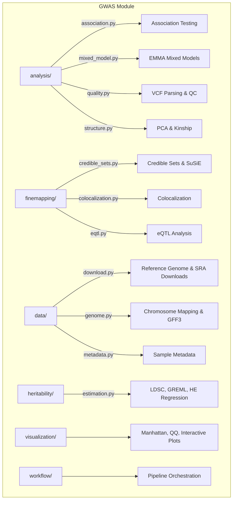

# GWAS Module

Genome-Wide Association Studies analysis, fine-mapping, and variant-expression integration.

## 📊 Architecture



## 🔑 Key Capabilities

### Fine-Mapping & Colocalization

```python
from metainformant.gwas.finemapping.credible_sets import compute_credible_set
from metainformant.gwas.finemapping.colocalization import (
    eqtl_coloc,        # GWAS-eQTL colocalization
    multi_trait_coloc, # Multi-trait analysis
    compute_clpp,      # CLPP method
    regional_coloc,    # Regional analysis
)

# 95% credible set for one locus: a Z-score and a standard error per variant
credible = compute_credible_set(
    [8.0, 1.1, -0.4, 0.2],  # Z-scores
    coverage=0.95,
    standard_errors=[0.05, 0.05, 0.06, 0.05],
)
# Returns: snps_in_set (indices), pips, coverage_achieved, n_snps, bayes_factors,
# log_bayes_factors, variance_model and prior_variance

# Test if GWAS signal colocalizes with expression QTL
result = eqtl_coloc(
    gwas_z=[1.2, 2.5, 3.1],  # GWAS Z-scores per variant
    eqtl_z=[1.1, 2.3, 2.9],  # eQTL Z-scores
    gene_id="LOC12345",
    gwas_standard_errors=[0.05, 0.04, 0.05],  # the standard errors fix the scale of each Bayes factor
    eqtl_standard_errors=[0.1, 0.1, 0.1],
)
# Returns: pp_h4 (shared-causal posterior), is_colocalized, lead_variant_gwas, lead_variant_eqtl,
# shared_variant, interpretation and coloc_result (PP_H0 .. PP_H4, snp_pp_h4, bayes_factor_model, summary)
```

Credible sets and colocalization use Wakefield (2009) approximate Bayes factors (ABFs). The effect estimate is modelled as `beta_hat ~ N(beta, V)` with the prior `beta ~ N(0, W)`, which gives `log ABF = (log(V / (V + W)) + z² W / (V + W)) / 2`. A Z-score does not carry the scale of `V`, so supply one of:

- `standard_errors` (a scalar, or one per variant): `V = SE²`.
- `sample_size` (a scalar, or one per variant), optionally with `maf` and, for a case-control trait, `case_fraction`: `V` is modelled as in coloc's `Var.data`, `1 / (2 N f (1 − f))` for a quantitative trait and `1 / (2 N f (1 − f) s (1 − s))` for a case-control trait, with `f = maf` and `s = case_fraction`. Without `maf` the genotype is standardised to unit variance and the `2 f (1 − f)` factor is 1.
- Neither: the Z-score scale (`V = 1`), a coarse fallback that the result flags as `variance_model == "z_scale"`.

The prior variance `W` defaults to `0.15²` for a quantitative trait, `0.2²` when `case_fraction` marks a case-control trait, and `5.2²` on the Z-score scale; `prior_variance=` overrides it. A result reports what was used as `variance_model` (`"standard_errors"`, `"sample_size"` or `"z_scale"`) and `prior_variance`. `colocalization` reports both per trait under `bayes_factor_model` and adds `snp_pp_h4`, the per-variant probability of being the shared causal variant given H4 (it sums to 1). `compute_credible_set` assumes one causal variant in the region and returns the smallest set of variants whose cumulative posterior inclusion probability reaches `coverage`. `metainformant.gwas.compute_credible_set` is a different function: the wrapper in `visualization.interactive.finemapping`, which takes the association-result dictionaries and applies the same model.

All Bayes factors, posterior inclusion probabilities and colocalization posteriors are accumulated in log space, so strong signals do not overflow. `compute_log_bayes_factors` returns natural-log ABFs, `colocalization_from_log_bayes_factors` takes log Bayes factors from any source (SuSiE, a different variance model per trait) and `log_sum_exp` is the shared helper, all in `credible_sets`. `compute_bayes_factors` returns linear-scale ABFs capped at `exp(500)`.

### Association Testing

| Function | Module | Purpose |
|----------|--------|---------|
| `run_gwas()` | `metainformant.gwas.workflow` | Full config-driven GWAS workflow (linear, logistic, or mixed model; LD pruning, summary statistics, SNP-to-gene annotation) |
| `run_mixed_model_gwas()` | `metainformant.gwas.analysis.mixed_model` | EMMA mixed-model GWAS across variants (eigendecomposes the kinship matrix once) |
| `association_test_mixed()` | `metainformant.gwas.analysis.mixed_model` | Single-SNP mixed-model association test |
| `run_linear_model_gwas()` | `metainformant.gwas.analysis.association` | Quantitative-trait GWAS across variants |
| `run_logistic_model_gwas()` | `metainformant.gwas.analysis.association` | Case-control GWAS across variants |
| `association_test_linear()` | `metainformant.gwas.analysis.association` | Single-variant linear association test |
| `association_test_logistic()` | `metainformant.gwas.analysis.association` | Single-variant logistic (case-control) test |

The linear and logistic tests analyse complete cases. A sample is left out when its genotype is missing (a negative dose such as -1, NaN, infinite or non-numeric) or when any covariate value is missing or non-finite, and the linear test also drops samples with a missing phenotype. `n_samples` in the result counts the samples analysed and `n_missing_dropped` the samples left out.

- **Linear test**: the p-value is two-sided from Student's t with `n_samples` minus the number of fitted parameters as degrees of freedom (a normal approximation is used only when SciPy is unavailable). A degenerate design (fewer than 3 complete cases, a constant genotype, collinear covariates) returns `status: "error"` with `p_value` 1.0, `converged` False and an `error` message instead of a statistic.
- **Logistic test**: phenotypes must be 0 or 1 (anything else raises `ValueError`), and at least 2 cases and 2 controls must remain among the complete cases, otherwise `status` is `"failed"`. `converged` is the fit's own convergence flag and is False when the fit does not converge (for example under separation), in which case the estimate and p-value are unreliable; `n_cases` and `n_controls` count the complete cases.

### Data I/O

| Function | Module | Purpose |
|----------|--------|---------|
| `parse_vcf_full()` | `metainformant.gwas.analysis.quality` | Parse VCF variant files |
| `apply_qc_filters()` | `metainformant.gwas.analysis.quality` | QC filters applied in the order QUAL (`min_qual`, optional), MAF, missingness, Hardy-Weinberg; a variant without a QUAL value fails the QUAL filter whenever `min_qual` is set |
| `filter_variants_bcftools()` | `metainformant.gwas.analysis.calling` | Keep the sites that meet every given threshold (`min_qual` as `QUAL>=`, `max_missing` as `F_MISSING<=`, `min_depth` as `DP>=`) with `bcftools filter -i`; needs bcftools on `PATH` |
| `discover_sample_vcfs()` | `metainformant.gwas.data.vcf_utils` | Discover per-sample VCFs under a data root |
| `count_variants()` | `metainformant.gwas.data.vcf_utils` | Count variants in a VCF |
| `merge_vcfs()` | `metainformant.gwas.data.vcf_utils` | Merge per-sample VCFs |
| `subsample_vcf()` | `metainformant.gwas.data.vcf_utils` | Subsample a VCF by fraction or interval |
| `extract_sample_ids()` | `metainformant.gwas.data.vcf_utils` | Extract sample IDs from a VCF |
| `bgzip_and_index()` | `metainformant.gwas.data.vcf_utils` | Bgzip-compress and tabix-index a VCF |
| `write_summary_statistics()` | `metainformant.gwas.analysis.summary_stats` | Write the summary-statistics TSV (`CHR POS SNP REF ALT BETA SE P Q_FDR N MAF`). `Q_FDR` is the result's own q-value, else Benjamini-Hochberg over all results; `MAF` is the result's own, else computed from the optional `genotypes=`; any other missing value is `NA`. `write_significant_hits()` writes the rows below a p-value threshold in the same format |

There is no PLINK bed/bim/fam reader in the current checkout.

## 📦 Submodules

| Module | Purpose |
|--------|---------|
| [`analysis/`](../../src/metainformant/gwas/analysis/) | Association testing |
| [`data/`](../../src/metainformant/gwas/data/) | VCF, PLINK I/O |
| [`finemapping/`](../../src/metainformant/gwas/finemapping/) | Fine-mapping, colocalization |
| [`heritability/`](../../src/metainformant/gwas/heritability/) | Heritability estimation |
| [`visualization/`](../../src/metainformant/gwas/visualization/) | Manhattan, QQ, LocusZoom |
| [`workflow/`](../../src/metainformant/gwas/workflow/) | Pipeline orchestration |

## 🧬 Integration with Expression Data

The GWAS module integrates with RNA-seq via the multiomics module:

```python
from metainformant.multiomics.analysis import integration
from metainformant.gwas.finemapping.colocalization import eqtl_coloc

# Convert GWAS and expression data to common format
dna_data = integration.from_dna_variants(gwas_sumstats)
rna_data = integration.from_rna_expression(expression_matrix)

# Run integrated analysis
integrated = integration.integrate_omics_data(
    dna_data=dna_data,
    rna_data=rna_data,
)
```

## 🔗 Related

- [metainformant.multiomics](../multiomics/) - Multi-omic integration
- [metainformant.rna](../rna/) - RNA-seq analysis
- [config/gwas/](../../config/gwas/) - Configuration files

## Apis mellifera Real Data

- Real genome/read organization, reads-to-estimators runbook, and BeeWAS
  synthetic-validation notes: `projects/apis_gwas/doc/current/`
  (gitlinked submodule — checkout that submodule to read them;
  `doc/current/` files were not present in this checkout at audit time)
- Real-cohort QC reporter: `scripts/gwas/pipelines/analyze_beewas_2026_real.py`
- Genomic-estimator validator: `scripts/gwas/pipelines/validate_beewas_genomic_estimators.py`
- Shared BeeWAS reporting helpers: `scripts/gwas/pipelines/beewas_reporting.py`
- Real guarded config: `projects/apis_gwas/config/beewas_2026_full_guarded.yaml`
- Generated/demo config: `config/gwas/gwas_amellifera.yaml`
