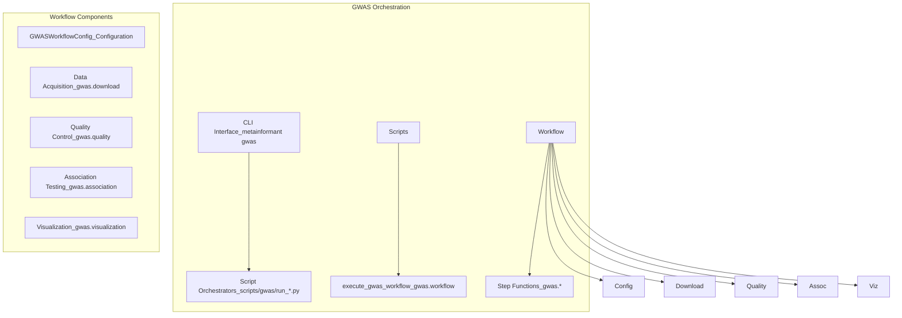

# GWAS Workflow Orchestration

## Overview

The GWAS module provides comprehensive workflow orchestration for genome-wide association studies, from variant data acquisition to statistical analysis and visualization. Workflows are built on the `BaseWorkflowOrchestrator` foundation with standardized configuration and error handling.

## Architecture



## Workflow Types

### Complete GWAS Workflow

The main workflow orchestrates all GWAS steps from data acquisition to results:

```python
from pathlib import Path

from metainformant.gwas.workflow.workflow_execution import execute_gwas_workflow
from metainformant.gwas.workflow.workflow_config import GWASWorkflowConfig

# Configure workflow
config = GWASWorkflowConfig(
    work_dir=Path("output/gwas/study"),
    vcf_path="data/variants/cohort.vcf.gz",
    phenotype_path="data/phenotypes/traits.tsv",
    threads=8
)

# Execute complete workflow (the workflow takes a configuration dictionary)
results = execute_gwas_workflow(config.to_dict())

if results["status"] == "completed":
    print(f"GWAS completed {len(results['steps_completed'])} steps")
else:
    print(f"GWAS failed: {results['errors']}")
```

### Convenience Functions

Simple function-based workflows for common operations:

```python-snippet
from metainformant.gwas import run_gwas

# Simple GWAS analysis
results = run_gwas(
    vcf_path="data/variants/cohort.vcf.gz",
    phenotype_path="data/phenotypes/traits.tsv",
    config={"model": "linear", "trait": "height"},
    output_dir="output/gwas/simple"
)
```

## Configuration

### GWASWorkflowConfig

Complete configuration for GWAS workflows:

```python
@dataclass
class GWASWorkflowConfig:
    """Configuration for GWAS workflow execution."""

    work_dir: Path                          # Base working directory
    threads: int = 8                        # Number of threads
    log_dir: Path | None = None            # Optional log directory

    # Data sources
    genome: dict[str, Any] | None = None    # Reference genome config
    variants: dict[str, Any] = field(default_factory=dict)
    samples: dict[str, Any] = field(default_factory=dict)
    phenotypes: dict[str, Any] = field(default_factory=dict)

    # Analysis parameters
    qc: dict[str, Any] = field(default_factory=dict)
    structure: dict[str, Any] = field(default_factory=dict)
    association: dict[str, Any] = field(default_factory=dict)
    correction: dict[str, Any] = field(default_factory=dict)

    # Output configuration
    output: dict[str, Any] = field(default_factory=dict)
```

### Config Loading

Load configuration from YAML, TOML or JSON files (defaults are merged in and the parameters are validated):

```python-snippet
from metainformant.gwas.data.config import load_gwas_config

# Load from YAML; nested sections are also available as attributes (config.variants)
config = load_gwas_config("config/gwas/gwas_study.yaml")
```

## Workflow Steps

`execute_gwas_workflow` runs these steps in order and lists each completed one in `results["steps_completed"]`:

| Step | Function | Purpose |
|------|----------|---------|
| `data_loading` | `parse_vcf_full` | Parse the VCF into sample-major genotypes and variant records |
| `quality_control` | `apply_qc_filters` | QUAL (when `min_qual` is set), MAF, missingness and Hardy-Weinberg filters |
| `ld_pruning` | `ld_prune` | Remove correlated variants before the structure analysis |
| `population_structure` | `compute_pca`, `compute_kinship_matrix` | Principal components and kinship matrix |
| `association_testing` | `run_linear_model_gwas`, `run_logistic_model_gwas` or `run_mixed_model_gwas`, chosen by `model` | One test per variant, with up to 5 principal components as covariates |
| `multiple_testing_correction` | `bonferroni_correction`, `fdr_correction`, `genomic_control` | Corrections over the tests that ran (the `correction` section selects one method) |
| `heritability_estimation` | `estimate_heritability`, `partition_heritability_by_chromosome` | REML SNP heritability and its per-chromosome partition |
| `summary_statistics` | `write_summary_statistics`, `write_significant_hits` | `summary_statistics.tsv` and `significant_hits.tsv` |
| `visualization` | `generate_all_plots` and the plots listed under [Visualization](#visualization) | Plots in the results directory |

Variant acquisition is not a workflow step: `vcf_path` names an existing VCF. The helpers that produce one are described under [Variant Acquisition](#variant-acquisition).

### Results

`execute_gwas_workflow(config)` returns a dictionary instead of raising for a failed run:

| Key | Content |
|-----|---------|
| `status` | `"completed"`, or `"failed"` with the message in `error` and `errors` (`"validated"` or `"invalid"` with `check=True`) |
| `success` | `True` unless the run failed |
| `steps_completed` | The step names above, in order |
| `outputs` | Includes `association_results` (one row per variant), `n_tests_failed`, the correction results (`bonferroni`, `fdr`, `genomic_control`), `heritability`, `kinship_metadata` and `plots` (plot name to file path) |

A test that fails has NaN statistics. Its row stays in `outputs["association_results"]`, so rows line up with the variants and the summary tables write it as `NA`, but it is left out of the corrections, the plots, the top hit and the fine-mapping. The number of such tests is `outputs["n_tests_failed"]`. `run_gwas` reports the same count as `results["results"]["n_tests_failed"]`, and `run_multi_trait_gwas` as `results["trait_results"][trait]["n_tests_failed"]` next to `n_tests`.

## Prerequisites

- Python 3.11+
- NumPy
- Matplotlib (for visualization)
- Optional: scipy (for advanced statistics)
- Optional: pandas (for data handling)
- Optional: bcftools (for variant calling/extraction)
- Optional: GATK (for variant calling)

## Step-by-Step Workflow

### Step 1: Prepare Configuration

Create a configuration file (YAML recommended):

```yaml
work_dir: output/gwas/my_study
threads: 8

genome:
  accession: GCF_000001405.40
  dest_dir: output/gwas/genome

variants:
  vcf_files:
    - data/variants/my_cohort.vcf.gz

qc:
  min_maf: 0.01
  max_missing: 0.05

samples:
  phenotype_file: data/phenotypes.tsv

association:
  model: linear
  trait: height
  covariates: [age, sex]
```

### Step 2: Prepare Input Files

#### Phenotype File Format

Create a TSV file with sample IDs and trait values:

```tsv
sample_id    height    weight
sample1      175.5     70.2
sample2      168.3     65.1
sample3      180.1     75.8
```

#### Covariates File Format (Optional)

```tsv
sample_id    age    sex
sample1      45     1
sample2      38     2
sample3      52     1
```

### Step 3: Run Workflow

#### Command Line

```bash
python -m metainformant gwas run --config config/my_gwas_config.yaml
```

#### Python API

```python
from metainformant.gwas.data.config import load_gwas_config
from metainformant.gwas import execute_gwas_workflow

config = load_gwas_config("config/my_gwas_config.yaml")
results = execute_gwas_workflow(config)
```

### Step 4: Review Results

`execute_gwas_workflow` writes to the output directory (`output.results_dir`; `work_dir` when it is not set):

- **Tables**: `summary_statistics.tsv` (columns `CHR POS SNP REF ALT BETA SE P Q_FDR N MAF`) and `significant_hits.tsv`. The `MAF` column holds the minor allele frequency of each variant, and a failed test is `NA` in the numeric columns.
- **Plots**: `manhattan_plot.png`, `qq_plot.png`, `pca_plot.png`, `kinship_plot.png`, `effect_size_plot.png`, `maf_spectrum_plot.png`, `regional_plot.png` and a `strain_analysis/` directory, as described under [Visualization](#visualization).
- **Structure**: `pca_results.json` and `kinship_results.json`.

The same information is in the returned dictionary (`results["outputs"]`), including the paths of the plots in `results["outputs"]["plots"]`.

## Workflow Steps Explained

### Genome Preparation

The workflow does not download a genome. `download_reference_genome(accession, output_dir)` in `metainformant.gwas.data.download` fetches a reference genome from NCBI (the Datasets API, with an FTP fallback) when you need one, and raises when both strategies fail.

### Variant Acquisition

`vcf_path` names an existing VCF; the workflow does not acquire variants. Helpers that produce one or fetch related data:

1. **Pre-existing VCF**: point `vcf_path` at it.
2. **Variant databases**: `download_variant_database("dbsnp" | "1000genomes", output_dir)` fetches the first matching VCF of dbSNP (NCBI FTP) or of the 1000 Genomes Phase 3 release (EBI FTP); any other name raises `ValueError`.
3. **GWAS Catalog summary table**: `download_variant_data("GCST...", output_dir, data_type="summary_stats")` downloads the association table of a study. `summary_stats` is the only supported `data_type`: `"vcf"` (the default) and `"both"` raise `NotImplementedError` before anything is requested, and an unknown type raises `ValueError`. It never returns genotypes.
4. **Calling**: `call_variants_bcftools` and `call_variants_gatk` call variants from BAM/CRAM files and need `bcftools` or GATK on `PATH`.

### Quality Control

Filters, applied in this order (a variant must pass every enabled filter):
- **Quality**: Remove variants with QUAL < `min_qual`. The filter is optional, and a variant without a QUAL value (`.` in the VCF) is removed whenever `min_qual` is set
- **MAF**: Remove variants with minor allele frequency < `min_maf`
- **Missing Data**: Remove variants with > `max_missing` missing genotypes
- **Hardy-Weinberg**: Remove variants deviating from HWE (p < `hwe_pval`)

The thresholds and the `qual_filter` summary are described in the [configuration reference](config.md#quality-control-configuration). `apply_qc_filters` raises `ValueError` when the genotype rows (one per sample) differ in length or when the number of variant records differs from the number of genotype columns.

### Population Structure

- **PCA**: Principal component analysis on genotype matrix
- **Kinship**: Compute kinship/relatedness matrix (VanRaden, Astle-Balding, or Yang method)

Principal components can be included as covariates in association testing to control for population stratification.

### Association Testing

Per-variant association tests:
- **Linear Regression**: For continuous traits
- **Logistic Regression**: For binary traits (case/control)

Model: `phenotype ~ genotype + covariates`

Outputs: beta (effect size), standard error, p-value, R² (for linear models), odds ratio (for logistic models)

Both tests analyse complete cases: samples with a missing genotype (a negative dose such as -1, NaN or a non-numeric value) or a missing or non-finite covariate value are left out, and the linear test also leaves out samples with a missing phenotype. Each result reports `n_samples` (the samples analysed) and `n_missing_dropped` (the samples left out).

- **Linear**: the two-sided p-value comes from Student's t.
- **Logistic**: phenotypes must be 0 or 1, and fewer than 2 cases or 2 controls among the complete cases gives `status: "failed"`. `converged` is the fit's own convergence flag; the estimate and p-value of a fit that did not converge (for example under separation) are unreliable.

**Failed tests.** A test that cannot be fitted is returned, not raised. It carries NaN for `beta`, `se`, `t_stat` (`z_stat` for logistic), `p_value`, and `r_squared` (`odds_ratio` for logistic), plus `status`, an `error` message and `converged` False. The linear `status` is `"error"`, the logistic `status` is `"failed"` or `"error"`, and mixed-model rows carry `status` too. NaN means missing; it is neither an effect of 0 nor a p-value of 1.

- A linear test fails for fewer than 3 complete cases, a constant genotype, a constant phenotype, collinear covariates or no residual degrees of freedom.
- Zero residual variance is read for what it means: an exact fit with a nonzero genotype effect reports t of plus or minus infinity and p = 0, and zero residual variance with a zero effect is a failed test.
- Failed tests are left out of the corrections, summaries and plots, and the tables print them as `NA` (see [Results](#results)).

### Multiple Testing Correction

- **Bonferroni**: Conservative correction (alpha / n_tests)
- **FDR (Benjamini-Hochberg)**: False discovery rate control
- **Genomic Control**: Calculate genomic inflation factor (lambda_GC)

The family of tests is the tests that ran. A failed test (NaN or `None` p-value) is left out instead of being counted as p = 1: `n_tests` counts only the p-values present, the dictionaries of `fdr_correction` and `bonferroni_correction` report the number left out as `n_excluded`, and the corrected values and `significant` flags stay aligned with the variants (NaN and False for a failed test). `qvalue_estimation` and `adjust_p_values` follow the same rule.

### Visualization

- **Manhattan Plot**: -log10(p-value) vs. genomic position, colored by chromosome
- **Q-Q Plot**: Observed vs. expected p-values under null, shows genomic inflation
- **Regional Plot**: Zoomed view of specific genomic regions

`execute_gwas_workflow` draws its plots only from the tests that ran, and returns their paths in `results["outputs"]["plots"]`:

| File | Content |
|------|---------|
| `manhattan_plot.png`, `qq_plot.png` | Manhattan and Q-Q plots; skipped, with a logged warning, when no test produced a p-value |
| `pca_plot.png`, `kinship_plot.png` | Principal components and kinship heatmap, from `pca_results.json` and `kinship_results.json` |
| `effect_size_plot.png` | Effect-size distribution |
| `maf_spectrum_plot.png` | Histogram of the minor allele frequencies (`maf`) the results carry; drawn when at least one result has a MAF above 0 |
| `regional_plot.png` | A 1 Mb window around the top hit |
| `strain_analysis/` | `strain_pca_grid.png`, `dendrogram.png`, `kinship_clustered.png`, `fst_manhattan.png` and `af_heatmap.png`, plus `fst_summary.json` and `strain_private_variants.json`, when the VCF has sample IDs |

The Manhattan, Q-Q, PCA and kinship plots come from `generate_all_plots`, which takes the association results as a list of records, a pandas DataFrame or the path of a `.json`, `.tsv`, `.txt` or `.csv` file. A result without a p-value is not drawn or counted, other input raises (`TypeError`, `FileNotFoundError` for a missing file, `ValueError` for an unsupported extension) and every figure it opens is closed. The [visualization gallery](visualization_gallery.md#visualization-suite) describes it and the larger suite that `run_gwas` calls.

## Troubleshooting

### Common Issues

1. **VCF file not found**: Ensure VCF paths in configuration are correct
2. **Phenotype file missing samples**: Check that sample IDs match between VCF and phenotype files
3. **Memory errors**: Reduce number of variants or samples, or use subset
4. **bcftools/GATK not found**: Install required tools or use pre-existing VCF files

### Performance Tips

- Use pre-filtered VCF files when possible
- Limit variant set to region of interest
- Use subset of samples for initial testing
- Run QC filters before association testing to reduce computation

## Advanced Usage

### Custom Association Models

You can use the low-level API to run custom association tests:

```python
from metainformant.gwas import association_test_linear, parse_vcf_full

vcf_data = parse_vcf_full("variants.vcf")
for variant_idx in range(len(vcf_data["variants"])):
    genotypes = [vcf_data["genotypes"][s][variant_idx] for s in range(len(vcf_data["samples"]))]
    result = association_test_linear(genotypes, phenotypes, covariates)
    if result["status"] != "success":
        continue  # NaN statistics; result["error"] gives the reason
```

`parse_vcf_full` and `apply_qc_filters` return the genotypes sample-major, `genotypes[sample][variant]`, which is why the loop above indexes the sample first. `execute_gwas_workflow` states that layout (`layout="sample_major"`) when it transposes the matrix to variants x samples, so a matrix with as many variants as samples is not misread. Without a declared layout, `_extract_genotype_matrix` infers it from the shape and treats a square matrix as variant-major, with a logged warning.

### Population Structure Analysis

```python
from metainformant.gwas.analysis.structure import estimate_population_structure

structure = estimate_population_structure(
    vcf_input="variants.vcf",
    config={"compute_pca": True, "n_components": 10},
    output_dir="output/structure"
)
```

`vcf_input` is a VCF path or a sample-major genotype matrix (one list of genotypes per sample). The result holds `status`, `pca` (`pcs`, `explained_variance_ratio`) and `kinship` (`matrix`, `method`), and `output_dir` receives `structure_summary.json`.

### Visualization

```python
from metainformant.gwas.visualization.genomic.genome import manhattan_plot
from metainformant.gwas.visualization.statistical.statistical import qq_plot

# association_results: the list of result dictionaries (chrom or CHROM, pos or POS, p_value)
manhattan_plot(
    results=association_results,
    output_path="plots/manhattan.png",
    significance_threshold=5e-8
)

qq_plot(
    results=association_results,
    output_path="plots/qq.png"
)
```

Both functions take the results in memory, not a file path, and return a dictionary with `status`. `qq_plot` accepts a list of p-values as well as a list of result dictionaries. They save with `savefig` directly, so create the `plots` directory first.
