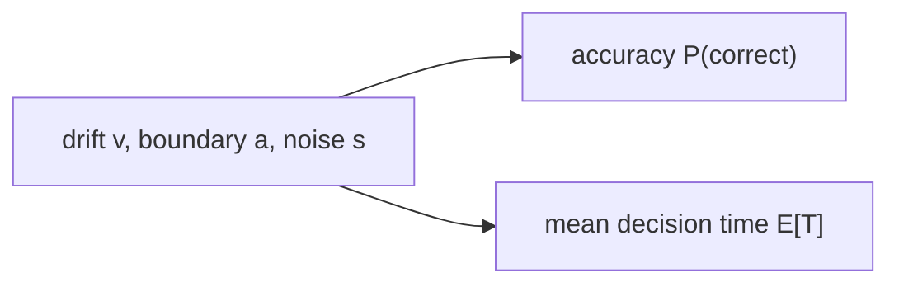

### Math: Drift–Diffusion Model (DDM)

Functions in `metainformant.math.decision_theory.ddm`: `ddm_analytic_accuracy`, `ddm_mean_decision_time`, `ddm_log_likelihood`, `fit_ddm_parameters`.



#### Closed forms

The evidence follows dx = v dt + s dW between two absorbing boundaries a apart, and it starts midway between them (an unbiased start). The upper boundary is the correct response when the drift is positive. For this process the standard closed forms (Palmer, Huk and Shadlen 2005; Bogacz et al. 2006, with thresholds at ±a/2 around the start) are:

    E[T]       = (a / 2v) · tanh(v a / 2s²)      →  a² / 4s²  as v → 0
    P(correct) = 1 / (1 + exp(−v a / s²))

| Function | Returns |
|----------|---------|
| `ddm_mean_decision_time(drift_rate, boundary, noise_sd=1.0)` | E[T], the mean decision time; non-decision time is not included |
| `ddm_analytic_accuracy(drift_rate, boundary, noise_sd=1.0)` | P(correct), the probability of absorption at the upper boundary |

- `noise_sd` is the diffusion standard deviation s and enters through s². Scaling v, a and s by the same factor leaves both results unchanged.
- A drift of zero or below is handled by symmetry. E[T] depends on |v| only, because with an unbiased start correct and error responses share the same mean time; P(correct) at −v is 1 − P(correct) at v, and it is 0.5 at v = 0.
- `boundary` and `noise_sd` must be positive and finite and `drift_rate` finite, otherwise `ValueError` is raised.

```python
from metainformant.math.decision_theory import ddm

acc = ddm.ddm_analytic_accuracy(0.2, 1.0)  # 0.5498
edt = ddm.ddm_mean_decision_time(0.2, 1.0)  # 0.2492
noisy = ddm.ddm_mean_decision_time(0.2, 1.0, noise_sd=2.0)  # 0.0625: more noise, earlier boundary crossings
flipped = ddm.ddm_analytic_accuracy(-0.2, 1.0)  # 0.4502, which is 1 - acc
```

#### Likelihood and fitting (approximation)

`ddm_log_likelihood(rt, choice, drift_rate, boundary_separation, starting_point=0.5, non_decision_time=0.0)` and `fit_ddm_parameters(rt_data, choice_data, bounds=None)` do not use the closed forms or the exact first-passage density of the diffusion above. They model the time to reach the chosen boundary as a normal distribution with mean (a − z) / v and variance (a − z) · a / (3 v²), where z = `starting_point` · a (for `choice=2` the drift is negated and z becomes a − z). This is a normal approximation, with these consequences:

- There is no noise parameter, and the opposite boundary is ignored.
- Choice 1 (upper boundary) needs a positive drift and choice 2 a negative one; otherwise, zero drift included, the log-likelihood is −inf. It is also −inf for a response time that does not exceed `non_decision_time`.
- Its time scale differs from `ddm_mean_decision_time`: for v = 1, a = 2 and an unbiased start it is centred on 1.0, where the closed form gives 0.76.

`fit_ddm_parameters` maximises this approximate likelihood with L-BFGS-B (default bounds: `drift_rate` 0.01 to 2.0, `boundary_separation` 0.5 to 3.0, `starting_point` 0.2 to 0.8, `non_decision_time` 0 to 0.5) and falls back to a coarse grid search when SciPy's optimiser is unavailable or does not converge. It returns a dictionary with `drift_rate`, `boundary_separation`, `starting_point`, `non_decision_time` and `log_likelihood`. Read the fitted values as approximate, not as maximum-likelihood estimates for the diffusion model of the closed forms.

#### References

- Palmer, J., Huk, A. C., & Shadlen, M. N. (2005). The effect of stimulus strength on the speed and accuracy of a perceptual decision. *Journal of Vision*, 5(5), 376-404.
- Bogacz, R., Brown, E., Moehlis, J., Holmes, P., & Cohen, J. D. (2006). The physics of optimal decision making: a formal analysis of models of performance in two-alternative forced-choice tasks. *Psychological Review*, 113(4), 700-765.
