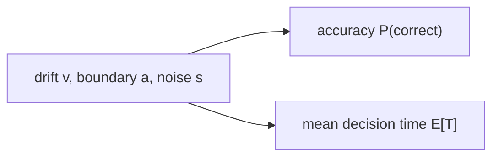

### Math: Drift–Diffusion Model (DDM)

Functions in `metainformant.math.decision_theory.ddm`: `ddm_analytic_accuracy`, `ddm_mean_decision_time`, `ddm_first_passage_density`, `ddm_log_likelihood`, `fit_ddm_parameters`.



#### Closed forms

The evidence follows dx = v dt + s dW between two absorbing boundaries a apart, and it starts midway between them (an unbiased start). The upper boundary is the correct response when the drift is positive. For this process the standard closed forms (Palmer, Huk and Shadlen 2005; Bogacz et al. 2006, with thresholds at ±a/2 around the start) are:

    E[T]       = (a / 2v) · tanh(v a / 2s²)      →  a² / 4s²  as v → 0
    P(correct) = 1 / (1 + exp(−v a / s²))

| Function | Returns |
|----------|---------|
| `ddm_mean_decision_time(drift_rate, boundary, noise_sd=1.0)` | E[T], the mean decision time; non-decision time is not included |
| `ddm_analytic_accuracy(drift_rate, boundary, noise_sd=1.0)` | P(correct), the probability of absorption at the upper boundary |

- `noise_sd` is the diffusion standard deviation s and enters through s². Scaling v, a and s by the same factor leaves both results unchanged.
- A drift of zero or below is handled by symmetry. E[T] depends on |v| only, because with an unbiased start correct and error responses share the same mean time; P(correct) at −v is 1 − P(correct) at v, and it is 0.5 at v = 0.
- `boundary` and `noise_sd` must be positive and finite and `drift_rate` finite, otherwise `ValueError` is raised.

```python
from metainformant.math.decision_theory import ddm

acc = ddm.ddm_analytic_accuracy(0.2, 1.0)  # 0.5498
edt = ddm.ddm_mean_decision_time(0.2, 1.0)  # 0.2492
noisy = ddm.ddm_mean_decision_time(0.2, 1.0, noise_sd=2.0)  # 0.0625: more noise, earlier boundary crossings
flipped = ddm.ddm_analytic_accuracy(-0.2, 1.0)  # 0.4502, which is 1 - acc
```

#### First-passage likelihood and fitting

`ddm_first_passage_density(rt, choice, drift_rate, boundary_separation, starting_point=0.5, non_decision_time=0.0, noise_sd=1.0, *, log=False)` evaluates the joint density of response time and boundary choice for the same diffusion, using the small-time and large-time Wiener first-passage series. Choice 1 reaches the upper boundary and choice 2 the lower boundary. `starting_point` is the starting position as a fraction of the boundary separation, strictly inside (0, 1). The density includes competition between both absorbing boundaries and supports either sign of drift, including zero.

The function broadcasts response times and choices. It returns zero, or `-inf` with `log=True`, when `rt <= non_decision_time`; invalid choices, non-finite response times or invalid model parameters raise `ValueError`.

`ddm_log_likelihood(rt, choice, drift_rate, boundary_separation, starting_point=0.5, non_decision_time=0.0, noise_sd=1.0)` sums the corresponding log densities. Both correct and error responses contribute to one likelihood. `noise_sd` fixes the otherwise unidentified common scale of drift, boundary separation and noise.

`fit_ddm_parameters(rt_data, choice_data, bounds=None, *, noise_sd=1.0)` maximises that first-passage likelihood with deterministic multi-start L-BFGS-B. It starts from the three best points of a fixed grid over the bounds. Default bounds are `drift_rate` 0.01–2.0, `boundary_separation` 0.5–3.0, `starting_point` 0.2–0.8 and `non_decision_time` 0–0.5; the upper non-decision-time bound is capped below the smallest response time, and an incompatible lower bound raises `ValueError`. It returns `drift_rate`, `boundary_separation`, `starting_point`, `non_decision_time` and `log_likelihood`. Invalid data or bounds raise `ValueError`, and non-convergence raises `RuntimeError`; a failed fit does not return default parameters.

#### References

- Palmer, J., Huk, A. C., & Shadlen, M. N. (2005). The effect of stimulus strength on the speed and accuracy of a perceptual decision. *Journal of Vision*, 5(5), 376-404.
- Bogacz, R., Brown, E., Moehlis, J., Holmes, P., & Cohen, J. D. (2006). The physics of optimal decision making: a formal analysis of models of performance in two-alternative forced-choice tasks. *Psychological Review*, 113(4), 700-765.
