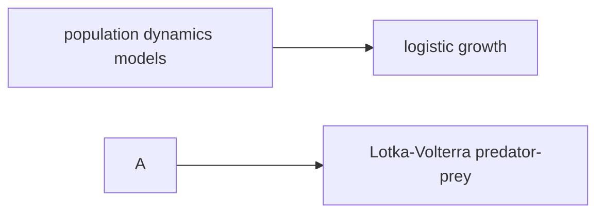

### Math: Population Dynamics

Functions: `logistic_growth_model`, `lotka_volterra_step`.



Mathematical models of population dynamics and ecological interactions.

#### Logistic Growth Model

The logistic growth model describes population growth with carrying capacity:

```
dN/dt = rN(1 - N/K)
```

Where:
- N: population size
- r: intrinsic growth rate
- K: carrying capacity

`logistic_growth_model` iterates the discrete form N(t+1) = N(t) + rN(t)(1 - N(t)/K).

#### Lotka-Volterra Predator-Prey Model

Models the interaction of a prey and a predator population:

```
dx/dt = αx - βxy
dy/dt = δxy - γy
```

Where x is the prey population, y the predator population, α the prey reproduction rate, β the predation rate, γ the predator death rate and δ the predator reproduction efficiency. `lotka_volterra_step` advances the system by one Euler step of size `dt`.

Example

```python-snippet
from metainformant.math.population_genetics.demography import logistic_growth_model
from metainformant.math.evolutionary_dynamics.core import lotka_volterra_step

# Logistic growth simulation
growth = logistic_growth_model(
    initial_size=100,
    carrying_capacity=1000,
    growth_rate=0.1,
    generations=100
)

# Lotka-Volterra predator-prey dynamics
prey, predator = 40.0, 9.0
trajectory = [(prey, predator)]
for _ in range(2000):
    prey, predator = lotka_volterra_step(prey, predator, alpha=1.0, beta=0.1, gamma=1.5, delta=0.075, dt=0.01)
    trajectory.append((prey, predator))
```
