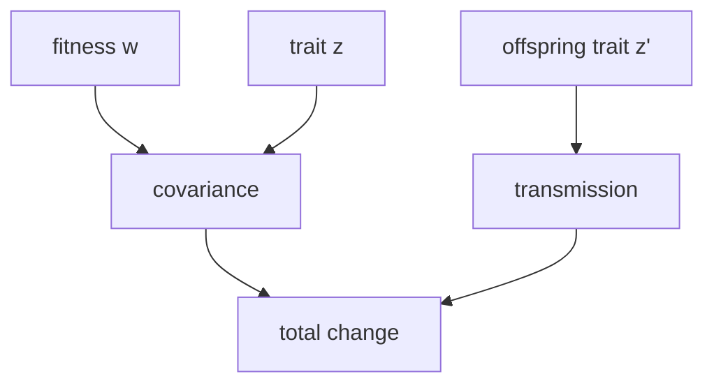

### Math: Price Equation

Functions in `metainformant.math.quantitative_genetics.price`: `expectation`, `variance`, `standard_deviation`, `weighted_variance`, `covariance`, `weighted_covariance`, `weighted_correlation`, `relative_fitness`, `selection_intensity`, `price_equation`, `delta_mean_trait`.

The unweighted `correlation` is in `metainformant.math.core.utilities`; `selection_differential`, `selection_gradient` and the trait-aware `selection_intensity(fitness_values, trait_values)` are in `metainformant.math.population_genetics.selection`.



Examples

```python-snippet
from metainformant.math.core import utilities
from metainformant.math.population_genetics import selection
from metainformant.math.quantitative_genetics import price

# Moments
mu_z = price.expectation([0.2, 0.4, 0.1])
var_z = price.variance([0.2, 0.4, 0.1])  # sample variance (denominator n - 1)
sd_z = price.standard_deviation([0.2, 0.4, 0.1])
var_wz = price.weighted_variance([0.2, 0.4, 0.1], [1.0, 2.0, 1.0])
cov_wz = price.covariance([1.0, 1.2, 0.9], [0.2, 0.4, 0.1])  # population covariance (denominator n)
cov_w = price.weighted_covariance([1.0, 1.2, 0.9], [0.2, 0.4, 0.1], [1.0, 2.0, 1.0])
rho_wz = utilities.correlation([1.0, 1.2, 0.9], [0.2, 0.4, 0.1])
rho_w = price.weighted_correlation([1.0, 1.2, 0.9], [0.2, 0.4, 0.1], [1.0, 2.0, 1.0])

# Selection metrics
wr = price.relative_fitness([1.0, 1.2, 0.9])
S = selection.selection_differential([1.0, 1.2, 0.9], [0.2, 0.4, 0.1])
i = selection.selection_intensity([1.0, 1.2, 0.9], [0.2, 0.4, 0.1])  # S divided by the trait's standard deviation
beta = selection.selection_gradient([1.0, 1.2, 0.9], [0.2, 0.4, 0.1])

# Price equation decomposition: (selection term, transmission term, total change)
cov, trans, total = price.price_equation(
    [1.0, 1.2, 0.9],
    [0.2, 0.4, 0.1],
    [0.25, 0.35, 0.15],
)

# Total change in mean trait
dz = price.delta_mean_trait(
    [1.0, 1.2, 0.9],
    [0.2, 0.4, 0.1],
    [0.25, 0.35, 0.15],
)
```

Notes:
- `price_equation(fitness, parent, offspring=None)` returns `Cov(w, z) / mean(w)` as the selection term and `mean(offspring) - mean(parent)` as the total change; the transmission term is the difference. Without `offspring` the transmission term is 0.0 and the total equals the selection term.
- `delta_mean_trait` called with two lists (trait values first, then fitness values) returns `Cov(trait, fitness) / mean(fitness)`; with three lists (fitness, parent, offspring) it is the total change from `price_equation`.
- `price.selection_intensity(fitness_values)` takes a single list and returns the coefficient of variation of the positive fitness values; it is not the trait-standardized differential in `selection`.
