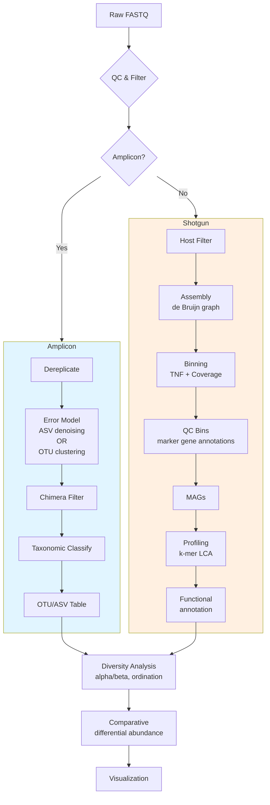

# Metagenomics Module Architecture

Comprehensive architectural overview of the METAINFORMANT metagenomics module, covering amplicon and shotgun workflows, data flow, and integration with analysis pipelines.

## Table of Contents

1. [Module Structure](#module-structure)
2. [Amplicon Workflow](#amplicon-workflow)
3. [Shotgun Workflow](#shotgun-workflow)
4. [Component Responsibilities](#component-responsibilities)
5. [Data Flow](#data-flow)
6. [Integration with Diversity & Functional Analysis](#integration-with-diversity--functional-analysis)
7. [Design Patterns](#design-patterns)
8. [Integration Points](#integration-points)
9. [Configuration](#configuration)
10. [Performance Considerations](#performance-considerations)
11. [Future Architecture Directions](#future-architecture-directions)
12. [Summary](#summary)

---

## Module Structure

### Directory Layout

```
src/metainformant/metagenomics/
├── __init__.py              # Exposes the six subpackages (functions live in their modules)
├── README.md                # Module overview
├── SPEC.md                  # Technical specification
├── AGENTS.md                # Agent directives
├── PAI.md                   # PAI guidelines
│
├── amplicon/               # 16S/ITS amplicon analysis
│   ├── __init__.py
│   ├── README.md
│   ├── otu_clustering.py   # Greedy centroid OTU clustering
│   ├── asv_denoising.py    # DADA2-style denoising, error model, paired-read merging
│   └── taxonomy.py         # Naive Bayes / k-mer ("blast") classification
│
├── shotgun/                # Whole-metagenome analysis
│   ├── __init__.py
│   ├── README.md
│   ├── assembly.py         # De Bruijn graph assembly
│   ├── binning.py          # Metagenomic binning (TNF + coverage)
│   └── profiling.py        # Taxonomic profiling (k-mer LCA)
│
├── diversity/              # Community diversity metrics
│   ├── __init__.py
│   ├── README.md
│   └── metrics.py          # Alpha/beta diversity, rarefaction, PERMANOVA, ordination
│
├── functional/             # Functional annotation
│   ├── __init__.py
│   ├── README.md
│   ├── annotation.py       # ORF prediction, gene families
│   └── pathways.py         # Pathway reconstruction, completeness
│
├── comparative/            # Differential abundance
│   ├── __init__.py
│   ├── README.md
│   └── differential_abundance.py  # ALDEx2-like / ANCOM-like tests, indicator species, biomarkers
│
└── visualization/          # Metagenomics plots
    ├── __init__.py
    ├── README.md
    └── plots.py            # Krona-style sunburst, stacked bar, rarefaction, ordination, alpha diversity, heatmap
```

Each subpackage directory also holds `AGENTS.md`, `PAI.md` and `SPEC.md` (omitted from the tree). The `metainformant.metagenomics` package and its subpackages expose only their submodules, so import functions from the module that defines them (for example `metainformant.metagenomics.amplicon.otu_clustering.cluster_otus`).

---

## Amplicon Workflow

### 16S/ITS Amplicon Analysis Pipeline

```
Raw FASTQ (Illumina)
        ↓
[Quality filtering] — trim adapters, filter low quality (external, e.g. fastp, cutadapt)
        ↓
[Paired-read merging] — merge_paired_reads() (paired-end data only)
        ↓
[Dereplication] — duplicate sequences merged with counts (inside denoise_sequences(), or by the caller)
        ↓
[ASV denoising] — error modeling (DADA2-style): denoise_sequences(), OR
[OTU clustering] — 97% identity centroid clustering: cluster_otus()
        ↓
[Chimera removal] — filter_chimeras(): simplified UCHIME-style, de novo or reference-based
        ↓
[Taxonomic classification] — classify_taxonomy(): naive Bayes k-mer classifier (RDP-style) or k-mer "blast"
        ↓
[OTU/ASV table] — samples × taxa abundance matrix (assembled by the caller)
        ↓
[Diversity analysis] → α diversity (Shannon, Simpson), β diversity (Bray-Curtis)
        ↓
[Statistical testing] → PERMANOVA, differential abundance
```

### Processing Modes

The module supports two parallel amplicon analysis strategies:

| Mode | Method | Resolution | Speed | Recommended For |
|------|--------|------------|-------|-----------------|
| **OTU clustering** | Greedy centroid (VSEARCH-style) | 97% identity clusters | Slow: pure-Python alignment, roughly 0.02–0.1 s per 250 bp pair (varies with hardware and load) | Traditional 16S analysis, up to a few thousand sequences (use VSEARCH for >1M reads) |
| **ASV denoising** | Error-model (DADA2-style) | Exact sequence variants (100%) | Much faster here: no alignments (300 simulated 250 bp reads on one machine: under 0.1 s vs about 11 s for OTU clustering; times vary with hardware, load and data); cost grows with unique sequences × ASVs | High-resolution analysis |

**OTU clustering** (`cluster_otus()`):
- Sorts sequences by length (default) or, with `sort_by="abundance"` and an `abundance` dict, by abundance
- Iteratively assigns each to best-matching centroid if identity ≥ threshold
- First sequence becomes centroid #1
- Complexity: one O(L₁×L₂) alignment per sequence–centroid pair; the k-mer pre-filter skips the alignments that a k-mer count test (the q-gram lemma) proves cannot reach the threshold. It never skips a pair that qualifies, so the clustering is the same with and without it
- Output: a `ClusteringResult` whose `otu_table` maps each centroid ID to its number of member sequences (no per-sample counts)

**ASV denoising** (`denoise_sequences()`):
- Dereplicates identical sequences with counts
- Uses a supplied `ErrorModel`, one estimated from the reads when `quality_scores` are given (error probabilities from the Phred scores, substitution shares from per-position consensus differences), or a default Phred-30 model; given `quality_scores`, the Phred scores also set the error probability of each mismatch when a variant is tested against a more abundant sequence
- Merges a variant into an ASV when the Poisson upper-tail probability of its abundance, `P(X >= abundance)` with `lambda = (ASV abundance) × P(variant | ASV)`, exceeds `omega_a`
- More sensitive to true biological variants (single-nucleotide differences)
- Output: a `DenoisingResult` whose `asvs` are `ASV` objects (`sequence`, `abundance`, and the mean Phred `quality` of their reads, 0.0 without quality scores) pooled over all input reads (no per-sample counts)

**Recommendation**: Use **ASV** for most studies (higher resolution, and much cheaper than `cluster_otus()` in this pure-Python implementation); use **OTU** for legacy compatibility with 97% OTU tables.

---

## Shotgun Workflow

### Shotgun Metagenomics Pipeline

```
Raw reads (Illumina, PacBio, ONT)
        ↓
[Quality control] — external (Trimmomatic, fastp: adapter/quality trimming)
        ↓
[Host removal] — external (map to host genome, filter; optional)
        ↓
[Assembly] — assemble_contigs(): simplified de Bruijn graph
             (MetaSPAdes, MEGAHIT run externally for production data)
        ↓
[Assembly stats] — calculate_assembly_stats(): N50, # contigs, total bp, GC fraction
        ↓
[Binning] — bin_contigs(): tetranucleotide frequency (TNF) + coverage-based k-means
        ↓
[Bin quality] — assess_bin_quality() / refine_bins(): CheckM-style completeness and contamination from
                single-copy marker gene annotations supplied by the caller (the marker search is external)
        ↓
[MAGs] — GenomeBin objects listing contig IDs per bin (no FASTA writer)
        ↓
[Profiling] — build_kmer_index() + profile_community(): k-mer LCA classification (Kraken-style)
        ↓
[Functional annotation] — predict_orfs(): six-frame ORF scan; annotate_genes(): scoring against
                          a user-supplied profile set
        ↓
[Pathway reconstruction] — reconstruct_pathways(): completeness for 8 built-in KEGG pathways
                           (or custom PathwayDefinition objects)
```

### Assembly Details

**`assemble_contigs()`** in `shotgun/assembly.py`:

- **Algorithm**: simplified de Bruijn graph (not a production assembler): k-mers are counted per read, non-branching paths are collapsed into contigs
- **k-mer sizes**: Multiple k values; the default depends on mean read length (`[21]` below 100 bp, `[21, 33]` below 200 bp, `[21, 33, 55]` otherwise) to balance contiguity and repeat resolution
- **Node**: (k-1)-mer, **Edge**: k-mer
- **Error filtering**: k-mers seen fewer than `min_kmer_coverage` times (default 2) are dropped; there is no tip removal or bubble popping
- **Multiple k**: contigs are processed longest first, and any contig identical to, or a substring of, one already kept (from any k) is dropped
- **Reproducibility**: graph start nodes are visited in sorted order, so the same reads and parameters give the same contigs and IDs in every process

**Output data model** (abbreviated):
```python
@dataclass
class Contig:
    contig_id: str
    sequence: str
    length: int
    coverage: float   # mean k-mer count along the contig
    gc_content: float # fraction, 0-1

@dataclass
class AssemblyStats:
    total_contigs: int
    total_length: int
    n50: int          # shortest contig length where ≥50% of the assembly is covered
    l50: int          # fewest contigs that cover ≥50% of the assembly
    gc_content: float # fraction, 0-1
    # also: largest_contig, smallest_contig, n90, l90, mean_coverage, mean_length, median_length
```

**Note**: Full de Bruijn assembly is computationally intensive. For large datasets (>1 Gb), use external assemblers (MEGAHIT, metaSPAdes) via system calls; METAINFORMANT does not currently provide wrappers.

---

### Binning Details

**`bin_contigs()`** in `shotgun/binning.py`:

- **Input**: Contigs dictionary `{id: sequence}`, optional per-contig coverage (one value, or a list of per-sample values); contigs shorter than `min_contig_length` (default 1000 bp) are left unbinned
- **Methods** (`method=`, default `"composition"`; coverage only enters the clustering features under `"coverage"` and `"combined"`):
  1. **Composition-only**: TNF (tetranucleotide frequency, both strands) via 4-mer counting → 256-dimensional vector → k-means clustering
  2. **Coverage-only**: log-transformed coverage (a vector across samples when per-sample coverage is given) → k-means clustering
  3. **Combined**: Concatenate the TNF vector + log-transformed coverage (recommended)

- **Algorithm**: pure-Python k-means with k-means++ initialization (`seed`). If `n_bins` is not given, it is the smaller of one bin per 3 Mbp of binned sequence and half the number of binnable contigs, raised to at least 2 and capped at the number of binnable contigs.
- **Quality**: with `marker_genes` (contig ID → marker gene names found on it) every bin is assessed by `assess_bin_quality()` and `BinningResult.high_quality_bins` is filled; without it both stay `None`

**Output** (abbreviated):
```python
@dataclass
class GenomeBin:
    bin_id: str
    contig_ids: list[str]
    total_length: int
    num_contigs: int
    gc_content: float
    mean_coverage: float
    completeness: float | None    # None until assessed from marker genes
    contamination: float | None   # None until assessed from marker genes
    quality_score: float | None    # completeness - 5 × contamination, or None
    marker_counts: dict[str, int]  # copy number of each expected marker found
```

**Quality assessment** (CheckM-style, from marker gene annotations; `assess_bin_quality()`):
- **Input**: `marker_genes` maps each contig ID to the single-copy marker gene names found on it (a name listed twice counts as two copies). The annotations must come from a real marker search of the contigs, for example HMMER with TIGRFAM or Pfam marker profiles; the package does not search sequences. `marker_set` lists the expected markers (default `BACTERIAL_SINGLE_COPY_MARKERS`, a fixed list of 36 bacterial gene symbols; pass the set that matches your annotation names)
- **Completeness**: expected markers present at least once ÷ expected markers
- **Contamination**: extra copies (copies − 1, summed over the markers present) ÷ expected markers; it exceeds 1.0 for a bin with several copies of most markers
- **Quality score**: completeness − 5 × contamination
- **No annotations**: all three are `None`; nothing is estimated from sequence composition or genome size
- **High-quality MAG** (the usual criterion): completeness ≥90%, contamination ≤5%; `count_high_quality_bins()` counts them among assessed bins (`None` while any bin is unassessed), and `bin_contigs()` stores that count in `BinningResult.high_quality_bins` when it is given `marker_genes`
- **Refinement**: `refine_bins()` requires `marker_genes` (`ValueError` otherwise), assesses the bins, drops those below `completeness_threshold`, and splits a bin of three or more contigs whose contamination exceeds `contamination_threshold` by TNF k-means; the sub-bins are assessed with the same annotations

---

### Profiling Details

**`build_kmer_index()`** and `profile_community()` in `shotgun/profiling.py`:

- **k-mer indexing**: Build k-mer → taxon lookup from reference genomes (forward-strand k-mers). For shared k-mers, store LCA (lowest common ancestor) taxon for that k-mer.
- **Classification**: For each read, extract k-mers and look them up; reads with fewer than `min_kmer_hits` hits stay unclassified. The taxon with the most hits is assigned if it holds at least `confidence_threshold` of them; otherwise the LCA of all hit taxa is assigned.
- **Confidence**: Fraction of a read's k-mer hits that support the top taxon.
- **No common ancestor**: k-mers shared by taxa with no common ancestor carry no taxonomic information and are ignored, and a read whose hit taxa have no common ancestor stays unclassified

**Data model** (abbreviated):
```python
@dataclass
class TaxonProfile:
    taxon_id: str      # reference ID, or an LCA ID such as "Bacteria;Firmicutes"
    name: str          # e.g., "Lactobacillus"
    rank: str          # species/genus/phylum
    lineage: list[tuple[str, str]]
    read_count: int
    relative_abundance: float   # fraction of classified reads
    kmer_count: int             # not filled in (stays 0)

@dataclass
class CommunityProfile:
    taxa: list[TaxonProfile]
    total_reads: int
    classified_reads: int
    unclassified_reads: int
    classification_rate: float
    rank_summaries: dict[str, dict[str, float]]   # rank -> {taxon name: abundance}
```

---

## Component Responsibilities

### `amplicon/` Subpackage

| File | Functions | Purpose |
|------|-----------|---------|
| `otu_clustering.py` | `cluster_otus()`, `calculate_identity()`, `filter_chimeras()` | OTU-based community profiling |
| `asv_denoising.py` | `denoise_sequences()`, `estimate_error_rates()`, `merge_paired_reads()` | High-resolution ASV inference, paired-read merging |
| `taxonomy.py` | `classify_taxonomy()`, `build_taxonomy_tree()`, `calculate_confidence()` | Taxonomic assignment |

**Key algorithms**:
- **`calculate_identity()`**: Needleman-Wunsch global alignment with affine gap penalties; returns identity as a fraction from 0 to 1 (matches divided by alignment columns, gap columns included). O(L₁×L₂) per pair, in pure Python with full dynamic-programming matrices (no banding).
- **`filter_chimeras()`**: UCHIME-style de novo detection — finds the two most similar parent sequences among those already accepted (processed by abundance, or by length when no abundance is given), builds chimeric models by concatenating left/right segments at 10% breakpoints, and computes how much better the model fits the query than the closer parent. A model counts only if it improves the identity by at least `min_divergence` percentage points (the UCHIME `mindiv` convention; 1.0 means 1%); the query is flagged if the best score is ≥ `min_score`.

---

### `shotgun/` Subpackage

| File | Functions | Purpose |
|------|-----------|---------|
| `assembly.py` | `assemble_contigs()`, `scaffold_contigs()`, `calculate_assembly_stats()` | De Bruijn graph assembly |
| `binning.py` | `bin_contigs()`, `calculate_tetranucleotide_freq()`, `assess_bin_quality()`, `refine_bins()` | Metagenome binning |
| `profiling.py` | `build_kmer_index()`, `profile_community()`, `calculate_relative_abundance()` | Taxonomic profiling |

**Key structures**:
- `Contig`, `Scaffold`, `AssemblyStats`
- `GenomeBin`, `BinningResult`
- `KmerIndex`, `CommunityProfile`

---

### `diversity/` Subpackage

`metrics.py` implements a comprehensive suite of diversity statistics (see separate `diversity.md` for full reference).

| Category | Metrics |
|----------|---------|
| Alpha diversity | Shannon, Simpson, InvSimpson, Chao1, ACE, Observed, Fisher alpha, Pielou evenness |
| Beta diversity | Bray-Curtis, Jaccard, Aitchison (CLR-Euclidean) |
| Ordination | PCoA (eigendecomposition of the double-centered distance matrix), NMDS (gradient stress minimization, random start drawn with `seed`, default 42) |
| Testing | PERMANOVA (pseudo-F permutation test), rarefaction analysis |

**All alpha metrics** accept a single abundance vector as a list or NumPy array (`chao1`, `ace` and `fisher_alpha` need integer counts and raise `ValueError` for relative abundances; the others also accept relative abundances); **beta metrics** accept a list of equal-length sample vectors. Rarefaction, `rarefy()` and PERMANOVA draw random numbers and are unseeded unless you pass `seed` (default `None`).

---

### `functional/` Subpackage

| File | Functions | Purpose |
|------|-----------|---------|
| `annotation.py` | `predict_orfs()`, `annotate_genes()`, `classify_gene_families()` | Six-frame start/stop codon ORF scan (not Glimmer or Prodigal) using an NCBI `translation_table`; `annotate_genes()` scores against a user-supplied profile set (no hits without one; no E-values are computed, so hit E-values are NaN and `e_value_threshold` must be None), with COG/KEGG/Pfam assignment by profile ID prefix; `classify_gene_families()` scores against `reference_profiles` and assigns no family (empty lists) when they are None |
| `pathways.py` | `reconstruct_pathways()`, `calculate_pathway_completeness()`, `compare_pathway_profiles()`, `find_differential_pathways()` | Metabolic pathway reconstruction and completeness scoring |

**Pathway completeness**: `reconstruct_pathways()` computes the fraction of a pathway's required KOs/ECs present in the annotations, relative to the pathway definition (8 KEGG pathways are built in). A definition with `reaction_steps` is scored by steps in both `reconstruct_pathways()` and `calculate_pathway_completeness()` (a step is complete if any alternative is present), so completeness always lies in [0, 1].

---

### `comparative/` Subpackage

`differential_abundance.py` implements the `differential_abundance()` methods (two groups only; BH-adjusted p-values) plus `clr_transform()`, `indicator_species()`, `effect_size_analysis()` and `biomarker_discovery()`:

- **`aldex2_like`**: Welch's t-test and Cohen's d on CLR values averaged over Dirichlet Monte Carlo draws
- **`ancom_like`**: pairwise log-ratio Welch tests per taxon; the W fraction of rejected comparisons is the effect size and `1 - W` the pseudo p-value
- **`simple_deseq`**: median-of-ratios size-factor normalization, then Welch's t-test and Cohen's d on the normalized counts

The count matrix may be a list of lists, a NumPy array or a pandas DataFrame. `aldex2_like` (Monte Carlo draws), `indicator_species()` (permutations) and `biomarker_discovery()` (random forest) are unseeded unless you pass `seed` (default `None`).

**Note**: `aldex2_like` handles compositionality with the centered log-ratio (CLR) transform and `ancom_like` with pairwise log-ratios, whereas `simple_deseq` only applies median-of-ratios size-factor normalization; the additive log-ratio (ALR) is not used.

---

## Data Flow

### High-Level Metagenomics Processing Flow



### Detailed Amplicon Flow

```
FASTQ (paired-end)
        ↓
Merge pairs: merge_paired_reads(forward, reverse) → merged sequences
        ↓
DADA2-style pipeline:
1. estimate_error_rates(quality_scores) → ErrorModel (optional; the error probability is the
   mean of 10^(-Q/10) over all scores, and passing sequences= adds substitution shares measured
   against the per-position consensus. denoise_sequences() passes the reads itself when given
   quality_scores, else uses a default Phred-30 model)
2. denoise_sequences(merged, error_rates=error_model) → ASVs
   - Alternative: cluster_otus() → OTUs
        ↓
Filter chimeras: filter_chimeras() (simplified UCHIME-style)
        ↓
Taxonomic classification: classify_taxonomy() (naive Bayes, k=8 mers)
        ↓
Feature table (built by the caller; export to TSV/BIOM yourself):
   samples × ASVs/OTUs (counts)
        ↓
→ diversity.metrics (alpha/beta)
→ comparative.differential_abundance
→ visualization.plots (plot_krona_chart, plot_stacked_bar)
```

### Detailed Shotgun Flow

```
FASTQ (interleaved or paired)
        ↓
Preprocess (trimming, quality filter)  [external: fastp, Trimmomatic]
        ↓
Assembly:
  assemble_contigs(reads, k_range=[21,33,55]) → contigs
  scaffold_contigs(contigs, paired_reads) → scaffolds (optional)
        ↓
Binning (contigs as {id: sequence}):
  bin_contigs(contig_dict, coverage, method="combined") → BinningResult (.bins: list of GenomeBin)
  refine_bins(result.bins, contig_dict, marker_genes=marker_genes) → bins that pass the marker-gene
    quality filter (marker_genes: contig ID → marker names from a marker search such as HMMER)
        ↓
Profiling (two approaches):
  A) k-mer LCA: build_kmer_index(ref_genomes) → profile_community(reads, database=index) → taxonomic abundances
  B) gene-centric: functional.annotation.predict_orfs → annotate_genes → functional.pathways.reconstruct_pathways → pathway completeness
        ↓
→ comparative.differential_abundance (any samples × features count matrix: taxon, gene, pathway)
→ visualization (plot_stacked_bar, plot_heatmap, ...)
```

---

## Integration with Diversity & Functional Analysis

### Diversity Module as Post-Processor

The `diversity` module consumes OTU/ASV tables and computes ecologically relevant statistics:

```python
import numpy as np

from metainformant.metagenomics.diversity import metrics

# OTU table: samples × taxa (counts), shape (n_samples, n_otus)
otu_table = np.array([
    [120, 30, 10, 0, 5],
    [100, 40, 0, 12, 8],
    [10, 60, 70, 30, 0],
])
n_samples = otu_table.shape[0]

# Alpha diversity (within-sample); abundances may be a list or a NumPy array
for sample_idx in range(n_samples):
    alpha = metrics.alpha_diversity(
        abundances=otu_table[sample_idx],
        metric="shannon",
    )
    print(f"Sample {sample_idx}: Shannon diversity = {alpha['value']:.3f}")

# Beta diversity (between-sample)
beta_result = metrics.beta_diversity(
    samples=otu_table.tolist(),
    metric="bray_curtis",
)
dist_matrix = beta_result["distance_matrix"]

# Ordination for visualization
pcoa = metrics.ordination(dist_matrix, method="pcoa", n_components=2)
coords = pcoa["coordinates"]  # 2D embedding of samples
```

**Integration point**: counts derived from `amplicon` results (assembled into a samples × features matrix by the caller) feed into `diversity.metrics`. The module is agnostic to data source; any feature table given as plain lists works.

---

### Functional Module as Downstream Annotator

The `functional` module operates on either:
- **Shotgun assemblies** (contigs → ORF prediction → annotation)
- **Gene catalogs** (any `{gene_id: protein_sequence}` dict)

```python
from metainformant.metagenomics.functional import annotation, pathways
from metainformant.metagenomics.shotgun import assembly

# reads: {id: sequence} or a list of sequences
# hmm_db: user-supplied profiles {profile_id: {position: {amino_acid: score}}},
#         with IDs such as "KO:K00844" or "COG:C" (no profile database is bundled)

# From shotgun assembly: contigs -> ORFs -> annotation
contigs = assembly.assemble_contigs(reads)
orfs = [
    orf
    for contig in contigs
    for orf in annotation.predict_orfs(contig.sequence, sequence_id=contig.contig_id)
]
proteins = {f"{orf.sequence_id}_orf{i}": orf.protein_seq for i, orf in enumerate(orfs)}
annotated = annotation.annotate_genes(proteins, hmm_db=hmm_db)  # assign COG/KEGG/Pfam by profile ID

# Pathway reconstruction takes {gene_id: [KO/EC ids]}, not FunctionalAnnotation objects
gene_annotations = {a.orf_id: a.kegg_orthologs + a.ec_numbers for a in annotated}
pathway_results = pathways.reconstruct_pathways(gene_annotations)  # list of PathwayResult
completeness = {r.pathway_id: r.completeness for r in pathway_results}

# Completeness of a single (custom) pathway definition against the observed KOs/ECs
observed = {ko for kos in gene_annotations.values() for ko in kos}
custom = pathways.PathwayDefinition(pathway_id="custom1", name="Custom", required_kos=["K00844", "K00845"])
print(pathways.calculate_pathway_completeness(custom, observed))
```

---

### Comparative Module as Unifying Test Engine

The `comparative` module provides differential abundance testing across all feature types (taxa, genes, pathways):

```python
# The function shares its name with the module that defines it
from metainformant.metagenomics.comparative.differential_abundance import differential_abundance

# Every input is a samples × features count matrix (a list of lists, a NumPy array or a
# DataFrame) with one integer group label per sample and one name per feature (column).
# Here otu_table needs 6 rows, one per entry of groups (the 3-sample table in the
# diversity example above is too small)
groups = [0, 0, 0, 1, 1, 1]  # e.g. control vs treatment

# OTU table differential
otu_diff = differential_abundance(
    counts=otu_table,
    groups=groups,
    taxa_names=otu_names,
    method="aldex2_like",  # CLR-based; pass seed=... for reproducible Monte Carlo draws
)

# Taxonomic profile differential
tax_diff = differential_abundance(
    counts=taxonomic_abundances,
    groups=groups,
    taxa_names=taxon_names,
    method="ancom_like",
)

# Gene family differential
gene_diff = differential_abundance(
    counts=gene_counts,
    groups=groups,
    taxa_names=gene_names,
    method="simple_deseq",
)
```

The only methods are `aldex2_like`, `ancom_like` and `simple_deseq`. All return a list of dicts with the same keys (`taxon`, `log2fc`, `p_value`, `adjusted_p`, `effect_size`, `mean_group1`, `mean_group2`), sorted by adjusted p-value, enabling consistent downstream handling.

---

## Design Patterns

### Pipeline Pattern: Sequence → Table → Analysis

Amplicon and shotgun workflows both follow a **feature table** convention (there is no feature-table class; downstream functions take plain `list[list[int]]` count matrices):

```
Input (FASTQ/reads)
    ↓
Feature detection (ASV/OTU/Contig/Gene)
    ↓
Abundance quantification (counts per sample)
    ↓
Feature table (samples × features: one row per sample)
    ↓
Diversity / Comparative / Functional analysis
```

This separation allows any feature table (even from external tools like QIIME2) to be consumed by downstream analysis functions.

---

### Method Dispatch via String Enum

Many functions accept a `method` string parameter:

```python
classify_taxonomy(..., method="naive_bayes")  # or "blast"
bin_contigs(..., method="combined")  # "composition" (the default), "coverage", "combined"
differential_abundance(..., method="aldex2_like")  # "ancom_like", "simple_deseq"
alpha_diversity(..., metric="shannon")  # "simpson", "chao1", etc. (`metric`, not `method`)
```

(`cluster_otus()` has no `method` parameter; it takes `sort_by` and `prefilter`.)

**Implementation**: Simple `if-elif` dispatch or dict-of-functions. Easy to extend: add new method by defining function and adding to dispatch table.

**Advantage**: User-friendly string API vs. importing multiple functions; disadvantage: no type safety for method names (use Enum in future).

---

### Result Dataclasses

The main amplicon, shotgun and functional functions return dataclasses for structured output; helper functions such as `filter_chimeras()`, `merge_paired_reads()`, `calculate_confidence()`, `calculate_relative_abundance()`, `classify_gene_families()`, `compare_pathway_profiles()` and `find_differential_pathways()`, and the diversity and comparative functions, return plain dicts or lists of dicts (`rarefy()` and `clr_transform()` return plain lists):

| Return type | Fields (selection) | Use |
|-------------|--------------------|-----|
| `ClusteringResult` | `otus`, `threshold`, `total_sequences`, `num_otus`, `otu_table` | OTU results |
| `DenoisingResult` | `asvs`, `error_model`, `total_reads`, `num_asvs`, `reads_removed` | ASV results |
| `BinningResult` | `bins`, `unbinned_contigs`, `total_contigs`, `binned_contigs`, `high_quality_bins` | Binning output |
| `AssemblyStats` | `n50`, `l50`, `total_length`, `gc_content` | Assembly quality |
| `TaxonomyAssignment` | `lineage`, `confidence`, `method` | Classification |
| `PathwayResult` | `pathway_name`, `completeness`, `matched_kos`, `missing_kos` | Pathway reconstruction |

Benefits: self-documenting, IDE autocomplete, type checking. Serialize with `dataclasses.asdict()` (use `TaxonomyNode.to_dict()` for taxonomy trees, whose `parent` links are circular); `json.dumps(obj.__dict__)` fails for results that hold nested dataclasses, such as `ClusteringResult`.

---

### Environment Variable Override Pattern

Functions that have sensible defaults but allow user customization via environment variables take the setting as an optional argument that defaults to `None`:

```python
_ENV_PREFIX = "META_"

def some_function(threshold=None):
    # An explicit argument always wins; the environment is consulted only when it is None
    if threshold is None:
        raw = os.environ.get(f"{_ENV_PREFIX}OTU_THRESHOLD")
        threshold = float(raw) if raw and raw.strip() else 0.97  # validated: ValueError outside (0, 1]
    ...
```

Used in:
- `cluster_otus()`: `META_OTU_THRESHOLD` (the only variable the metagenomics package reads)

The environment value is read only when `threshold` is `None`, and it is validated like the argument: a value that is not a number in (0, 1] raises `ValueError`, and a blank value counts as unset. Other modules define `_ENV_PREFIX = "META_"` but do not read any variable.

**Rationale**: Allows batch-wide configuration without editing code or config files; useful for HPC where jobs are submitted via script.

---

## Integration Points

### With `core` Infrastructure

- **Logging**: All submodules use `metainformant.core.utils.logging.get_logger()`
- **Sequence utilities**: `metainformant.core.sequence.reverse_complement` is used by `amplicon.asv_denoising` (paired-read merging) and `functional.annotation` (reverse-strand ORFs)
- **I/O and config**: not used. The functions take plain dicts and lists and do not import `metainformant.core.io` or `metainformant.core.utils.config`; load FASTQ/FASTA with `metainformant.dna.io.fastq.read_fastq` (returns `{id: (sequence, quality_string)}`: keep the sequence for the `{id: sequence}` inputs used here, and note that `quality_scores` expects integer lists, not quality strings) and `metainformant.dna.sequence.core.read_fasta` (returns `{id: sequence}`), or your own reader

---

### With `visualization` Module

Metagenomics has its own `visualization/plots.py`, but the shared plotting helpers can be combined with it:

```python
import pandas as pd

from metainformant.metagenomics.diversity.metrics import ordination
from metainformant.metagenomics.visualization import plots as meta_viz
from metainformant.visualization.plots import pca_plot

# PCoA of a distance matrix (for example the "distance_matrix" from beta_diversity)
dist_matrix = [
    [0.0, 0.2, 0.7, 0.8],
    [0.2, 0.0, 0.6, 0.7],
    [0.7, 0.6, 0.0, 0.3],
    [0.8, 0.7, 0.3, 0.0],
]
pcoa = ordination(dist_matrix, method="pcoa", n_components=2)
sample_groups = ["control", "control", "treated", "treated"]

# Shared: pca_plot draws pre-computed PC1/PC2 coordinates, coloured by `hue`, with the
# variance in the axis labels (its variance columns are percentages, while
# ordination() returns fractions). Also shared: volcano_plot for differential
# abundance results in a DataFrame (its default columns are log2FoldChange and padj, so
# pass log2fc_col="log2fc", pval_col="adjusted_p" for differential_abundance() output),
# correlation_heatmap, expression_heatmap.
pcoa_df = pd.DataFrame({
    "PC1": [row[0] for row in pcoa["coordinates"]],
    "PC2": [row[1] for row in pcoa["coordinates"]],
    "PC1_variance": 100 * pcoa["variance_explained"][0],
    "PC2_variance": 100 * pcoa["variance_explained"][1],
    "group": sample_groups,
})
pca_plot(pcoa_df, hue="group", output_path="output/metagenomics/pcoa_shared.png")

# Metagenomics-specific: Krona-style sunburst of lineage ("A;B;C") -> abundance;
# also plot_stacked_bar, plot_ordination, plot_rarefaction_curves, plot_alpha_diversity, plot_heatmap
taxonomic_abundances = {
    "Bacteria;Firmicutes;Bacilli": 40.0,
    "Bacteria;Proteobacteria;Gammaproteobacteria": 25.0,
}
krona_path = meta_viz.plot_krona_chart(taxonomic_abundances, output_path="output/metagenomics/krona.png")
```

`plot_ordination` in the metagenomics plots is the alternative that starts from a distance matrix instead: it takes a nested-dict matrix and computes its own 2-D ordination. `method` (case-insensitive) selects `"PCoA"` (the default; axes labelled PC1 and PC2) or `"NMDS"` (the `ordination()` implementation, started from a random configuration drawn with `seed`, default 42; axes labelled NMDS1 and NMDS2); any other value raises `ValueError`. The metagenomics plot functions return the saved path when `output_path` is given and a matplotlib `Figure` otherwise.

---

### With `ecology` Module

**Synergy**: `metagenomics.diversity` and `ecology.analysis` both implement diversity indices and rarefaction; `ecology.analysis` also covers ordination, community tests and macroecology (`community`, `ordination`, `indicators`, `macroecology`, `functional`).

```python-snippet
# ecology.analysis.community computes expected richness exactly
from metainformant.ecology.analysis import community as eco_metrics
from metainformant.metagenomics.diversity import metrics as diversity

abundances = [100, 50, 30, 20, 10, 5, 3, 1, 1]

# Use ecology's rarefaction with exact hypergeometric formula
# (returns [(sample_size, expected_richness), ...] for every sample size up to
# min(max_samples, total individuals))
rarefaction = eco_metrics.rarefaction_curve(abundances, max_samples=1000)

# Metagenomics uses seedable Monte Carlo subsampling and returns a dict
# (depths, mean_species, std_species, is_saturated)
rarefaction_approx = diversity.rarefaction_curve(abundances)
```

**Integration**: For exact expected richness use the `ecology` version; `metagenomics.diversity.metrics.rarefaction_curve` additionally reports a standard deviation per depth and a saturation flag.

---

### With `networks` Module

Post-binning: Build co-occurrence networks between MAGs or taxa.

```python-snippet
from metainformant.networks.analysis import graph_core as net

# Correlation-based network from normalized abundances
abundances = otu_table  # samples × taxa DataFrame
network = net.create_network(list(abundances.columns))  # nodes = taxa
net.add_edges_from_correlation(
    network,
    abundances.T,  # features × samples
    method="spearman",
    threshold=0.7,
)
# Network: nodes = taxa, edges = strong correlations (edge weight = |correlation|)
```

---

## Configuration

Unlike RNA module, metagenomics does not have a dedicated configuration file system. Configuration is primarily **parameter-driven**.

### Environment Variables

| Variable | Purpose | Scope |
|----------|---------|-------|
| `META_OTU_THRESHOLD` | Default for `threshold`, read only when the argument is `None` (an explicit `threshold` always wins). Must be a number in (0, 1], otherwise `ValueError`; a blank value counts as unset and the built-in 0.97 applies | `cluster_otus()` |

No other environment variables are read. Several modules define `_ENV_PREFIX = "META_"`, but no other function uses it, and the package does not use `metainformant.core.utils.config` (no `apply_env_overrides` or `load_typed_env` call).

### Function Parameters as Configuration

All behavior controlled by function arguments. For reproducible pipelines, create a config dict or YAML file and pass parameters programmatically. Nothing in METAINFORMANT reads such a file: it is your own convention. In the `amplicon`, `shotgun` and `diversity.rarefaction` blocks the keys are parameter names, so each block can be passed as keyword arguments, for example `cluster_otus(sequences, **cfg["amplicon"]["clustering"])` after `cfg = metainformant.core.io.load_yaml("config/metagenomics.yaml")`; `alpha_metrics` and `beta_metric` are values you loop over and pass as `metric=`.

Example `config/metagenomics.yaml`:
```yaml
amplicon:
  clustering:                # cluster_otus(sequences, **...)
    threshold: 0.97
    sort_by: length
    prefilter: true
  taxonomy:                  # classify_taxonomy(sequences, reference_db, reference_taxonomy, **...)
    method: naive_bayes
    confidence_threshold: 0.8
    bootstrap_n: 100
shotgun:
  assembly:                  # assemble_contigs(reads, **...)
    k_range: [21, 33, 55]
    min_contig_length: 500
  binning:                   # bin_contigs(contigs, coverage, **...); marker_genes is data, pass it in code
    method: combined
  refinement:                # refine_bins(bins, contigs, marker_genes=..., **...)
    completeness_threshold: 0.5
    contamination_threshold: 0.1
diversity:
  alpha_metrics: [shannon, simpson]   # alpha_diversity(abundances, metric=...)
  beta_metric: bray_curtis            # beta_diversity(samples, metric=...)
  rarefaction:               # rarefaction_curve(abundances, **...)
    n_iterations: 10
```

---

## Performance Considerations

Timings quoted in this document (here and in the Processing Modes table) are measurements from one machine under varying load. The algorithms are pure Python, so absolute times scale with CPU speed and load; treat them as orders of magnitude.

### OTU Clustering Complexity

- **Naïve O(n²)**: For n sequences, all-vs-all identity calculation would be quadratic.
- **Greedy centroids**: each sequence is compared only with the existing centroids, so the work is about n × (number of OTUs) comparisons.
- **With k-mer pre-filter**: An alignment is computed only if the pair shares at least `longer length - 7 - 8e` 8-mers (repeated 8-mers counted), where `e = floor(shorter length × (1 - threshold) / threshold)` is the largest number of non-matching alignment columns compatible with the identity threshold. For 250 bp sequences at `threshold=0.97`, `e` is 7 and 187 shared 8-mers are required. The bound follows from the q-gram lemma (one edit changes at most eight 8-mers), so no qualifying pair is skipped.
- **Cost per alignment**: `calculate_identity()` is pure Python with full O(L₁×L₂) matrices, roughly 0.02–0.1 s for two 250 bp sequences. In a test with 200 simulated 250 bp sequences from five templates (1% divergence from the template), clustering took roughly 10–15 s with the pre-filter and about 80 s without it, and both runs produced the same 11 OTUs. Clustering is therefore practical for hundreds to a few thousand sequences, not 100k or more; use an external tool such as VSEARCH for large datasets.

**Scaling**: ~O(n × c) alignments where c = number of centroids that pass the pre-filter for each sequence.

**Optimization**: The pre-filter compares multisets of 8-mers, so it costs far less than an alignment: a random pair shares about 0.4% of its 8-mers and is rejected in well under a millisecond. It is a lower bound on what a qualifying pair must share, not a similarity score: two 250 bp sequences with five evenly spaced substitutions (98% identity) still share about 203 of their 243 8-mers (83%), more than the 187 required at `threshold=0.97`, so they are aligned and clustered together whether or not `prefilter` is set.

---

### Assembly Memory Use

De Bruijn graphs require storing all (k-1)-mers as nodes. For k=31, node space is 4³⁰ ≈ 10¹⁸ theoretically but in practice only observed k-mers are stored.

**Memory**: `assemble_contigs()` counts every k-mer of every read in an in-memory Python `Counter` (one string key per distinct k-mer) before filtering with `min_kmer_coverage`, so memory grows with the number of distinct k-mers, and sequencing errors add many singletons. Each entry costs on the order of 100 bytes or more in Python, so this assembler suits small datasets. Use disk-based or streaming assemblers (MEGAHIT, metaSPAdes) for large ones.

---

### Binning Speed

k-means clustering on TNF vectors (256 dimensions) runs in pure Python (at most 100 iterations; 400 simulated 2 kb contigs into 10 bins took roughly 2–9 s). It is limited by:
- Number of contigs
- Number of bins
- Number of iterations until convergence

**Time**: O(iterations × n_contigs × k_bins × dimensions).

---

## Future Architecture Directions

Planned improvements (not yet implemented):

| Feature | Description | Target |
|---------|-------------|--------|
| **QIIME2 integration** | Wrapper to import/export QIIME2 artifacts | Q3 2026 |
| **Kraken2/Bracken integration** | Native wrappers for taxonomic profiling | Q4 2026 |
| **MetaBAT2/MaxBin2** | External binning tools via subprocess | 2027 |
| **CheckM / HMMER integration** | Marker gene search that produces the `marker_genes` input of `assess_bin_quality()` | 2027 |
| **PhyloPhlan / RAxML** | Phylogenetic tree building from 16S | 2027 |
| **Songbird / Qurro** | Multinomial regression for differential abundance | 2028 |

---

## Summary

The metagenomics module is organized into clear subpackages aligned with standard analysis workflows: **amplicon** (16S/ITS), **shotgun** (WGS), **diversity** (ecology), **functional** (annotation), **comparative** (stats), and **visualization**. Data flows from raw sequences → feature table (OTU/ASV/contig/gene) → abundance matrix → ecological/statistical analysis.

Key strengths:
- **Pure Python implementations** of core algorithms (OTU clustering, UCHIME, diversity metrics)
- **Modular design**: swap external tools (assembly, binning) without breaking downstream
- **Comprehensive**: covers both amplicon and shotgun in one package
- **Extensible**: method dispatch patterns allow adding new algorithms easily

**Cross-cutting concerns**: logging and the reverse-complement helper come from the `core` module; the package uses no `core` config or I/O helpers (inputs are plain dicts and lists). Advanced stats could leverage `ml` or `math` modules in future.
