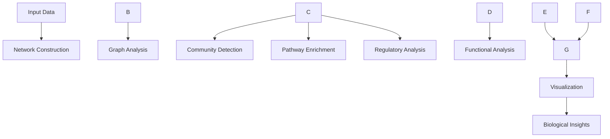

# Networks: Biological Network Analysis

The networks module provides comprehensive tools for analyzing biological networks including protein interaction networks, regulatory networks, pathway analysis, and community detection.

## Overview

This module handles various types of biological networks and provides algorithms for network construction, analysis, and visualization. It supports multiple network types and provides both basic graph operations and advanced biological network analysis.

## Core Components

### [Graph Analysis](./graph.md)
Fundamental graph operations, metrics, and utilities:
- Network creation from various data sources
- Centrality measures (degree, betweenness, closeness, eigenvector, PageRank)
- Shortest path analysis
- Network filtering and manipulation

### [Community Detection](./community.md)
Algorithms for identifying functional modules and communities:
- Louvain, Leiden, greedy modularity, Girvan-Newman and label propagation algorithms
- Modularity and community quality metrics
- Community functional analysis
- Hierarchical community detection
- Community stability assessment

### [Protein-Protein Interaction Networks](./ppi.md)
Analysis of protein interaction networks:
- STRING-format table import and TSV, CSV, JSON, BioPlex and IntAct file loading
- Interaction prediction methods
- Network topology analysis
- Functional enrichment of modules
- Interaction confidence filtering

### [Gene Regulatory Networks](./regulatory.md)
Regulatory network inference and analysis:
- Network inference from expression data (correlation and mutual information, with a seed for the randomised mutual-information estimate)
- Transcription factor metadata
- Regulatory motif detection
- Regulatory influence propagation
- Cascade, feed-forward (all three edges) and feedback loop identification

### [Pathway Analysis](./pathway.md)
Biological pathway enrichment and analysis:
- Pathway gene sets from dictionaries, JSON or GMT files
- Enrichment analysis (Fisher's exact and hypergeometric tests, exact with or without scipy)
- Pathway activity scores from expression data
- Pathway similarity analysis and pathway similarity networks

## Architecture



## Key Features

### Comprehensive Network Types
- **Protein-Protein Interactions**: Physical and functional protein associations
- **Regulatory Networks**: Transcriptional regulation between regulators and targets
- **Pathway Networks**: Gene sets grouped into pathways, with pathway similarity networks
- **Correlation Networks**: Gene co-expression and correlation patterns
- **Community Networks**: Functional modules and complexes

### Multiple Analysis Methods
- **Community Detection**: Louvain, Leiden, greedy modularity, Girvan-Newman, label propagation, asynchronous label propagation, fluid communities, plus multi-level `hierarchical_communities`
- **Centrality Analysis**: Degree, betweenness, closeness, eigenvector centrality and PageRank
- **Enrichment Analysis**: Hypergeometric and Fisher's exact tests
- **Network Inference**: Correlation, mutual information and regression (lasso, ridge); Granger causality for time series lives in `metainformant.information.network_info.information_flow`

### Integration Capabilities
- **Network Combination**: Union and intersection of networks (`network_union`, `network_intersection`)
- **Functional Annotation**: Gene Ontology term enrichment (`metainformant.ontology.core.go.enrich_genes`) and pathway enrichment
- **Expression Correlation**: Build networks from correlation matrices and regulatory networks from expression matrices
- **Data Import**: STRING-format interaction tables and pathway gene sets (dictionaries, JSON, GMT)

## Quick Start

### Basic Network Analysis

```python
import numpy as np
from metainformant.networks.analysis.graph_core import create_network, add_edges_from_interactions
from metainformant.networks.analysis.graph_algorithms import network_metrics, centrality_measures

# Create network from interactions: two triangles joined by one edge
nodes = ["gene1", "gene2", "gene3", "gene4", "gene5", "gene6"]
network = create_network(nodes, directed=False)

# Add edges from interaction list
interactions = [
    ("gene1", "gene2", 0.8),
    ("gene2", "gene3", 0.6),
    ("gene3", "gene1", 0.9),
    ("gene4", "gene5", 0.7),
    ("gene5", "gene6", 0.8),
    ("gene6", "gene4", 0.9),
    ("gene3", "gene4", 0.5)
]

add_edges_from_interactions(network, interactions)

# Analyze network properties
metrics = network_metrics(network)
print(f"Network has {metrics['num_nodes']} nodes and {metrics['num_edges']} edges")

# Calculate centrality measures (a dict of {node: score} per measure)
centrality = centrality_measures(network)
degree_scores = centrality['degree']
cutoff = np.mean(list(degree_scores.values())) + np.std(list(degree_scores.values()))
hub_genes = [node for node, score in degree_scores.items() if score > cutoff]
print(f"Hub genes: {hub_genes}")
```

### Community Detection

```python
from metainformant.networks.analysis.community import detect_communities, modularity

# Detect communities (a {node: community_id} dictionary)
communities = detect_communities(network, method='leiden', resolution=1.0)

# Evaluate community quality
mod_score = modularity(network, communities)
print(f"Modularity: {mod_score:.3f}")

# Analyze community properties
for community_id in set(communities.values()):
    community_nodes = [node for node, comm in communities.items() if comm == community_id]
    print(f"Community {community_id}: {len(community_nodes)} nodes")
```

`'leiden'` needs the optional `leidenalg` and `python-igraph` packages and `'louvain'` needs `python-louvain`; without them `detect_communities` falls back (Leiden to Louvain when `python-louvain` is installed, everything else to greedy modularity; see [Community Detection](./community.md)). Louvain takes a `random_state` seed that leaves the global random states untouched.

### Pathway Enrichment

```python
from metainformant.networks.analysis.pathway import PathwayNetwork, pathway_enrichment

# Pathway gene sets
pathway_network = PathwayNetwork(
    name="central_metabolism",
    pathways={
        "glycolysis": ["HK1", "PFKL", "FBA", "PGK1", "PGAM1"],
        "tca_cycle": ["CS", "ACO1", "IDH1", "OGDH", "SUCLG1"],
    },
)

# Gene list of interest
gene_list = ["HK1", "PFKL", "FBA", "PGK1", "CS", "ACO1"]

# Pathway enrichment analysis (a dict keyed by pathway ID)
enriched_pathways = pathway_enrichment(
    gene_list,
    pathway_network,
    method="hypergeometric",
    correction="fdr"
)

# Display top enriched pathways
ranked = sorted(enriched_pathways.items(), key=lambda item: item[1]["p_value"])
for pathway_id, result in ranked[:5]:
    print(f"{pathway_id}: p={result['p_value']:.2e}")
    print(f"  Overlap: {result['overlap_genes']}")
```

## Integration with Other Modules

### With Expression Data

```python-snippet
import pandas as pd
from metainformant.rna.analysis import expression
from metainformant.networks.analysis.community import detect_communities
from metainformant.networks.interaction.regulatory_analysis import infer_grn

# Normalize a raw count matrix (genes as rows, samples as columns)
counts = pd.read_csv("counts.csv", index_col=0)
normalized = expression.normalize_counts(counts, method="log2cpm")
expression_data = normalized.T  # infer_grn expects samples as rows, genes as columns

# Infer regulatory network
regulatory_network = infer_grn(
    expression_data,
    list(expression_data.columns),
    method="correlation",
    threshold=0.7
)

# Analyze network modules (a {gene: module_id} dictionary)
modules = detect_communities(regulatory_network)
```

### With Protein Data

```python-snippet
import pandas as pd
from metainformant.networks.interaction.ppi import load_string_interactions
from metainformant.networks.analysis.community import detect_communities
from metainformant.ontology.core import go

# Load PPI network from a STRING-style table (columns protein1, protein2, combined_score)
string_table = pd.read_csv("string_links.tsv", sep="\t")
protein_network = load_string_interactions(string_table, confidence_threshold=700)

# Find functional modules (protein -> module id), then group proteins per module
membership = detect_communities(protein_network, method='leiden')
modules = {}
for protein, module_id in membership.items():
    modules.setdefault(module_id, []).append(protein)

# Functional enrichment against GO term annotations (GO term -> set of proteins)
go_annotations = {"GO:0016301": {"P1", "P2", "P3"}, "GO:0005215": {"P4", "P5", "P6"}}
for module_id, proteins in modules.items():
    enriched_terms = go.enrich_genes(proteins, protein_network.get_proteins(), go_annotations)
    print(f"Module {module_id}: {enriched_terms['go_term'].head(3).tolist()}")
```

## Scaling Notes

- The module works on in-memory NetworkX graphs; it has no parallel, streaming or sparse-storage options.
- `ppi_network_analysis` skips centrality measures when the network has more than `max_nodes_for_centrality` nodes (default 1000).

## Testing

Comprehensive tests cover all network functionality:

```bash
# Run all network tests
uv run pytest tests/networks/test_networks_*.py -v

# Test specific components
uv run pytest tests/networks/test_networks_graph.py::TestCentralityMeasures::test_degree_centrality -v
uv run pytest tests/networks/test_networks_community.py::TestCommunityDetection::test_detect_communities_basic -v
```

## Related Documentation

- [Core Graph Operations](./graph.md): Basic network operations and metrics
- [Community Detection](./community.md): Network module identification
- [Protein Interaction Networks](./ppi.md): PPI network analysis
- [Regulatory Networks](./regulatory.md): Gene regulation analysis
- [Pathway Analysis](./pathway.md): Biological pathway enrichment
