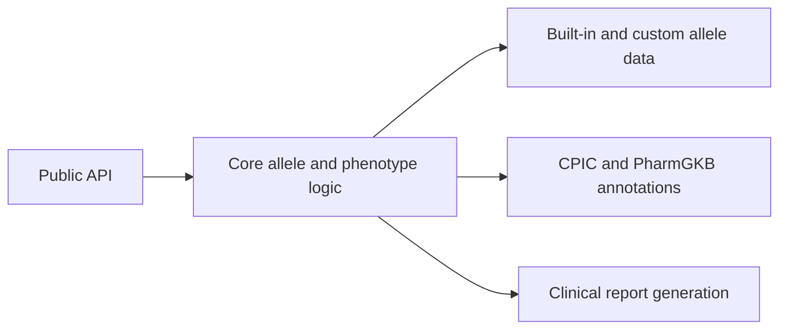

# Architecture: Pharmacogenomics



## Layer cake

1. **Public API**: `predict_metabolizer()` plus the functions of each submodule
   (`call_star_alleles`, `classify_phenotype`, CPIC helpers, ...), imported from the module
   that defines them
2. **Core logic** (`alleles/`): star-allele matching, diplotype scoring, phenotype assignment
3. **Front end** (`metabolism/`): string and dict interface over the core logic, plus dose adjustment
4. **Allele data**: Python-literal star-allele and activity tables, plus a custom file loader
5. **Annotations**: CPIC guidelines, PharmGKB, drug labeling (bundled, with file loaders)
6. **Clinical layer**: report generation, drug-gene and drug-drug analysis, ACMG classification

## Key design decisions

- **Synchronous by default**: calls are plain Python on small dictionaries and sets and return
  immediately; cohort parallelism is a map over samples with `parallel.thread_map` or a
  `ThreadPoolExecutor`.
- **Deterministic results**: allele calling tries the definition with the most defining variants
  first, ties keep definition order, and the result is sorted by allele name; nothing in the
  package draws random numbers or depends on set iteration order. A test runs complete analyses
  under different `PYTHONHASHSEED` values and requires identical output.
- **One allele table, one phenotype implementation**: `alleles.diplotype._ACTIVITY_SCORE_TABLES`
  holds every allele value, `alleles.phenotype` holds every phenotype definition, and
  `metabolism.metabolizer_status` copies the former and delegates to the latter, so
  `predict_metabolizer` and `classify_phenotype` cannot disagree.
- **Phenotypes as CPIC defines them**: genes CPIC defines by activity score use score bands;
  CYP2C19, SLCO1B1 and UGT1A1 use pairs of allele functions (see
  [Phenotype definitions](SPEC.md#phenotype-definitions)).
- **No hidden global state**: custom allele definitions, scoring tables, guidelines and
  interaction databases are passed to the functions as arguments; they never replace the built-in
  data process-wide.
- **Bundled data, no network**: the module downloads and caches nothing. The built-in CPIC
  guidelines (9) and PharmGKB annotations are Python literals; newer data load from a file you
  provide.

## Call flow

```
user code
  ↓
call_star_alleles(variants, gene)            ← subset-matching engine
  → list[StarAllele]
  ↓
determine_diplotype(a1, a2, gene)            ← sums the two alleles' values from the allele table
  → Diplotype (with activity_score)
  ↓
classify_phenotype(diplotype, gene)          ← score bands, or allele-function pairs for
  → dict with a MetabolizerPhenotype           CYP2C19, SLCO1B1 and UGT1A1
  ↓
(optional) get_dosing_recommendation(...)    ← CPIC lookup
  → recommendation dict
```

`predict_metabolizer(genotype, gene)` is the front end for the middle steps: it takes the
diplotype from a dict (`{"diplotype": "*1/*4"}`) and returns the same phenotype as a lowercase
token, with the activity score and the bands it used. `generate_clinical_report` runs the
classification and the CPIC lookup for every gene in one call.

## File layout

```
src/metainformant/pharmacogenomics/
  alleles/
    star_allele.py        ← subset-matching engine, definition loading, CYP2D6 copy number
    diplotype.py          ← diplotype scoring; _ACTIVITY_SCORE_TABLES (the allele values)
    phenotype.py          ← score bands, allele-function rules, MetabolizerPhenotype
  metabolism/
    metabolizer_status.py ← dict front end, allele-table copy, dose adjustment
  annotations/
    cpic.py               ← bundled guidelines, file loader, drug-gene lookup
    pharmgkb.py           ← bundled annotations, TSV parser, query functions
    drug_labels.py        ← FDA label parsing and biomarker extraction
  clinical/
    pathogenicity.py      ← ACMG classification of PGx variants
    drug_interaction.py   ← drug-gene analysis, alternatives, polypharmacy assessment
    reporting.py          ← text/JSON/HTML report builder
  interaction/
    drug_interactions.py  ← drug-drug interactions based on CYP inhibition
  visualization/
    plots.py              ← matplotlib plots
```

## Thread / process safety

The allele tables, guidelines and annotation sets are module-level literals built at import
time, and the functions only read them (`default_allele_function_table()` returns a copy). There
is nothing to pre-warm or load before creating a process pool; map a per-sample function with
`parallel.thread_map`, or with `parallel.process_map` and a top-level function. A definition
list loaded with `load_allele_definitions(gene)` can be passed to `call_star_alleles` for every
sample so the file is read once.

## Extensibility hooks

| Hook | Purpose | How to use |
|------|---------|------------|
| Custom allele file | Add or replace star-allele definitions | `load_allele_definitions(gene='XYZ', filepath='~/xyz.json')`, passed as `allele_definitions=` |
| CPIC guidelines | Use newer or additional guidelines | `load_cpic_guidelines(filepath='cpic_2025.json')`, passed as `guidelines=` |
| Activity scoring | Non-standard allele values | `determine_diplotype(..., scoring_table=...)`, `predict_metabolizer(..., activity_scores=...)` |
| Phenotype bands | New gene or revised CPIC definition | edit `_PHENOTYPE_THRESHOLDS` in `alleles/phenotype.py` (see [AGENTS.md](AGENTS.md)); there is no runtime override argument |

## Testing strategy

Tests in `tests/pharmacogenomics/` use real implementations with small deterministic data:
- Allele matching and definition loading (empty set, overlapping definitions, the `source` and
  `filepath` contract, genes without calling definitions)
- Phenotype classification checked against CPIC diplotype tables written out in the test, band
  tiling, and agreement of `predict_metabolizer` with `classify_phenotype` for every diplotype
- CPIC guideline lookup, PharmGKB queries, ACMG classification
- Report generation: genotype results, recommendations, actions and the exported text/HTML/JSON
- Randomness audit and `PYTHONHASHSEED` independence of complete analyses

No network calls are made.

## Performance profile

Per-sample calls are plain Python on small dictionaries and sets, and the per-sample cost does
not grow with cohort size. See [PERFORMANCE.md](PERFORMANCE.md) for scaling notes.

## Known limitations

- CYP2D6 copy number is not inferred from variants: pass it to `handle_cyp2d6_cnv`. Everything
  else treats the gene as diploid.
- A variant outside every allele definition is ignored: it adds neither a match score nor a
  penalty (use `detect_novel_alleles` to list such variants).
- UGT1A1 and CYP1A2 have activity values but no calling definitions.
- Phenotype APIs raise `ValueError` for a gene without its own supported definition. CYP1A2 values permit scoring only and still need primary-source qualification.
