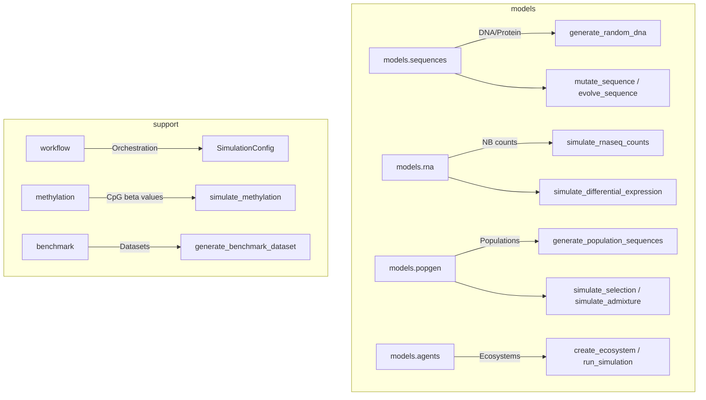

### Simulation Module

The `metainformant.simulation` module provides synthetic data generators for biological
sequences, RNA-seq count data, population genetics scenarios, and agent-based ecosystem
models. It also includes workflow orchestration, methylation simulation, and benchmark
dataset generation. The package has no plotting module of its own: plot simulation
results with `metainformant.visualization` (see
[visualization of simulation results](../visualization/simulation.md)).

---

## Architecture



---

## Submodules

| Submodule              | Description                                                           |
|------------------------|-----------------------------------------------------------------------|
| `models.sequences`     | Random DNA/protein generation, mutation, evolution, gene duplication   |
| `models.rna`           | Negative binomial RNA-seq counts, differential expression, scRNA-seq  |
| `models.popgen`        | Population genetics: bottlenecks, expansion, selection, admixture     |
| `models.agents`        | Agent-based ecosystem modeling with typed agents on grid environments  |
| `workflow`             | Pipeline configuration, execution, calibration, and validation        |
| `methylation`          | Simulated CpG methylation datasets with ground-truth DMRs             |
| `benchmark`            | Synthetic benchmark datasets for method evaluation                    |

---

## Quick Start

### Sequence Simulation

```python
from metainformant.simulation.models.sequences import generate_random_dna, mutate_sequence, evolve_sequence

# Generate a random DNA sequence with 60% GC content
seq = generate_random_dna(500, gc_content=0.6)

# Introduce 10 point mutations
mutated = mutate_sequence(seq, n_mut=10)

# Evolve over 1000 generations
evolved = evolve_sequence(seq, generations=1000, mutation_rate=0.001)
```

### RNA-seq Count Simulation

```python
from metainformant.simulation.models.rna import simulate_rnaseq_counts, simulate_differential_expression
import numpy as np

# Simple count matrix (10 samples x 1000 genes)
counts = simulate_rnaseq_counts(n_genes=1000, n_samples=10)

# Differential expression between two conditions. Each fold change is a signed ratio
# applied to the group-1 mean of one of the first len(fold_changes) features:
# positive values multiply it (2.0 doubles, 0.5 halves) and negative values divide it
# by their magnitude (-4.0 gives about 0.25x)
fold_changes = np.array([2.0, 3.0, 0.5, -4.0])
expression, labels = simulate_differential_expression(
    n_samples=20, n_features=5000, fold_changes=fold_changes,
)
# expression has shape (20, 5000); labels holds the 0/1 condition of each sample
```

A negative fold change needs a magnitude of at least 1, and `fold_changes` must be an
`np.ndarray` of finite values with fewer entries than `n_features`; breaking these rules
raises `metainformant.core.utils.errors.ValidationError`. See
[RNA Count Simulation](rna_counts.md#differential-expression) for the full list of errors.

### Population Genetics

```python
import numpy as np
from metainformant.simulation.models.popgen import (
    generate_population_sequences,
    generate_genotype_matrix,
    simulate_bottleneck_population,
    simulate_selection,
)

# Generate a population of 50 sequences with neutral variation
pop_seqs = generate_population_sequences(n_sequences=50, length=1000, theta=0.01)

# Simulate a population bottleneck
bottleneck_seqs = simulate_bottleneck_population(
    n_sequences=100, sequence_length=500, bottleneck_size=10,
)

# Simulate natural selection on a genotype matrix (individuals x sites)
genotypes = np.array(generate_genotype_matrix(n_individuals=100, n_sites=20))
fitness_effects = np.tile([0.0, 0.5, 1.0], (20, 1))  # fitness effect of genotypes 0, 1, 2 at each site
selected = simulate_selection(genotypes, fitness_effects, generations=50, selection_strength=0.1)
final_frequencies = selected["allele_frequencies"][-1]  # one frequency per site
```

See [Population Genetics Simulation](popgen.md) for every generator.

### Agent-Based Ecosystem Modeling

```python
from metainformant.simulation.models.agents import create_ecosystem, run_simulation, Agent

# Create an ecosystem with producer and consumer agents
eco = create_ecosystem(
    n_agents=50,
    agent_types=["producer", "consumer"],
    environment_size=(20, 20),
)

# Run simulation for 100 steps
snapshots = run_simulation(eco, n_steps=100)
```

### Workflow Orchestration

```python
from metainformant.simulation.workflow.workflow import (
    SimulationConfig,
    create_simulation_config,
    run_simulation_workflow,
    validate_simulation_output,
)

# Parameters are SimulationConfig fields (population_size, sequence_length, n_steps, ...)
config = create_simulation_config(
    simulation_type="sequence_evolution",
    parameters={"population_size": 20, "sequence_length": 200, "n_steps": 50, "random_seed": 1},
)
results = run_simulation_workflow(config)  # also writes <output_dir>/sequence_evolution_result.json

# Returns (is_valid, issues); the criteria dictionary says what to check
is_valid, issues = validate_simulation_output(
    results, {"required_fields": ["simulation_type", "final_population"]}
)
```

`simulation_type` is one of `sequence_evolution`, `population_genetics`, `rna_expression`,
`agent_ecosystem`, `predator_prey` and `competition`. `output_dir` defaults to
`output/simulation`.

---

## Key Classes

### `Agent`

Individual agent in an ecosystem. Has an `id`, `agent_type`, `position`, `energy`, `age`,
an `alive` flag, and a `properties` dictionary.

### `GridAgent` / `GridWorld`

Lightweight agent (`id`, `x`, `y`, `energy`) and 2D grid environment (`width`, `height`)
for spatial simulations.

### `Ecosystem`

Container for the agents of a simulation: `agents` keyed by id, the grid `size`, an
`environment` dictionary and a `time_step`. Agent types are plain strings; `run_simulation`
applies the rules for `producer`, `consumer` and `decomposer` agents, and
`simulate_predator_prey` and `simulate_competition` run the other two scenarios.

### `SimulationConfig`

Dataclass for configuring simulation workflows with parameters, output paths, and
execution settings.

---

## Reproducibility

The generators and simulators in `metainformant.simulation.models` accept an `rng`
parameter (`random.Random` instance) for deterministic results. Workflows take
`random_seed` in `SimulationConfig`, and `generate_benchmark_dataset` takes `seed`.

```python
import random
from metainformant.simulation.models.sequences import generate_random_dna

rng = random.Random(42)
seq1 = generate_random_dna(100, rng=rng)

rng = random.Random(42)
seq2 = generate_random_dna(100, rng=rng)

assert seq1 == seq2  # Identical with same seed
```

---

## See Also

- **[Sequence Simulation](sequences.md)** -- Detailed DNA/protein simulation docs
- **[RNA Count Simulation](rna_counts.md)** -- RNA-seq count generation
- **[Population Genetics Simulation](popgen.md)** -- Populations, genotypes, bottlenecks, expansions
- `metainformant.math` -- Population genetics theory (coalescent, drift)
