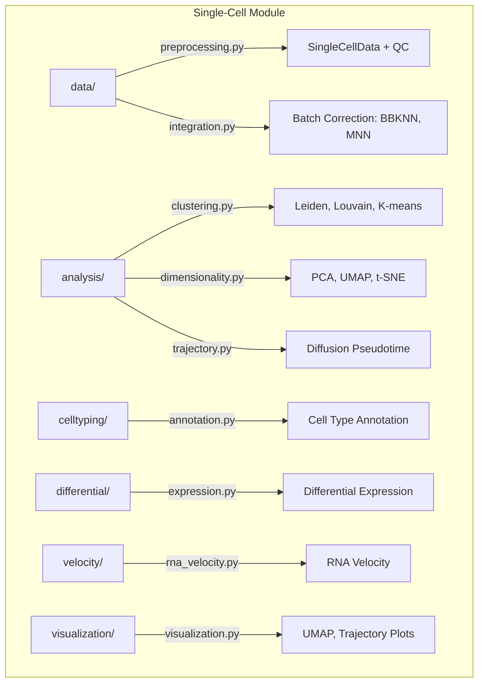

# SINGLECELL

## Overview
Single-cell analysis module for METAINFORMANT.

## Contents
- **[index.md](index.md)**: overview, conventions, quick start, dataset download and external tools
- **[preprocessing.md](preprocessing.md)**: `SingleCellData`, loading, QC, filtering, normalization, scaling
- **[dimensionality.md](dimensionality.md)**: highly variable genes, PCA, neighbor graph, UMAP, t-SNE, diffusion maps
- **[clustering.md](clustering.md)**: Leiden, Louvain, k-means, hierarchical clustering, markers, validation
- **[trajectory.md](trajectory.md)**: diffusion pseudotime and the simplified cluster-level methods
- **[visualization.md](visualization.md)**: plotting functions
- **[integration.md](integration.md)**, **[celltyping.md](celltyping.md)**, **[differential.md](differential.md)**, **[velocity.md](velocity.md)**: batch integration, annotation, differential expression, RNA velocity
- [src/metainformant/singlecell/__init__.py](../../src/metainformant/singlecell/__init__.py)

## Structure



## Usage
Import the container and the loader, then follow the topic pages above:
```python
from metainformant.singlecell.data.preprocessing import SingleCellData, load_count_matrix
```
