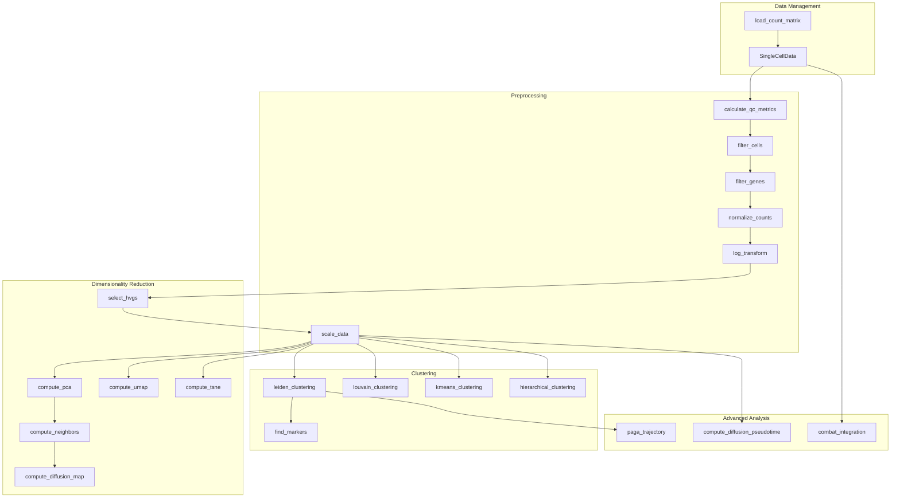

# Single-Cell Genomics

METAINFORMANT's single-cell genomics module provides comprehensive tools for analyzing single-cell RNA-sequencing (scRNA-seq) data. The module follows standard scRNA-seq analysis workflows while maintaining compatibility with popular formats and tools.

## Overview

The single-cell module is designed around a lightweight `SingleCellData` class that provides an AnnData-like interface for storing and manipulating single-cell data. It includes:

- **Data Structure**: `SingleCellData` class for managing expression matrices, cell/gene metadata
- **Preprocessing**: Loading, QC metrics, filtering, normalization, scaling
- **Dimensionality Reduction**: HVG selection, PCA, UMAP, t-SNE, diffusion maps
- **Clustering**: Leiden, Louvain, K-means, hierarchical clustering
- **Trajectory Analysis**: Diffusion pseudotime (the DPT algorithm of Haghverdi et al. 2016), an embedding-distance pseudotime, simplified cluster-level PAGA- and Slingshot-style functions, pseudotime grouping
- **Visualization**: QC plots, dimensionality reduction plots, marker expression plots (dot plot, heatmap, violin)
- **Integration**: Batch correction and dataset merging

## Architecture



The arrows show a typical order of steps, not enforced dependencies. In practice the functions read these inputs:

- `compute_neighbors` builds the neighbor graph (`data.uns["neighbors"]`) from the PCA coordinates (`data.obsm["X_pca"]`) when `compute_pca` has been run and from `data.X` otherwise.
- `compute_diffusion_map` and `compute_diffusion_pseudotime` both work on that graph. Each reuses `data.uns["neighbors"]` when it exists and otherwise builds a graph from `data.X` with its own `n_neighbors` argument; neither reads `data.obsm["X_pca"]` directly, and diffusion pseudotime does not read the diffusion map either.
- UMAP, t-SNE and the clustering functions are fitted on the expression matrix `data.X` itself, not on the stored PCA coordinates (t-SNE first reduces `data.X` to up to 50 internal principal components when there are more than 5000 cells).
- `paga_trajectory` needs a cluster column in `data.obs`.

## Key Features

### Data Structure
- **AnnData-like**: Same attribute layout as scanpy/AnnData (`X`, `obs`, `var`, `uns`, `obsm`, `varm`, `obsp`, `varp`, `layers`); H5AD files can be loaded, but there is no built-in export back to AnnData
- **Sparse matrix support**: Sparse input is accepted and CSV/TSV/Matrix Market files are loaded as CSR matrices; most analysis steps convert to dense arrays internally
- **Flexible metadata**: Store cell and gene annotations
- **Extensible**: Easy to add custom analysis results

### Preprocessing Pipeline
- **Quality control**: Calculate standard QC metrics (total counts, n_genes, mitochondrial/ribosomal percentages)
- **Flexible filtering**: Filter cells and genes based on various criteria
- **Multiple normalization methods**: Total count, median, median-of-ratios size factors
- **Log transformation**: `log(x + 1)` with a configurable base
- **Data scaling**: Z-score standardization with optional centering

### Dimensionality Reduction
- **HVG selection**: Four flavors (`seurat`, `cell_ranger`, `seurat_v3`, `variance`; `seurat_v3` expects raw counts); `select_hvgs` only flags genes in `data.var['highly_variable']` and does not subset the matrix
- **PCA**: Principal component analysis with explained variance (`data.uns['pca']`); all genes by default, or only the flagged HVGs with `use_hvgs=True`
- **UMAP**: Uniform Manifold Approximation and Projection (requires umap-learn)
- **t-SNE**: t-distributed Stochastic Neighbor Embedding
- **Diffusion maps**: For trajectory analysis
- **Neighbor graphs**: K-nearest neighbors for downstream analysis

### Clustering & Analysis
- **Graph-based clustering**: Leiden (requires `igraph` and `leidenalg`) and Louvain (requires `python-louvain`, which provides the `community` module) algorithms; both also need `networkx`. Without its packages `leiden_clustering` raises `ImportError` instead of substituting another algorithm; for plain matrices only, `allow_kmeans_fallback=True` opts into a warned k-means fallback
- **Centroid-based clustering**: K-means with a configurable number of random restarts (`n_init`)
- **Hierarchical clustering**: With various linkage methods
- **Marker gene identification**: Find genes that define clusters
- **Trajectory inference**: Pseudotime and lineage analysis

The clustering functions are fitted on the expression matrix `data.X` and store their labels in `data.obs` (`leiden_cluster`, `louvain_cluster`, `kmeans_cluster`, `hierarchical_cluster`).

## Conventions

- **Copies by default.** The functions that add results to a `SingleCellData` return a modified copy and leave their input untouched. `select_hvgs`, `compute_neighbors` and `compute_diffusion_map` take a keyword-only `inplace=False`; with `inplace=True` they write into the argument and return that same object. `SingleCellData.copy()`, `filter_cells` and `filter_genes` copy `uns` recursively, so nested entries are never shared between objects.
- **Seeds.** Where the module draws random numbers itself (subsets and subsamples), it takes a seed parameter (`random_state`) and uses a local generator, so it never reads or advances numpy's global random state. With the default `None` the draw differs on every call: the 1000-cell subset of `hierarchical_clustering`, the subsample of `compute_cluster_silhouette`, the subsample of `compute_dimensionality_metrics` (above 1000 cells) and the cell subsample of the `plot_marker_expression` heatmap. Functions that hand `random_state` to scikit-learn, umap-learn or leidenalg (PCA, k-means, t-SNE, UMAP, Leiden) leave the seeding to that library, so pass an integer when you need a reproducible result. `compute_diffusion_map` starts ARPACK from a fixed vector, so repeated calls give identical coordinates.
- **Errors.** Argument checks raise `ValidationError` (from `metainformant.core.utils.errors`, not a `ValueError` subclass); a few functions raise the built-in `ValueError` (for example `select_hvgs` for an unknown flavor and `normalize_counts` for an unknown method). Missing optional packages raise `ImportError`.

## Quick Start

```python-snippet
from metainformant.singlecell.data.preprocessing import (
    calculate_qc_metrics,
    filter_cells,
    filter_genes,
    load_count_matrix,
    log_transform,
    normalize_counts,
    scale_data,
)
from metainformant.singlecell.analysis.pca_methods import select_hvgs, compute_pca
from metainformant.singlecell.analysis.nonlinear_methods import compute_umap
from metainformant.singlecell.analysis.clustering import leiden_clustering

# Load data (a CSV with genes as rows and cells as columns, hence transpose=True)
data = load_count_matrix("counts.csv", format="csv", transpose=True)

# Quality control and filtering
data = calculate_qc_metrics(data)
data = filter_cells(data, min_genes=200, max_genes=5000, max_pct_mt=20)  # also refreshes the per-gene QC columns
data = filter_genes(data, min_cells=3)

# Normalization and HVG selection (on the log-normalized data, before scaling)
data = normalize_counts(data, target_sum=1e4, method='total_count')
data = log_transform(data, base=2)
data = select_hvgs(data, n_top_genes=2000)  # flags data.var['highly_variable']; does not subset genes

# Scaling and dimensionality reduction
data = scale_data(data)
data = compute_pca(data, n_components=50)   # stores data.obsm['X_pca']; all genes (use_hvgs=True restricts it to the flagged HVGs)
data = compute_umap(data, n_components=2)   # stores data.obsm['X_umap']

# Clustering (needs the optional networkx, igraph and leidenalg packages of the `singlecell` extra;
# raises ImportError without them)
data = leiden_clustering(data, resolution=0.5)  # labels in data.obs['leiden_cluster']
```

## File Format Support

- **CSV/TSV**: Standard comma or tab-separated files
- **Matrix Market**: Sparse matrix format (.mtx files), with gene and barcode names in separate text files
- **H5AD**: AnnData HDF5 files (requires anndata)
- **Compressed formats**: CSV/TSV and Matrix Market files with a `.gz` extension are read directly

## Integration with Other Tools

The module reads common single-cell file formats and writes its results back onto the `SingleCellData` object:
- **Input**: `load_count_matrix` reads H5AD, CSV/TSV and Matrix Market files; Matrix Market files are read as genes × cells (the 10x layout) with one-column gene and barcode name files
- **Output**: `SingleCellData.to_df()` returns the expression matrix as a pandas DataFrame; there is no built-in export to scanpy/AnnData or Seurat formats
- **Visualization**: Plotting functions live in `metainformant.singlecell.visualization.visualization` (matplotlib); see [visualization.md](./visualization.md)

## Module Structure

- **[data/preprocessing.py](./preprocessing.md)**: Data loading, QC, normalization, scaling
- **[analysis/pca_methods.py and analysis/nonlinear_methods.py](./dimensionality.md)**: HVG selection, PCA, UMAP, t-SNE, diffusion maps, neighbor graphs (`analysis/dimensionality.py` re-exports both)
- **[analysis/clustering.py](./clustering.md)**: Various clustering algorithms and marker identification
- **[analysis/trajectory.py](./trajectory.md)**: Pseudotime and trajectory inference
- **[visualization/visualization.py](./visualization.md)**: Plotting functions for scRNA-seq data
- **[data/integration.py](./integration.md)**: Batch correction and dataset integration
- **[celltyping/annotation.py](./celltyping.md)**, **[differential/expression.py](./differential.md)**, **[velocity/rna_velocity.py](./velocity.md)**: Cell type annotation, differential expression, RNA velocity
- **io.py**: Dataset download and external tools (see below)

## Dataset Download and External Tools

`metainformant.singlecell.io` downloads data and wraps two command-line tools:

- `download_geo_supplementary(accession, output_dir)` (wget), `download_sra_fastqs(accession, output_dir, threads=1)` (fasterq-dump, then pigz or gzip) and `fetch_atlas_datasets(datasets, output_base)`, which fetches the GEO supplementary files of the named atlas datasets (unknown names are skipped with a warning; an ArrayExpress accession such as `Li-2022` only gets its directory created).
- `run_salmon_alevin(fastq_r1, fastq_r2, index_dir, tg_map, output_dir, threads=1)` runs `salmon alevin` with the 10x Chromium v3 setting.

Nine more helpers exist as names but are **not implemented**. They raise `NotImplementedError` with a message that names the function and a way forward, and they create nothing at the requested output path, because an empty file or directory there would be mistaken for a real result by the next pipeline step:

| Helper | Stands for | Use instead |
|--------|-----------|-------------|
| `run_seurat_integration` | Seurat integration | Seurat in R, or `metainformant.singlecell.data.integration` |
| `run_differential_expression` | Seurat differential expression | `FindMarkers` in R, or `metainformant.singlecell.differential.expression` |
| `run_scenic_grnboost2` | `pyscenic grn` | run `pyscenic grn` yourself |
| `run_scenic_cistarget` | `pyscenic ctx` | run `pyscenic ctx` yourself |
| `run_scenic_aucell` | `pyscenic aucell` | run `pyscenic aucell` yourself |
| `filter_regulons_post_scenic` | a post-SCENIC regulon filter | filter the regulon table yourself (for example with pandas) |
| `run_pseudotime_trajectory` | Monocle3 | Monocle3 in R, or `metainformant.singlecell.analysis.trajectory` |
| `run_go_enrichment` | clusterProfiler | clusterProfiler in R, or `metainformant.ontology.core.go.enrich_genes` |
| `run_shinycell_export` | ShinyCell | the ShinyCell R package |

## Dependencies

### Required
- `numpy`: Numerical computations
- `pandas`: Data manipulation
- `scipy`: Statistical functions and sparse matrices
- `scikit-learn`: PCA, K-means, t-SNE and neighbor graphs

### Optional
- `anndata`: For reading H5AD files
- `umap-learn`: For UMAP dimensionality reduction
- `igraph` and `leidenalg`: For Leiden clustering (with `networkx`); the `singlecell` extra installs `leidenalg`, which brings `igraph`
- `python-louvain`: For Louvain clustering (with `networkx`); it provides the `community` module the code imports, and the `singlecell` extra installs it
- `matplotlib`: For visualization

## Performance Considerations

- **Memory efficiency**: CSV/TSV/Matrix Market data is loaded as a sparse CSR matrix and filtering keeps it sparse, but QC metrics, normalization, scaling, HVG selection, PCA and clustering work on dense arrays
- **Scalability**: Leiden and Louvain clustering build a dense cells × cells distance matrix, so memory grows quadratically with the number of cells; hierarchical clustering fits a random subset of 1000 cells when there are more cells than that and assigns the rest by nearest neighbor

## Best Practices

1. **Quality control first**: Always examine QC metrics before filtering
2. **Appropriate filtering**: Be conservative with filtering thresholds initially
3. **Normalization strategy**: Consider your downstream analysis when choosing normalization
4. **HVG selection**: `select_hvgs` only flags genes (`data.var['highly_variable']`); `compute_pca` uses just those genes when you pass `use_hvgs=True`, the neighbor graph (and the diffusion map on it) is built from the PCA coordinates when they exist and so inherits the PCA's gene choice, and the other downstream functions use every gene unless you subset the data yourself
5. **Parameter tuning**: Clustering and UMAP parameters may need optimization per dataset

## Examples and Tutorials

For detailed examples and analysis workflows, see:
- `tests/singlecell/test_singlecell_preprocessing.py`: Example preprocessing workflows
- `tests/singlecell/test_singlecell_dimensionality.py`: Dimensionality reduction examples

## Related Documentation

- [Quality Control](../quality/index.md): For raw sequencing data QC
- [DNA Sequences](../dna/sequences.md): For sequence-based analysis
- [Visualization](../visualization/index.md): For general plotting utilities
- [Core I/O](../core/io.md): For file handling utilities
