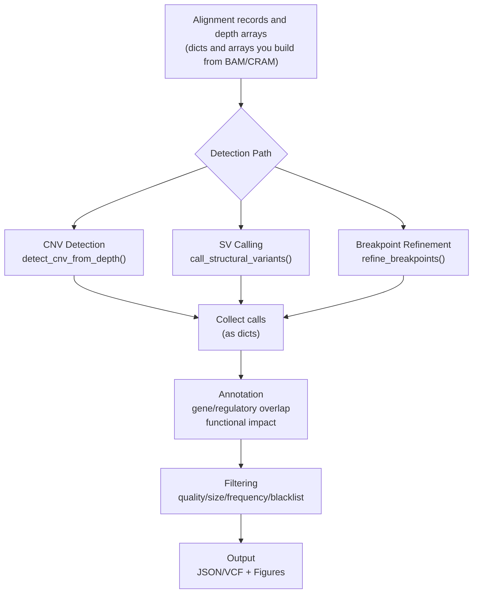

# Structural Variants Module Architecture

Comprehensive overview of the structural variant analysis module, including component responsibilities, data flow patterns, integration points, and design rationale.

## Table of Contents

1. [Module Overview](#1-module-overview)
2. [Directory Structure](#2-directory-structure)
3. [Component Responsibilities](#3-component-responsibilities)
4. [Data Flow](#4-data-flow)
5. [Key Data Structures](#5-key-data-structures)
6. [Integration Points](#6-integration-points)
7. [Design Patterns & Rationale](#7-design-patterns--rationale)
8. [Algorithm Details](#8-algorithm-details)
9. [Configuration Architecture](#9-configuration-architecture)
10. [Extensibility](#10-extensibility)
11. [Performance Characteristics](#11-performance-characteristics)
12. [Design Decisions & Trade-offs](#12-design-decisions--trade-offs)
13. [Testing Philosophy](#13-testing-philosophy)
14. [Related Documentation](#14-related-documentation)

---

## 1. Module Overview

The `structural_variants` module provides analysis of genomic structural variants (SVs) from alignment records and read-depth arrays. It works on in-memory Python structures (alignment dicts, depth arrays, variant dicts); reading BAM or BED files is left to the caller (only `survivor_merge()` reads VCF paths itself), and the `plot_*` functions write figure files. It covers five functional domains:

| Domain | Capabilities | Primary Entry Points |
|--------|-------------|---------------------|
| **Detection** | CNV (CBS), SV (split/discordant reads), breakpoint refinement | `cnv.detect_cnv_from_depth()`, `sv_calling.call_structural_variants()`, `breakpoints.refine_breakpoints()` |
| **Annotation** | Gene/regulatory overlap, functional impact, dosage sensitivity, TAD disruption | `overlap.annotate_gene_overlap()`, `functional_impact.predict_functional_impact()` |
| **Filtering** | Quality/size/frequency filters, blacklist removal, multi-caller merging | `quality_filter.filter_by_quality()`, `merge.merge_callsets()` |
| **Population** | Cohort genotyping, allele freq, association, PCA, LD | `sv_population.genotype_sv_population()`, `sv_allele_frequency()`, `sv_association_test()` |
| **Visualization** | Circos plots, coverage tracks, size histograms | `plots.plot_circos()`, `plots.plot_coverage_track()` |

**SV types (`SVType`):** `DEL` (deletion), `DUP` (duplication), `INV` (inversion), `TRA` (translocation), `INS` (insertion), `BND` (breakend), `UNKNOWN` (evidence too weak to classify). **CNV states (`CNVSegment.state`):** `DEL`, `DUP`, `NEUTRAL`, `AMP` (amplification), `HOMODEL` (homozygous deletion).

---

## 2. Directory Structure

```
src/metainformant/structural_variants/
├── __init__.py                      # Public API: exports all submodules
├── AGENTS.md                        # Agent directives
│
├── detection/                       # SV detection algorithms
│   ├── __init__.py                  # Exports: cnv, sv_calling, breakpoints
│   ├── cnv.py                       # ~775 lines: CBS, CNV state assignment, log2 ratio
│   │   ├── CNVSegment (dataclass)
│   │   ├── CNVResult (dataclass)
│   │   ├── detect_cnv_from_depth()              # Main entry
│   │   ├── segment_coverage()                   # CBS core algorithm
│   │   ├── _cbs_best_arc(), _cbs_recursive(), _cbs_pvalue()   # Vectorised arc scan, recursion, Gumbel p-value
│   │   ├── call_cnv_states()                    # State classification
│   │   ├── calculate_log2_ratio()               # Tumor/normal ratio, optional GC correction
│   │   ├── merge_adjacent_segments()
│   │   └── _check_depths(), _assign_cnv_state(), _calculate_segment_confidence(), _gc_correct(), _gc_correct_py(), _center_on_median()
│   │
│   ├── sv_calling.py                # ~920 lines: split/discordant evidence
│   │   ├── SVType (enum: DEL, DUP, INV, TRA, INS, BND, UNKNOWN)
│   │   ├── StructuralVariant (dataclass)
│   │   ├── SVEvidence (dataclass)
│   │   ├── InsertSizeStats (dataclass)
│   │   ├── ReadIndex (class: reads by start position, for genotyping)
│   │   ├── call_structural_variants()           # Main entry
│   │   ├── detect_split_reads()                 # Soft-clip evidence
│   │   ├── detect_discordant_pairs()            # Insert size/orientation
│   │   ├── classify_sv_type()                   # Evidence → SVType
│   │   ├── genotype_sv()                        # 0/0, 0/1, 1/1 (./. without reads)
│   │   ├── _estimate_insert_size()
│   │   ├── _parse_cigar_clips(), _parse_cigar_string(), _parse_sa_tag()
│   │   └── _cluster_evidence(), _merge_evidence(), _calculate_sv_quality()
│   │
│   └── breakpoints.py               # ~750 lines: refinement, microhomology, strand, inserted sequence
│       ├── Breakpoint (dataclass)
│       ├── BreakpointPair (dataclass)
│       ├── refine_breakpoints()                # Consensus position, strand, microhomology, inserted sequence
│       ├── detect_microhomology()               # Junction sequence homology
│       ├── cluster_breakpoints()
│       ├── calculate_breakpoint_confidence()
│       ├── _ClipIndex (class: soft-clip junctions by reference position), _ClipHit (dataclass)
│       ├── _refine_breakpoint(), _majority_strand(), _junction_microhomology()
│       ├── _split_read_insertion(), _inserted_between_alignments()
│       ├── _cigar_ops(), _query_extent(), _parse_sa_alignments(), _parse_clips_from_cigar()
│       └── _first_present(), _consensus_position(), _position_std()
│
├── annotation/                      # Variant effect prediction
│   ├── __init__.py
│   ├── overlap.py                   # ~570 lines: interval overlap
│   │   ├── GenomicInterval (dataclass)
│   │   ├── OverlapResult (dataclass)
│   │   ├── IntervalIndex (class: max-end segment tree over sorted intervals)
│   │   ├── annotate_gene_overlap()             # Main gene overlap
│   │   ├── annotate_regulatory_overlap()       # Enhancers/promoters
│   │   ├── find_nearest_gene()
│   │   ├── calculate_overlap_fraction()
│   │   └── _normalize_intervals(), _compute_overlap_bp(), _classify_relationship()
│   │
│   └── functional_impact.py         # ~590 lines: impact prediction
│       ├── FunctionalImpact (dataclass)
│       ├── DosageSensitivity (dataclass)
│       ├── TADPrediction (dataclass)
│       ├── predict_functional_impact()         # Main entry (all-in-one)
│       ├── assess_dosage_sensitivity()         # HI/TS/pLI/LOEUF from DBs
│       ├── predict_tad_disruption()            # Boundary crossing
│       ├── score_pathogenicity()               # Composite [0,1] score
│       ├── _find_overlapping_genes()
│       ├── _count_coding_genes()
│       └── _classify_impact()                  # Impact level/type
│
├── filtering/                       # Quality control & merging
│   ├── __init__.py                  # Exports: quality_filter, merge
│   ├── quality_filter.py            # ~610 lines: filters
│   │   ├── FilterStats (dataclass)
│   │   ├── filter_by_quality()                # Qual/support/MAPQ/GQ
│   │   ├── filter_by_size()                   # Size range
│   │   ├── filter_by_frequency()              # Population AF
│   │   ├── apply_blacklist()                  # Known bad regions
│   │   └── _parse_population_db(), _build_population_lookup(), _lookup_population_frequency(), _as_position(), _as_frequency()
│   │
│   └── merge.py                     # ~790 lines: multi-caller consensus
│       ├── MergedVariant (dataclass)
│       ├── MergeStats (dataclass)
│       ├── merge_callsets()                   # Reciprocal overlap
│       ├── survivor_merge()                   # Distance-based
│       ├── calculate_reciprocal_overlap()
│       ├── deduplicate_variants()
│       ├── _union(), _find() (union-find)
│       ├── _median_position(), _majority_sv_type(), _call_quality(), _consensus_genotype()
│       └── _load_vcf_variants(), _parse_vcf_basic(), _pysam_first_genotype(), _vcf_sample_genotype(), _format_genotype()   # VCF input for survivor_merge
│
├── population/                      # Cohort-scale analysis
│   ├── __init__.py
│   └── sv_population.py             # ~860 lines: genotyping, stats, PCA
│       ├── genotype_sv_population()           # Genotype matrix
│       ├── sv_allele_frequency()              # AF, MAF, SFS, per-pop
│       ├── sv_association_test()              # Linear/logistic regression
│       ├── sv_population_structure()          # PCA
│       ├── sv_ld_analysis()                   # LD with SNPs
│       ├── merge_sv_callsets()                # Cross-sample merging
│       ├── _genotype_by_depth(), _genotype_by_split()
│       ├── _linear_regression(), _logistic_regression()
│       └── _should_merge(), _build_consensus(), _normal_cdf_np(), _total_variance()
│
└── visualization/                   # Plotting
    ├── __init__.py
    └── plots.py                     # ~930 lines: Circos, coverage, histograms
        ├── plot_circos()                      # Genome-wide chord diagram
        ├── plot_coverage_track()              # Read-depth track with SV overlay
        ├── plot_sv_size_distribution()
        ├── plot_sv_type_summary()
        ├── plot_breakpoint_detail()
        ├── plot_cnv_profile()                 # Genome-wide CNV segments
        ├── _draw_chord(), _draw_chromosome_arcs()
        ├── _pos_to_angle(), _chrom_sort_key(), _check_matplotlib()
        └── Color schemes: SV_COLORS, CNV_COLORS
```

**Total (~6,900 lines, ~235 KB):** 15 Python files implementing 42 public functions, 15 public dataclasses, 1 enum (`SVType`) and the `IntervalIndex` and `ReadIndex` classes.

---

## 3. Component Responsibilities

### 3.1 Detection Subpackage

**Purpose:** Convert alignment records (dicts built from a BAM) or depth arrays into preliminary SV calls.

#### `cnv.py`

| Function | Purpose | Input | Output |
|----------|---------|-------|--------|
| `detect_cnv_from_depth()` | Entry point for CNV detection | `dict[chrom, depth_array]` (per-bin depths, finite and non-negative, zeros allowed; each chromosome is divided by the median of its positive bins; a negative or non-finite value raises `ValueError`) | `dict[chrom, CNVResult]` |
| `segment_coverage()` | CBS algorithm | 1D array (log2 ratios); `min_width >= 1` | `list[(start, end, mean)]` |
| `call_cnv_states()` | Assign HOMODEL/DEL/NEUTRAL/DUP/AMP | segments or CNVSegments | `list[CNVSegment]` with `state`, `cn` |
| `calculate_log2_ratio()` | Normalize tumor vs normal depth | tumor_depth, normal_depth, GC | log2 ratio array |
| `merge_adjacent_segments()` | Fuse same-state neighbors | list of CNVSegment | merged list |

**Key Data:**

- **`CNVResult`**: Container per chromosome — `segments`, `log2_ratios`, `bin_size`, `method`, `parameters`.
- **`CNVSegment`**: Single CNV region — `chrom`, `start`, `end`, `mean_log2ratio`, `n_bins`, `state`, `cn`, `confidence` (0–1).

#### `sv_calling.py`

| Function | Purpose | Key Inputs | Key Outputs |
|----------|---------|------------|-------------|
| `call_structural_variants()` | Main SV detection | `alignments: list[dict]`, `min_support`, `insert_size_stats` | `list[StructuralVariant]` |
| `detect_split_reads()` | Soft-clip breakpoint evidence | `reads`, `min_clip=20` | `list[SVEvidence]` |
| `detect_discordant_pairs()` | Insert size/orientation anomalies | `pairs`, `insert_size_stats`, `n_std=4.0` | `list[SVEvidence]` |
| `classify_sv_type()` | Evidence → DEL/DUP/INV/TRA/INS, or UNKNOWN | `SVEvidence` | `SVType` enum |
| `genotype_sv()` | 0/0, 0/1, 1/1 | `StructuralVariant`, `reads` (a read list or a `ReadIndex`) | genotype string |

**Evidence gathering:**
- **Split-read**: CIGAR soft clips (`S` operation) + SA tag (supplementary alignments) → breakpoint pairs. A clipped read without an SA tag yields a single-position breakpoint.
- **Discordant pairs**: Abnormal insert size (> 4σ from mean) OR inter-chromosomal OR same-strand orientation OR reversed (RF) orientation.

**Clustering:** `_cluster_evidence()` sorts the evidence and puts each item into the first existing cluster (newest first) whose first item has the same chromosome pair and both breakpoints within 500 bp; otherwise it starts a new cluster. `_merge_evidence()` computes consensus breakpoints (median), the most common strands, and totals support.

**Calls:** A translocation (`TRA`) has no interval. Its `chrom`/`start` are the first breakpoint, its `chrom2`/`pos2` the second, `end` repeats `start` and `size` is 0. An insertion (`INS`) has `size` 0 ("not measured": split-read evidence does not measure the inserted length) and is exempt from `min_sv_size`, which filters DEL, DUP, INV and UNKNOWN calls on their breakpoint distance.

**Genotyping:** Compares supporting reads (split reads + discordant pairs) to reads that span a ±100 bp window around the variant start (`mapq` at least `min_mapq`, not among the evidence reads; a read spans `pos` to `pos + read_length`, with `read_length` defaulting to 150). Allele-fraction thresholds: <0.15 → `0/0`, 0.15–0.85 → `0/1`, ≥0.85 → `1/1`; `./.` when no read counts at all. `call_structural_variants()` builds one `ReadIndex` from the filtered reads: per chromosome, the reads sorted by start position plus the length of the longest read. A call then needs two binary searches and a pass over only the reads that start within one longest-read length before the window, instead of a pass over every read, and `genotype_sv()` returns the same genotype for an index as for the plain read list. It is called with its default `min_mapq=20`, whatever `min_mapq` the caller passed.

#### `breakpoints.py`

| Function | Purpose |
|----------|---------|
| `refine_breakpoints()` | Mode of the soft-clip positions within `window` of each approximate breakpoint, from the reads you pass in (a read is located by the reference coordinate of its soft clip, wherever its alignment starts, so a long alignment or a long deletion in its CIGAR does not hide it). The reads that clip at the mode are the supporting reads; per breakpoint they give `strand`, `microhomology` and `inserted_sequence` (see below) |
| `detect_microhomology()` | Mirror-match run of identical bases on both sides of the midpoint of a sequence (the NHEJ/MMEJ signature, estimated from read bases alone) |
| `cluster_breakpoints()` | Single-linkage nearby breakpoint grouping |
| `calculate_breakpoint_confidence()` | Support count + positional consistency + clip fraction + mean MAPQ |

**Breakpoint inputs:** the first breakpoint of a variant dict is `breakpoint1`, else `start`, on `chrom1` or `chrom`; the second is `breakpoint2`, else `pos2`, else `end`, on `chrom2` (absent, `None` or `""` means the first chromosome). `dataclasses.asdict()` of a `StructuralVariant` therefore works as is, translocations included. Read CIGARs may be strings or lists of `(op_code, length)` tuples.

**Supporting reads:** the reads that clip at a breakpoint's consensus position are its supporting reads, and each of the two breakpoints is analysed from its own set:

- `strand`: the majority `is_reverse` (`'-'` when more reads are reverse-complemented than not; `'+'` when no read reports it, or on a tie).
- `microhomology`: the longest `detect_microhomology()` result over the window of each read's `seq` (up to 50 bases each side) centred on that read's clip junction. It compares bases outwards from the junction, so it is a mirror-match heuristic on the read, not true microhomology, which needs the reference sequence.
- `inserted_sequence`: the bases of `seq` between the primary alignment and the read's single supplementary alignment (`sa_tag`), in the orientation of the stored `seq`. It is derived only when a supporting read has `seq`, `is_reverse`, `cigar` and a one-entry `sa_tag` whose alignment lies at the other breakpoint, and both CIGARs account for the whole `seq`; otherwise it is empty.

---

### 3.2 Annotation Subpackage

#### `overlap.py`

| Function | Purpose |
|----------|---------|
| `annotate_gene_overlap()` | Overlap SVs with gene annotations (dicts with `chrom`, `start`, `end`, `name`, or `GenomicInterval` objects) |
| `annotate_regulatory_overlap()` | Overlap with enhancers/promoters/CTCF |
| `find_nearest_gene()` | Nearest gene within `max_distance` |
| `IntervalIndex` | Max-end segment tree over sorted intervals (`query_overlap`, `query_nearest`) |

**`IntervalIndex` design:** Build once from a `GenomicInterval` list. It groups the intervals by chromosome, sorts each group by `(start, end)` and builds, on that order, a segment tree of the maximum interval end over ranges of intervals, plus the running maximum of the ends with the interval that reaches it. `query_overlap(chrom, start, end)` takes the prefix of intervals with `start < end` by binary search, then descends only into tree nodes that cover part of that prefix and hold an end beyond the query start. It returns every interval with `interval.start < end and interval.end > start`, sorted by `(start, end)`, in `O(k log n)` time for `k` hits, however long the intervals are and wherever on the chromosome the query falls. `query_nearest(chrom, position, max_distance)` returns an interval that spans the position at distance 0 (the one that starts last when several do); otherwise it compares the interval with the smallest start at or after the position with the interval whose end is largest before it (the running maximum), and the former wins a tie. `annotate_gene_overlap()` builds a new index on every call.

#### `functional_impact.py`

| Function | Purpose |
|----------|---------|
| `predict_functional_impact()` | Unified impact assessment orchestrator |
| `assess_dosage_sensitivity()` | Look up HI/TS/pLI/LOEUF scores |
| `predict_tad_disruption()` | Check SV breakpoints vs TAD boundary midpoints |
| `score_pathogenicity()` | Weighted evidence model → [0,1] |

**Impact classification hierarchy:**
1. **HIGH**: Dosage-sensitive gene hit (HI gene for DEL/HOMODEL, TS gene for DUP) OR gene-disrupting DEL/HOMODEL OR TRA overlapping a gene (fusion candidate).
2. **MODERATE**: DUP, INV or INS involving genes, or TAD disruption.
3. **LOW**: Large (>100 kb) intergenic, or intergenic >10 kb.
4. **MODIFIER**: Small benign-appearing variants.

`predict_functional_impact()` hands all four databases (`haploinsufficiency_db`, `triplosensitivity_db`, `pli_db`, `loeuf_db`, each optional) to `assess_dosage_sensitivity()`. An overlapped gene is dosage-sensitive when it is haploinsufficient and the variant is a DEL or HOMODEL, or triplosensitive and the variant is a DUP, so a duplication over a triplosensitive gene is `HIGH` / `dosage_gain`. Without a database no gene is marked, and a duplication over genes is `MODERATE` / `gene_duplication`.

**Pathogenicity scoring weights:**
- Coding genes (0.15 each, capped at 1) plus dosage-sensitive genes (0.3 each): 30%
- Size (sigmoid, midpoint 100 kb): 15%
- TAD disruption: 10%
- SV type (HOMODEL 0.9 > TRA/BND 0.8 > DEL 0.7 > AMP 0.6 > DUP 0.5 > INV 0.4 > INS/UNKNOWN 0.3): 15%
- Impact level (HIGH > MODERATE > LOW > MODIFIER): 15%
- Population frequency (rare = higher score, used only when `population_frequency` is supplied to `score_pathogenicity()`; otherwise it scores the maximum): 15%

---

### 3.3 Filtering Subpackage

#### `quality_filter.py`

| Function | Filters | Key Parameters |
|----------|---------|---------------|
| `filter_by_quality()` | Quality score, support count, MAPQ, GQ | `min_qual`, `min_support`, `min_mapq`, `min_gq` |
| `filter_by_size()` | Size min/max (TRA/BND always kept, and so are INS with no positive `size`) | `min_size`, `max_size` |
| `filter_by_frequency()` | Population AF (gnomAD, 1000G) | `max_af`, `match_window`, `min_reciprocal_overlap` |
| `apply_blacklist()` | Remove variants overlapping blacklisted regions | `blacklist_regions`, `min_overlap_fraction` |

All return `(filtered_variants, FilterStats)`. The databases (population frequencies, blacklist regions) are passed in as Python objects; the module reads no reference files.

**Frequency matching:** A database entry matches when it lies within `match_window` (±200 bp by default) of the variant and the reciprocal overlap reaches `min_reciprocal_overlap` in both directions. The window is a pre-filter: with the default 0.5, the overlap test decides, and the window only matters when `min_reciprocal_overlap` is 0. The database is read as a dict `{"chrom:start-end[-svtype]": af}` or a list of dicts with `chrom`, `start`, `end`, `af` (or `allele_frequency`) and optionally `sv_type`, with `af` in [0, 1]. A non-empty database none of whose entries can be read raises `ValueError` naming the supported layouts, because the filter would otherwise pass every variant without comparing it to anything; unreadable entries of a database that is otherwise usable are skipped and counted in a logged warning. A zero-length call (`start == end`, such as a translocation) has a reciprocal overlap of 0 with every entry, so it matches none unless `min_reciprocal_overlap` is 0.

**Blacklist overlap:** A variant is removed when its overlap with a region exceeds `min_overlap_fraction` of the variant. A zero-length variant (`start == end`, such as an insertion point) has no bases to overlap: strictly inside a region it counts as fully overlapping (fraction 1.0), and on a region's edge or outside it does not overlap, like an interval that only abuts the region.

#### `merge.py`

| Function | Method | Description |
|----------|--------|-------------|
| `merge_callsets()` | Reciprocal overlap | Union-find over variant pairs from different callers whose `reciprocal_overlap ≥ min_overlap` (same type when `type_match`). Clusters → consensus position (median), consensus type (majority vote), genotype (majority vote; a tie goes to the genotype seen first), `consensus_quality` = mean call quality + `100 · log10(n_callers + 1)`. |
| `survivor_merge()` | Distance-based | SURVIVOR approach: merge if both breakpoints are within `max_distance`; keeps clusters seen by at least `min_callers` callers. Accepts VCF paths or lists of variant dicts. Genotype: majority vote among the non-missing genotypes (allele order ignored), a tie going to the larger summed call quality and then to the genotype that sorts first. `consensus_quality` = mean call quality + `10 · n_callers · log10(n_callers + 1)`; calls of quality 80 and 40 from two callers give 69.54. |

`MergedVariant.caller_names` is sorted. The merge functions read `chrom`, `start` and `end` only and ignore `chrom2` and `pos2`: `survivor_merge()` joins translocations whose first breakpoints are close whatever their partner, and `merge_callsets()` and `deduplicate_variants()` give a zero-length call a reciprocal overlap of 0, so with a threshold above 0 they never join or collapse translocations.

**Reciprocal overlap:** `min(overlap_len/variant1_len, overlap_len/variant2_len)` over the variants' `[start, end)` intervals; variants on different chromosomes score 0.

---

### 3.4 Population Subpackage

| Function | Purpose | Returns |
|----------|---------|---------|
| `genotype_sv_population()` | Genotype known SVs across samples from per-sample evidence stored in each call (`samples[sample]` with `depth_ratio`, `split_reads`, `discordant_pairs`) | `genotype_matrix`, `quality_scores`, `allele_frequencies` |
| `sv_allele_frequency()` | AF, MAF, SFS, optionally per-population | Dict with `frequencies`, `maf`, `n_polymorphic`, `sfs`, `population_frequencies` |
| `sv_association_test()` | Linear (continuous) or logistic (binary) regression | `beta`, `se`, `p_value`, `odds_ratio` (binary only), `n_samples` |
| `sv_population_structure()` | PCA from genotype matrix | `pcs`, `eigenvalues`, `variance_explained` (each component's eigenvalue over the sum of all eigenvalues, so the returned values sum to 1 only when every component is returned), `loadings` |
| `sv_ld_analysis()` | LD (r²) between SV and SNP genotypes | `ld_matrix`, `tag_snps`, `max_r2_per_sv` |
| `merge_sv_callsets()` | Combine calls across samples into unified reference | list of merged dicts (`n_samples`, `samples`, `support_count`, `merged_calls`) |

**Genotyping methods:**
- **`depth`**: Uses the observed/expected depth ratio (a linear ratio, not log2). For DEL: ratio <0.25 → 1/1, <0.75 → 0/1, otherwise 0/0. For DUP: ratio >1.75 → 1/1, >1.25 → 0/1, otherwise 0/0. Other types call 0/1 when the ratio is <0.5.
- **`split`**: Uses the fraction `(split_reads + discordant_pairs) / total_reads` (`total_reads` defaults to 30): ≥0.85 → 1/1, ≥0.15 → 0/1, otherwise 0/0.

---

### 3.5 Visualization Subpackage

| Function | Plot Type | Output |
|----------|-----------|--------|
| `plot_circos()` | Circular genome layout with SV chords from `chrom:start` to `chrom2:pos2` (translocations) or `chrom:end` (other calls) | Saved to `output_path` (format from the extension), returns `Figure` |
| `plot_coverage_track()` | Read depth per bin (not log2 ratios) + SV overlay | Same |
| `plot_sv_size_distribution()` | Histogram by SV type | Same |
| `plot_sv_type_summary()` | Bar chart and pie chart of SV type counts | Same |
| `plot_breakpoint_detail()` | Three panels over `[start - flanking, end + flanking]`: read pileup (first 100 reads), coverage, split/discordant evidence | Same |
| `plot_cnv_profile()` | Genome-wide CNV segments | Same |

**Color scheme:** `SV_COLORS`: DEL(#E74C3C red), DUP(#3498DB blue), INV(#2ECC71 green), TRA and BND(#9B59B6 purple), INS(#F39C12 orange), plus UNKNOWN, NEUTRAL, AMP and HOMODEL entries; `CNV_COLORS` covers the five CNV states.

---

## 4. Data Flow

### 4.1 End-to-End: Single-Sample SV Discovery



**Detailed sequence:**

1. **CNV Detection** (optional but recommended):
   - Input: read depth per window (1000 bp default) per chromosome, as finite non-negative values (a negative or non-finite value raises `ValueError`)
   - Each chromosome is normalized to its own median and converted to log2 ratios; for tumor vs normal, form the ratio with `calculate_log2_ratio()` first and pass `2**ratio` as depth
   - CBS segmentation → segments with constant mean log2
   - State calling (DEL/DUP/NEUTRAL/AMP/HOMODEL) via thresholds
   - Output: `CNVResult` per chromosome with `CNVSegment` list

2. **SV Calling**:
   - Parse CIGAR strings (soft-clip detection) and SA tags
   - Detect discordant pairs (abnormal insert size/orientation/chromosome)
   - Cluster evidence by genomic proximity (≤500 bp)
   - Merge cluster evidence (median breakpoints, total support)
   - Classify SV type from strand patterns and distance
   - Build a translocation (`TRA`) from the two breakpoints on their own chromosomes (`chrom`/`start` and `chrom2`/`pos2`, `end == start`, `size` 0); an insertion (`INS`) gets `size` 0 and is exempt from `min_sv_size`
   - Genotype via allele fraction from supporting vs reference reads, with one shared `ReadIndex`
   - Output: `list[StructuralVariant]`

3. **Breakpoint Refinement** (optional, post-processing):
   - For each SV, use the reads you pass in (typically those within a 200–500 bp window of each breakpoint)
   - Collect the soft-clip positions within `window` of each breakpoint, locating each read by its clip and not by its alignment start
   - Mode (most frequent position) as consensus; the reads that clip there are the supporting reads
   - Derive `strand`, `microhomology` and `inserted_sequence` for both breakpoints from their own supporting reads (see 3.1)
   - Output: `list[BreakpointPair]` with `Breakpoint` objects

4. **Annotation**:
   - Build an `IntervalIndex` from gene/regulatory entries (parse BED/GTF yourself into dicts or `GenomicInterval`)
   - `query_overlap()` per variant → `OverlapResult` list
   - Dosage sensitivity lookup (HI/TS/pLI/LOEUF databases, each optional, through `predict_functional_impact()` or one gene at a time through `assess_dosage_sensitivity()`)
   - TAD boundary proximity check (within 10 kb window; a translocation is tested at its first breakpoint only)
   - Composite pathogenicity score (6 evidence lines)
   - Output: `FunctionalImpact` per variant

5. **Filtering**:
   - Quality: `quality ≥ 20`, `support ≥ 3` by default; mean MAPQ and genotype quality are optional (`min_mapq`, `min_gq`, off by default)
   - Size: `size ≥ 50 bp` by default, with an optional `max_size` (TRA/BND exempt from size)
   - Frequency: Remove variants with AF above `max_af` (1% by default) in the population database you supply
   - Blacklist: Remove overlaps with the blacklist regions you supply (for example the ENCODE blacklist or segmental duplications)
   - Output: Filtered variant list

6. **Multi-Caller Merge** (if multiple callers):
   - Tag each variant with caller name
   - Reciprocal overlap graph → connected components = consensus clusters (two variants from the same caller are never compared directly, but a call from another caller can bridge them into one cluster)
   - Consensus position = median start/end; consensus type = majority vote
   - Consensus quality increases with `n_callers`
   - Output: `list[MergedVariant]`

7. **Population Analysis** (cohort):
   - Genotype each SV per sample from the per-sample evidence in the calls (depth or split-read method)
   - Build an `n_SVs × n_samples` genotype matrix (0, 1 or 2 alternate alleles)
   - Compute AF, MAF, SFS, per-population stratification
   - Association testing (linear or logistic regression with covariates)
   - PCA for population structure
   - Output: Dict of statistics

8. **Visualization**:
   - Circos: chords connecting breakpoints across the chromosomes you pass in, colored by type
   - Coverage: CNV log2 ratio track with SV rectangles overlay
   - Histograms: size distribution per SV type
   - Output: PNG/PDF files

---

## 5. Key Data Structures

### Core Dataclasses

All major types are `@dataclass` for clarity and type safety:

```python
@dataclass
class CNVSegment:
    chrom: str
    start: int                      # 0-based inclusive
    end: int                        # 0-based exclusive
    mean_log2ratio: float
    n_bins: int
    state: str = "NEUTRAL"          # DEL/DUP/NEUTRAL/AMP/HOMODEL
    cn: int = 2                     # integer copy number
    confidence: float = 0.0         # [0, 1]

@dataclass
class StructuralVariant:
    chrom: str
    start: int
    end: int
    sv_type: SVType                 # enum: DEL, DUP, INV, TRA, INS, BND, UNKNOWN
    size: int = 0
    quality: float = 0.0
    evidence: SVEvidence = field(default_factory=SVEvidence)
    genotype: str = "./."
    filter_status: str = "PASS"
    chrom2: str = ""                # Second breakpoint's chromosome (translocations; "" otherwise)
    info: dict[str, Any] = field(default_factory=dict)
    pos2: int | None = None         # Second breakpoint's position on chrom2 (translocations; None otherwise)

# A TRA call has end == start (its first breakpoint) and size 0; size 0 also means "not measured" for INS.

@dataclass
class Breakpoint:
    chrom: str
    position: int
    strand: str = "+"               # majority is_reverse of the supporting reads ('+' without orientation)
    confidence: float = 0.0
    support: int = 0
    microhomology: str = ""         # mirror-match heuristic on read bases, per breakpoint
    inserted_sequence: str = ""     # read bases between primary and supplementary alignment; "" if not derivable
    read_names: list[str] = field(default_factory=list)

@dataclass
class FunctionalImpact:
    variant_id: str = ""
    impact_level: str = "MODIFIER"  # HIGH/MODERATE/LOW/MODIFIER
    impact_type: str = ""           # gene_disruption, dosage_loss, tad_disruption, ...
    affected_genes: list[str] = field(default_factory=list)
    dosage_sensitive_genes: list[str] = field(default_factory=list)
    tad_disrupted: bool = False
    pathogenicity_score: float = 0.0
    details: dict[str, Any] = field(default_factory=dict)
```

---

## 6. Integration Points

### 6.1 Within METAINFORANT

| Module | Integration | Usage |
|--------|-------------|-------|
| `core.utils.logging` | Logging | Every module calls `get_logger(__name__)`; `configure_logging_from_env()` reads `CORE_LOG_LEVEL` |
| `core.io` | File I/O (caller side) | The analysis functions do no file I/O (`survivor_merge()` reads VCF paths and the `plot_*` functions write figures); the examples use `io.load_json()`, `io.dump_json()` and `io.read_tsv()` for inputs and results |
| `core.utils.config` | Configuration | Only for loading a settings file of your own (`load_mapping_from_file`); the five `SV_` overrides are read with `os.environ` inside the detection and filtering functions |
| `dna` | VCF input/output | `dna.variation.variants.parse_vcf()` and `write_vcf()` (see [EXAMPLES.md](EXAMPLES.md)) |
| `longread` | Long-read alignments | `longread.io.bam.read_long_read_bam()` returns `LongReadAlignment` objects; convert them to the dict records used here |

The module imports nothing from other METAINFORMANT packages except `core.utils.logging`. Correlating SVs with RNA expression or other omic layers is not implemented here.

### 6.2 External Tools

- **pysam**: Optional, imported only by `filtering.merge` when `survivor_merge()` is given VCF paths (a basic text parser is used when pysam is missing). Reading BAM files and indexing them is left to the caller.
- **SURVIVOR**: Optional external merger; SURVIVOR-style merging provided in pure Python.
- **BEDTools**: Partially reimplemented in `annotation.overlap` via `IntervalIndex`.

---

## 7. Design Patterns & Rationale

### 7.1 Detection: Split-Read + Discordant Pair Hybrid

**Why both?**
- Split-read: Precise breakpoint (single-base), but only for reads crossing SV boundary (sensitivity limited by mappability). Best for SVs ≥50 bp.
- Discordant pairs: Sensitive to larger SVs (insert size deviation), but breakpoint less precise (≈insert size / 2). Best for deletions/duplications >1 kb.
- **Combined**: Complementarity increases recall; evidence clustering yields both type and coordinates.

### 7.2 Circular Binary Segmentation (CBS)

**Why CBS over simple thresholding?**
- Robust to noise: Model-based vs hard log2 ratio cutoffs.
- Statistically grounded: p-values from the asymptotic Gumbel approximation of Olshen et al. (no permutation test is run).
- Adaptive segment boundaries: No arbitrary windowing.
- **References:** Olshen et al. (2004) Biostatistics.

**Algorithm (recursive):**
1. Score every arc `[i, j)` of the segment whose length lies between `min_width` and half the segment (with at least `min_width` bins outside it) by `|mean_in − mean_out| · sqrt(n_in · n_out / n) / s`, where `s` is the segment's sample standard deviation. An arc that touches an end of the segment is a single change point, so plain binary segmentation is the special case of this scan. The arcs of one length are scored together with array arithmetic, which performs the same floating-point operations in the same order as scoring them one at a time; the first arc in `(i, j)` order wins a tie
2. Take the best arc; if its Gumbel-approximated `p ≤ significance`, split the segment into up to three pieces (before, inside and after the arc)
3. Recurse on the resulting pieces until no significant change-point remains (or `max_iterations` depth)
4. Merge adjacent segments with the same CN state within `merge_distance`

### 7.3 Interval Index Using a Max-End Segment Tree

**Alternatives considered:** Sorted starts with a linear scan (cost grows with the query's position on the chromosome, and a long interval that starts early is rescanned by every later query); a pointer-based interval tree. **Chosen:** A segment tree of the maximum end over the intervals sorted by `(start, end)`, stored as flat lists.

**Rationale:**
- A query descends only into nodes that can hold an overlapping interval, so it costs `O(k log n)` for `k` hits, wherever on the chromosome it falls and however long the intervals are (a gene that spans most of a chromosome is found, and does not slow down the queries after it).
- The sorted order keeps results sorted by `(start, end)` without a separate sort, and a running maximum of the ends answers the nearest-interval-to-the-left question in constant time.
- Flat lists keep memory linear in the number of intervals (the tree array has twice as many slots as the next power of two above the count of intervals on a chromosome), and the build costs one sort plus a linear pass (see [PERFORMANCE.md](PERFORMANCE.md)).

### 7.4 Composite Pathogenicity Score

**Why weighted sum vs ML model?**
- Interpretable: Each weight corresponds to evidence line.
- Fixed constants in `score_pathogenicity()`, not fitted to any dataset.
- Extensible: easy to add new evidence (population frequency, constraint, etc.).
- Intended for triage (HIGH/LOW/MODIFIER), not clinical classification.

### 7.5 Union-Find for Multi-Caller Merging

**Why not all-pairs comparison?**  Comparing every pair across 3+ callers is O(n²).

**Graph clustering:** Variants are sorted by chromosome and start; each variant is compared only with the variants that follow it until the next start lies more than 10 kb past its end (`merge_callsets()`) or farther than `max_distance` plus its length (`survivor_merge()`). Matching pairs are joined with union-find (~O(n α(n))), and consensus values derive from the component members.

---

## 8. Algorithm Details

### 8.1 CBS P-value Approximation

The CBS statistic's null distribution under permutation converges to the distribution of the maximum of a standardized Brownian bridge. Olshen et al. (2004) approximates this via a Gumbel distribution:

```
a_n = sqrt(2 * log(n))
b_n = 2 * log(n) + 0.5*log(log(n)) - 0.5*log(π)
z = (T * a_n - b_n)
p = 1 - exp(-exp(-z))   # Gumbel survival function
```

Used by `_cbs_recursive()` (called from `segment_coverage()`) through `_cbs_pvalue()`. Segments with fewer than 4 points always get `p = 1`.

### 8.2 SV Type Classification Logic

From `classify_sv_type()` evidence patterns, tested in this order (for the last two rows the pair is first normalized to genomic order, upstream read first):

| Condition | SV Type |
|-----------|---------|
| `chrom2` set and different from `chrom1` | `TRA` |
| split-read support and breakpoint distance < 50 | `INS` |
| `strand1 == strand2` (both `+` or both `-`) | `INV` |
| upstream `-`, downstream `+` (reads point away from each other) | `DUP` |
| upstream `+`, downstream `-` (reads face each other) with split-read support or distance ≥ 50 | `DEL` |
| Anything else, including weak or missing strand information | `UNKNOWN` |

The classifier never defaults to `DEL` from weak evidence.

### 8.3 Dosage Sensitivity Classification

- **Haploinsufficient**: HI ≥ 0.5 OR pLI ≥ 0.9 OR LOEUF < 0.35.
- **Triplosensitive**: TS ≥ 0.5.

Genes with these properties are flagged when a variant changes copy number (DEL/HOMODEL for HI, DUP for TS). `predict_functional_impact()` passes all four databases it is given to `assess_dosage_sensitivity()` (see 3.2).

### 8.4 TAD Disruption Detection

A TAD boundary (midpoint) is disrupted if:
- **DEL**: Breakpoint(s) within `boundary_window` (10 kb default) of midpoint OR deletion spans midpoint.
- **INV/TRA/BND**: Either breakpoint within `boundary_window`. The function reads the variant's `chrom`, `start` and `end` only, and a translocation call from `call_structural_variants()` has `end == start`, so it is tested at its first breakpoint; its `chrom2`/`pos2` are not looked at.
- **DUP**: Tandem duplication spans midpoint (may re-loop boundary).
- **Other types**: The variant extended by `boundary_window` covers the midpoint.

Disruption score = `min(1.0, n_boundaries × 0.4 × type_weight)` where type_weight(DEL)=1.0, TRA=BND=0.95, INV=0.9, DUP=0.7, INS=0.3, other=0.5.

---

## 9. Configuration Architecture

Module parameters are keyword arguments with defaults in each function signature. Five `SV_` environment variables override the matching argument when the function is called; nothing is read from a config file and there is no `structural_variants.*` key namespace.

**Environment overrides:**

| Parameter | Default | Env Var | Used In |
|-----------|---------|---------|---------|
| `min_support` | 3 | `SV_MIN_SUPPORT` | SV calling, `filter_by_quality()` |
| `min_qual` | 20.0 | `SV_MIN_QUAL` | `filter_by_quality()` |
| `significance` | 0.01 | `SV_CNV_SIGNIFICANCE` | `detect_cnv_from_depth()` (CBS segmentation) |
| `del_threshold` | -0.3 | `SV_CNV_DEL_THRESHOLD` | `call_cnv_states()` |
| `dup_threshold` | 0.3 | `SV_CNV_DUP_THRESHOLD` | `call_cnv_states()` |

Every other parameter (for example `min_sv_size`, `max_af`, `min_overlap`, `boundary_window`) is a function argument only.

**Access:**
```python
import os

os.environ["SV_MIN_SUPPORT"] = "5"   # read on each call to call_structural_variants() and filter_by_quality()
```

See [CONFIGURATION.md](CONFIGURATION.md) for the full argument reference.

---

## 10. Extensibility

### Adding a New SV Type

1. Add enum member in `sv_calling.py`: `MYTYPE = "MYTYPE"`
2. Extend `classify_sv_type()` logic
3. Add to `SV_COLORS` in `plots.py`
4. Update `_classify_impact()` in `functional_impact.py` (and the weight tables in `score_pathogenicity()` and `predict_tad_disruption()`)

### Adding a New Filter

```python
def filter_by_annotation(variants, annotation_db):
    # Implementation
    return filtered, FilterStats(...)

# Define it in filtering/quality_filter.py (or a new module that filtering/__init__.py imports).
# Callers import it from the module path:
# from metainformant.structural_variants.filtering.quality_filter import filter_by_annotation
```

### Supporting a New File Format

The module has no I/O layer: callers convert BAM, VCF or BED into the dict records the functions take (see [GETTING_STARTED.md](GETTING_STARTED.md)). The one exception is `filtering.merge.survivor_merge()`, which reads VCF paths itself.

---

## 11. Performance Characteristics

### Time Complexity

| Operation | Complexity | Notes |
|-----------|------------|-------|
| CBS segmentation | **O(n²) per recursion level** | Per chromosome; n = number of bins; every arc of at most half the segment is scored, vectorised over the arcs of one length (O(n) array operations of O(n) elements each) |
| Split-read detection | **O(m)** | m = total reads; parse CIGAR once |
| Discordant pair detection | **O(m)** | Single pass over reads that carry mate information |
| Evidence clustering | **O(e log e) sort + O(e·c) cluster scan** | e = evidence items, c = clusters |
| Genotyping (`genotype_sv`) | **O(m log m) once, then O(log m + r) per call** | `ReadIndex` build (sort by start); r = reads that start within one longest-read length before the window. A plain read list costs O(m) per call |
| Gene overlap (IntervalIndex) | **O(G log G) build, O(k log g) per query** | G = genes in the list, g = genes on the chromosome, k = genes returned; independent of the query's position |
| Multi-caller merge | **O(v²)** worst case for v variants per chromosome | Sorted sweep with an early break on distance |
| Population PCA | **Dense eigendecomposition** | `numpy.linalg.eigh` on the smaller of the sample × sample and SV × SV covariance matrices |

### Memory Layout

- **Alignments**: an alignment dict with 11 keys and no sequence took about 0.6-0.7 KB (measured with `tracemalloc`), so 100M reads need about 60-70 GB before any sequence strings; process per chromosome or region.
- **CNV**: depth and log2 ratios are float64 arrays (8 bytes per bin); the result stores `log2_ratios` as a Python list. Whole-genome 1000 bp bins would be about 3.1 million bins, about 25 MB per float64 array.
- **Genotype matrix**: `genotype_sv_population()` returns nested Python lists (genotypes and quality scores), which cost far more per entry than a `uint8` array; convert with `numpy.asarray(..., dtype=np.uint8)` before downstream steps.

### Scalability

- **Single sample**: Work in slices (per chromosome or region) because the detection and annotation functions take in-memory lists and have no streaming mode; see [PERFORMANCE.md](PERFORMANCE.md) for measured scaling on synthetic data.
- **Cohort**: Parallelize across samples (embarrassingly parallel). For very large genotype matrices, the dense eigendecomposition in `sv_population_structure()` becomes the heavy step; a randomized SVD (for example `sklearn.decomposition.TruncatedSVD`) is an alternative you would run yourself.

---

## 12. Design Decisions & Trade-offs

### 12.1 Dictionary-Based Read Representation

`call_structural_variants()` accepts `list[dict[str, Any]]` rather than pysam `AlignedSegment` objects.

**Pros:** Testable with synthetic data, no pysam dependency at function level, serializable.
**Cons:** Slight overhead creating dictionaries; consumer must transform BAM→dict.

**Pattern:** The functions take dict records only; transform BAM→dict in your own code at the system boundary (see [GETTING_STARTED.md](GETTING_STARTED.md)).

### 12.2 Environment Variable Override Pattern

Five thresholds (`min_support`, `min_qual`, CNV `significance`, CNV `del_threshold` and `dup_threshold`) can be overridden with `SV_` prefixed environment variables; all other thresholds are plain arguments.

**Rationale:** Deploy-time configuration (Docker/K8s) for the thresholds most often tuned per run, without code changes; consistent with other METAINFORMANT modules.

### 12.3 No External Binary Dependencies

Although tools like SURVIVOR exist as binaries, the module implements its core algorithms in Python (with NumPy for the array work).

**Rationale:** Portability, reproducibility, no compilation, easier debug. Can be slower than a compiled tool but acceptable for most cohort sizes (<10K samples). External callers can still be wrapped separately.

### 12.4 Dataclass Return Types

Detection, annotation, filtering and merging return simple dataclasses (`StructuralVariant`, `CNVResult`, `FunctionalImpact`, `MergedVariant`, `FilterStats`, ...); the population functions return plain dicts. No complex inheritance.

**Rationale:** Interoperability, transparency, avoids hidden state, easy to document. Dataclasses convert to dicts with `dataclasses.asdict()`.

---

## 13. Testing Philosophy

- **Real implementations**: Tests in `tests/structural_variants/` run the algorithms themselves on synthetic inputs under the repository's real-implementation policy (`docs/REAL_IMPLEMENTATION_POLICY.md`); `monkeypatch` is used only to set the `SV_` environment variables.
- **Synthetic datasets**: Fixtures build depth arrays and alignment dicts with injected deletions, duplications, split reads and discordant pairs of known type and size. No BAM files are used.
- **Fallback parity**: `test_numpy_fallback_parity.py` checks that the numpy and pure-Python code paths agree.
- **Targeted regressions**: classification direction (`test_sv_classification_direction.py`), consensus medians (`test_sv_consensus_median.py`), and depth tests for detection, merging, filtering and functional impact. Defect regressions (`test_sv_calling_fixes.py`, `test_breakpoint_refinement_fixes.py`, `test_interval_index_correctness.py`, `test_dosage_gain_reachable.py`, `test_quality_filter_fixes.py`, `test_survivor_merge_fixes.py`, `test_cnv_fixes.py`, `test_population_variance_explained.py`) check hand-derived values rather than the implementation's own output; cost claims are ratios between two sizes timed in the same process, never absolute limits, and `test_cnv_fixes.py` keeps a scalar CBS as an oracle for the vectorised one.
- **Determinism**: the package uses no random number generators and sorts every list built from a set, so a run does not depend on the hash seed (`test_reproducibility.py` runs fresh interpreters with different `PYTHONHASHSEED` values). `annotate_regulatory_overlap()` is the exception that stays a set: its `regulatory_types` value.

---

## 14. Related Documentation

- **[GETTING_STARTED.md](GETTING_STARTED.md)** — Usage examples and quick tutorial
- **[CONFIGURATION.md](CONFIGURATION.md)** — All settings and environment variables
- **[EXAMPLES.md](EXAMPLES.md)** — Real-world analysis scenarios
- **[PERFORMANCE.md](PERFORMANCE.md)** — Optimization and scaling
- **[TROUBLESHOOTING.md](TROUBLESHOOTING.md)** — Error diagnosis
- **[detection.md](detection.md)** — Detection module deep-dive
- **[annotation.md](annotation.md)** — Annotation deep-dive
- **[filtering.md](filtering.md)** — Filtering and merging
- **[population.md](population.md)** — Population genetics workflows
