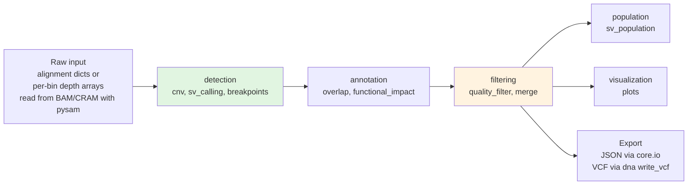

# Integration: structural_variants

## Related Modules
- [dna](../dna/README.md)
- [longread](../longread/README.md)
- [dna/variants](../dna/variants.md)
- [visualization](../visualization/README.md)
- [gwas](../gwas/README.md)

## Import Patterns
### Minimal (standalone)
```python
from metainformant import structural_variants
variants = structural_variants.detection.sv_calling.call_structural_variants(alignments)
```

### Full integration
```python-snippet
from metainformant.structural_variants.detection.cnv import detect_cnv_from_depth
from metainformant.structural_variants.detection.sv_calling import call_structural_variants
from metainformant.structural_variants.annotation.overlap import annotate_gene_overlap
from metainformant.structural_variants.visualization.plots import plot_circos
from metainformant.core import io
from metainformant.core.utils import logging
```

The subpackages are `detection`, `annotation`, `filtering`, `population` and `visualization`; there is no `structural_variants.io` or `structural_variants.core`, and the functions are not re-exported from the package root.

## Data Flow Architecture


All stages exchange plain Python objects (lists of dicts, dicts of arrays, a few dataclasses); nothing is written to disk unless you call a writer. Detection functions take in-memory lists of alignment dicts or depth arrays, so reading the BAM is the caller's job.

## Cross-Module Workflows

### structural_variants + gwas + phenotype
SV genotypes (0/1/2 alt alleles per sample) can be tested against a phenotype with the phenotype module's genotype-association helper and corrected with the GWAS module's FDR routine:
```python-snippet
import pandas as pd
from metainformant.gwas import fdr_correction
from metainformant.phenotype.integration.cross_omic import phenotype_genotype_association
from metainformant.structural_variants.population.sv_population import genotype_sv_population
from metainformant.visualization.plots.general import manhattan_plot

# sv_calls: SV dicts with per-sample evidence under "samples" (see population.md);
# samples: sample IDs; phenotypes: {sample_id: value}, in the same order as `samples`
geno = genotype_sv_population(sv_calls, samples)
genotypes = {                                    # variant id -> genotype per sample
    f"{sv['chrom']}:{sv['start']}-{sv['end']}": row
    for sv, row in zip(sv_calls, geno["genotype_matrix"])
}
assoc = phenotype_genotype_association(phenotypes, genotypes)   # assoc["associations"][variant_id]

p_values = [a["p_value"] for a in assoc["associations"].values()]
fdr = fdr_correction(p_values)                   # dict: "significant", "adjusted_p_values", ...

# Manhattan plot: a DataFrame with chromosome, position and p-value columns
rows = [
    {"CHR": sv["chrom"], "BP": sv["start"],
     "P": assoc["associations"][f"{sv['chrom']}:{sv['start']}-{sv['end']}"]["p_value"]}
    for sv in sv_calls
    if f"{sv['chrom']}:{sv['start']}-{sv['end']}" in assoc["associations"]
]
manhattan_plot(pd.DataFrame(rows), output_path="output/sv_manhattan.png")
```
`phenotype_genotype_association` silently skips a variant with fewer than 3 usable samples, hence the membership test. `sv_association_test` in `structural_variants.population.sv_population` is the SV-specific alternative (it also reports `beta`, `se` and, for binary phenotypes, an odds ratio), and `metainformant.gwas` offers `association_test_linear` / `association_test_logistic` with the same genotype-list and phenotype-list inputs.

### structural_variants + visualization (detailed)
```python-snippet
import numpy as np
from metainformant.structural_variants.population.sv_population import genotype_sv_population
from metainformant.visualization.plots.basic import heatmap

res = genotype_sv_population(sv_calls, samples)   # res["genotype_matrix"]: SVs × samples
heatmap(np.asarray(res["genotype_matrix"]), output_path="output/sv_genotypes.png")
```

## Shared Infrastructure
| Service | Provided By | Use in structural_variants |
|---------|-------------|----------------------------|
| Logging | `core.utils.logging` | Every submodule logs through `get_logger(__name__)`; INFO and DEBUG output only appears after `configure_logging_from_env()` (or `setup_logger`) is called, while warnings are printed regardless |
| I/O | `core.io` | Not imported by the module itself; the examples use `io.load_json` / `io.dump_json` for inputs and results |
| Config | `core.utils.config` | Not used: the module reads only the `SV_*` environment variables listed in [CONFIGURATION.md](CONFIGURATION.md) |
| Caching | `core.io.cache` | Not used by the module; `JsonCache` can cache intermediate results such as depth arrays (see [PERFORMANCE.md](PERFORMANCE.md)) |
| DB | `core.db` | Not used |

## Data Contract
There is no shared result class. Each stage returns its own container:

| Function | Returns |
|----------|---------|
| `detection.cnv.detect_cnv_from_depth` | `dict[str, CNVResult]` (chromosome → result with `CNVSegment` list) |
| `detection.sv_calling.call_structural_variants` | `list[StructuralVariant]` (dataclass with `SVEvidence`) |
| `detection.breakpoints.refine_breakpoints` | `list[BreakpointPair]` |
| `annotation.overlap.annotate_gene_overlap`, `annotate_regulatory_overlap` | `list[dict]`: the input variant dicts plus annotation keys |
| `annotation.functional_impact.predict_functional_impact` | `FunctionalImpact` |
| `filtering.quality_filter.filter_by_*`, `apply_blacklist` | `(list[dict], FilterStats)` |
| `filtering.merge.merge_callsets`, `survivor_merge` | `(list[MergedVariant], MergeStats)` |
| `population.sv_population.*` | `dict` with function-specific keys (for example `genotype_matrix`, `variance_explained`); `merge_sv_callsets` returns a `list[dict]` of merged calls |

The annotation, filtering, merging and plotting functions consume plain variant dicts (`chrom`, `start`, `end`, `sv_type`, ...), so convert `StructuralVariant` objects with `dataclasses.asdict` (and `sv.sv_type.value` for a plain-string type) before passing them on, and convert back to dicts or DataFrames yourself for downstream modules (`pd.DataFrame(list_of_dicts)`).

## Multi-Module Orchestration
See [docs/agents/](../agents/MULTI_AGENT_WORKFLOWS.md) for agent-driven multi-module pipelines.
