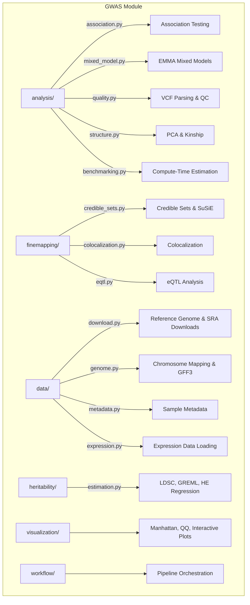

# GWAS Module

Genome-Wide Association Studies analysis, fine-mapping, variant-expression integration, and compute-time benchmarking.

## Overview

Genome-Wide Association Studies analysis, fine-mapping, variant-expression integration, and compute-time benchmarking.


## Table of Contents

- [Architecture](#architecture)
- [Key Capabilities](#key-capabilities)
  - [Association Testing](#association-testing)
  - [Quality Control and Summary Statistics](#quality-control-and-summary-statistics)
  - [Fine-Mapping & Colocalization](#fine-mapping--colocalization)
  - [Compute-Time Benchmarking](#compute-time-benchmarking)
  - [Data I/O](#data-io)
  - [Heritability Estimation](#heritability-estimation)
- [Submodules](#submodules)
- [Integration with Expression Data](#integration-with-expression-data)
- [Related](#related)
- [See Also](#see-also)

## Architecture



## Key Capabilities

### Association Testing

| Function | Purpose |
|----------|---------|
| `run_gwas()` | Full GWAS pipeline (via `workflow.workflow`) |
| `association_test_linear()` | Linear regression for quantitative traits (Student's t p-values) |
| `association_test_logistic()` | Logistic regression for case-control (Wald p-values, `converged` flag) |
| `association_test_mixed()` | EMMA mixed model with kinship correction |
| `run_multi_trait_gwas()` | Multi-trait GWAS sharing VCF/QC/PCA/kinship |

The linear and logistic tests analyse complete cases. A sample is dropped when its genotype is missing (a negative or non-finite dosage) or a covariate value is missing or non-finite; the linear test also drops samples with a missing phenotype, and the logistic test raises `ValueError` for a phenotype that is not 0 or 1. `n_samples` counts the samples analysed and `n_missing_dropped` the samples dropped. The linear test takes p-values from Student's t distribution (a normal approximation when SciPy is unavailable). The logistic test reports `converged`; a fit that did not converge (for example under perfect separation) keeps `status: "success"` but its estimate and p-value are unreliable.

A test that cannot be fitted is returned with NaN for its statistics (`beta`, `se`, `t_stat` or `z_stat`, `p_value`, and `r_squared` or `odds_ratio`), `converged=False`, a `status` and the reason in `error`: `"error"` for a linear test (fewer than 3 complete cases, a constant genotype or phenotype, a singular design matrix), `"failed"` or `"error"` for a logistic test (fewer than 2 cases or 2 controls, or a failed fit), and `"error"` for a mixed-model row. NaN is missing, not an effect of 0 or a p-value of 1: the corrections, summaries and writers leave a failed test out, and the writers print it as `NA`. A linear fit with zero residual variance and a nonzero genotype effect reports t of plus or minus infinity and p = 0. The workflows report the number of failed tests as `n_tests_failed`.

### Quality Control and Summary Statistics

| Function | Purpose |
|----------|---------|
| `apply_qc_filters()` | QUAL, MAF, missingness and HWE filters on parsed VCF data or a VCF path |
| `filter_variants_bcftools()` | `bcftools filter` that keeps sites meeting `min_qual`, `max_missing` and `min_depth` |
| `write_summary_statistics()` | Summary statistics TSV with columns `CHR POS SNP REF ALT BETA SE P Q_FDR N MAF` |
| `write_significant_hits()` | The same columns for variants below a p-value threshold, sorted by p-value |

`apply_qc_filters(vcf_data, qc_config)` reads `min_maf` (default 0.01), `max_missing` (0.1), `min_hwe_p` (1e-6) and an optional `min_qual`, and raises `ValueError` when the genotype rows differ in length or the number of variant records differs from the number of genotype columns. A variant passes `min_qual` when its QUAL is at least the threshold. A variant with a missing QUAL (`.` in the VCF) is removed whenever `min_qual` is set, and the result's `qual_filter` entry counts how many variants were removed and how many of those had a missing QUAL; leave `min_qual` unset for a VCF without QUAL values. `filter_variants_bcftools()` joins its thresholds into one `&&` expression and passes it to `bcftools filter -i`.

`write_summary_statistics()` writes `NA` for a missing or non-finite numeric value and `.` for missing text. `Q_FDR` is the result's own `q_value`, `q_fdr` or `Q_FDR` when present, and otherwise the Benjamini-Hochberg q-value over the p-values of `results`, so pass every test rather than a subset. `MAF` is the result's own `maf` or `MAF` when present, and otherwise computed from the optional `genotypes=` matrix (variants x samples, 0/1/2 alternate-allele dosages); without either it is `NA`. The workflows give each result a `maf` and pass the genotypes to the writers, so `summary_statistics.tsv` carries a MAF column.

### Fine-Mapping & Colocalization

```python
from metainformant.gwas.finemapping.colocalization import (
    eqtl_coloc,        # GWAS-eQTL colocalization
    multi_trait_coloc, # Multi-trait analysis
    compute_clpp,      # CLPP method
    regional_coloc,    # Regional analysis
)

# Test if GWAS signal colocalizes with expression QTL
result = eqtl_coloc(
    gwas_z=[1.2, 2.5, 6.1, 0.4],  # GWAS Z-scores per variant
    eqtl_z=[1.1, 2.3, 5.8, 0.2],  # eQTL Z-scores
    gene_id="LOC12345",
    gwas_standard_errors=0.05,    # scale of each study's effect estimates
    eqtl_standard_errors=0.08,
)
# Returns: pp_h4 (shared causal), is_colocalized, shared_variant, interpretation, coloc_result
```

Credible sets and colocalization use Wakefield approximate Bayes factors, which need the scale of each effect estimate: pass `standard_errors`, or `sample_size` with `maf` and `case_fraction`. With neither, the Bayes factors are computed on the z-score scale and the result reports `variance_model == "z_scale"` (under `bayes_factor_model` for colocalization). The default prior variances are coloc's (`0.15**2` quantitative, `0.2**2` case-control). See [finemapping/README.md](finemapping/README.md) for the model, `compute_log_bayes_factors()`, `colocalization_from_log_bayes_factors()` and `log_sum_exp()`.

### Compute-Time Benchmarking

Estimate full-genome GWAS runtimes from pilot runs on data subsets:

```python
from metainformant.gwas import benchmark_subset_run, extrapolate_full_genome_time

# Time a pilot run on a small subset
timings = benchmark_subset_run(
    "pilot.vcf", "pheno.tsv", config,
    max_samples=100, max_variants=1000,
)

# Extrapolate to full genome using scaling models
estimate = extrapolate_full_genome_time(
    timings,
    target_n_samples=5000,
    target_n_variants=10_000_000,
)
print(estimate.summary())
# Estimated total runtime: 42h 15m 30s
#   Pilot: 100 samples × 1000 variants
#   Target: 5000 samples × 10000000 variants
```

Scaling models used per step:

- **QC / MAF filtering**: O(n·m) — linear in samples × variants
- **LD pruning**: O(w²·m) — quadratic in window, linear in variants
- **PCA**: O(m·k²) — linear in variants, quadratic in components
- **Kinship (GRM)**: O(n²·m) — quadratic in samples, linear in variants
- **Association testing**: O(n·m) — linear in samples × variants
- **Fine-mapping (SuSiE)**: O(k³) — cubic in credible-set region size

### Data I/O

| Function | Purpose |
|----------|---------|
| `parse_vcf_full()` | Parse VCF files into genotype/variant dicts |
| `download_reference_genome()` | Download reference genome from NCBI |
| `download_variant_database()` | Download dbSNP / 1000 Genomes data (`"dbsnp"` or `"1000genomes"`) |
| `download_variant_data()` | Download the association summary table of a GWAS Catalog study (`data_type="summary_stats"` only; `"vcf"` and `"both"` raise `NotImplementedError`) |
| `download_sra_run()` | Download SRA sequencing data |
| `normalize_chromosome_name()` | Chromosome name normalization (NCBI acc, chr, roman) |
| `parse_gff3_genes()` | Parse GFF3 gene annotations |
| `ExpressionLoader` | Load Amalgkit kallisto quantification (TPM/counts) |

### Heritability Estimation

| Function | Purpose |
|----------|---------|
| `estimate_h2_ldsc()` | LD Score Regression (LDSC) |
| `partitioned_h2()` | Partitioned heritability by annotation category |
| `genetic_correlation()` | Cross-trait genetic correlation |
| `greml_simple()` | Genomic REML variance component estimation |
| `haseman_elston_regression()` | Haseman-Elston regression |
| `compute_liability_h2()` | Liability-scale conversion for case-control |

## Submodules

| Module | Purpose |
|--------|---------|
| [`analysis/`](analysis/) | Association testing, QC, population structure, benchmarking |
| [`data/`](data/) | VCF/SRA download, genome annotation, expression loading |
| [`finemapping/`](finemapping/) | Fine-mapping, colocalization, eQTL analysis |
| [`heritability/`](heritability/) | Heritability estimation (LDSC, GREML) |
| [`visualization/`](visualization/) | Manhattan, QQ, LocusZoom, interactive dashboards |
| [`workflow/`](workflow/) | Pipeline orchestration, config management |

## Integration with Expression Data

The GWAS module integrates with RNA-seq via the multiomics module and expression loader:

```python
from metainformant.gwas.data.expression import ExpressionLoader
from metainformant.gwas.finemapping.eqtl import cis_eqtl_scan

# Load Amalgkit kallisto quantification
loader = ExpressionLoader("/path/to/species_workdir")
tpm_matrix = loader.load_amalgkit_quant(metric="tpm")

# Run cis-eQTL scan
results = cis_eqtl_scan(
    expression_matrix=tpm_matrix,
    genotype_matrix=genotypes,
    gene_positions=gene_pos,
    variant_positions=var_pos,
)
```

## Related

- [metainformant.multiomics](../../../docs/multiomics/) — Multi-omic integration
- [metainformant.rna](../../../docs/rna/) — RNA-seq analysis
- [config/gwas/](../../../config/gwas/) — Configuration files

---

## See Also

- **Documentation**: [docs/gwas/index.md](../../../docs/gwas/index.md) — Workflow guides, methods, troubleshooting
- **API Reference**: [docs/gwas/SPEC.md](../../../docs/gwas/SPEC.md) — Data structures, function signatures
- **Tutorial**: [docs/TUTORIALS.md](../../../docs/TUTORIALS.md#3-gwas-analysis-tutorial) — Step-by-step walkthrough
- **eQTL integration**: [docs/eqtl/README.md](../../../docs/eqtl/README.md) — Combined RNA × GWAS analysis
- **Configuration**: [config/gwas/](../../../config/gwas/) — YAML config files for pipelines
