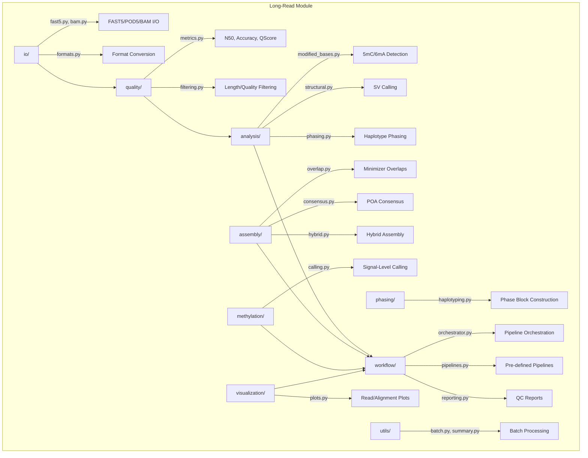

# Long-Read Sequencing Module

PacBio and Oxford Nanopore long-read analysis: signal I/O, quality assessment, assembly, methylation calling, haplotype phasing, and structural variant detection.

## Overview

PacBio and Oxford Nanopore long-read analysis: signal I/O, quality assessment, assembly, methylation calling, haplotype phasing, and structural variant detection.


## Table of Contents

- [Architecture](#architecture)
- [Submodules](#submodules)
- [Key Classes](#key-classes)
  - [Pipeline Orchestration](#pipeline-orchestration)
  - [Pipeline Stages](#pipeline-stages)
- [Quick Start](#quick-start)
- [Integration](#integration)
- [Related](#related)

## Architecture



## Submodules

| Module | Purpose |
|--------|---------|
| [`io/`](io/) | FAST5, POD5, BAM reading/writing and format conversion |
| [`quality/`](quality/) | Read metrics (N50, Nx, accuracy), filtering by length/quality, adapter detection and trimming |
| [`analysis/`](analysis/) | Modified base detection, structural variants, phasing |
| [`assembly/`](assembly/) | Minimizer overlaps, POA consensus, hybrid assembly |
| [`methylation/`](methylation/) | Signal-level methylation calling (threshold and Bayesian models) and DMR detection |
| [`phasing/`](phasing/) | Read-based haplotyping and switch error computation |
| [`workflow/`](workflow/) | Pipeline orchestration with dependency resolution |
| [`visualization/`](visualization/) | Read length, quality, alignment, and methylation plots |
| [`utils/`](utils/) | Batch processing and run summary generation |

## Key Classes

### Pipeline Orchestration

- `LongReadOrchestrator` - End-to-end pipeline engine with dependency resolution
- `PipelineStep` - Individual pipeline step definition
- `PipelineResult` - Step execution results and metadata

### Pipeline Stages

| Builder | Description |
|---------|-------------|
| `_build_qc_steps` | Quality assessment and read filtering |
| `_build_assembly_steps` | Overlap detection through consensus polishing |
| `_build_methylation_steps` | Signal-level methylation calling pipeline |
| `_build_sv_steps` | Structural variant detection from split reads |

## Quick Start

```python
import random

from metainformant.longread.workflow.orchestrator import LongReadOrchestrator
from metainformant.longread.workflow.pipelines import get_qc_pipeline_config

# Run the QC pipeline over a list of read dictionaries. A Path to a single
# FAST5, POD5, BAM or CRAM file also works; a directory does not.
rng = random.Random(0)
reads = [
    {"read_id": f"read{i}", "sequence": "".join(rng.choice("ACGT") for _ in range(1500)), "quality_string": "5" * 1500}
    for i in range(20)
]
config = get_qc_pipeline_config()
orchestrator = LongReadOrchestrator(config, "output/longread/")
result = orchestrator.run_qc_pipeline(reads)
print(result.success, [step.name for step in result.steps])  # PipelineResult: success, steps, summary, ...

# Or work with individual submodules
from metainformant.longread.io import fast5, bam
from metainformant.longread.quality import metrics, filtering
from metainformant.longread.analysis import modified_bases, structural
from metainformant.longread.assembly import overlap, consensus, hybrid
from metainformant.longread.methylation import calling
from metainformant.longread.phasing import haplotyping
```

## Integration

Long-read data integrates with other METAINFORMANT modules for multi-omic analysis:

```python
from metainformant.longread.analysis import structural
from metainformant.structural_variants import population

# Alignments may be LongReadAlignment objects or plain dicts; here, three reads carry the same 300 bp deletion
alignments = [
    {"read_name": f"read{i}", "reference_name": "chr1", "reference_start": 10_000 + i,
     "cigar_string": "2000M300D2000M", "mapping_quality": 60}
    for i in range(3)
]

# SV calls from long reads: a list of StructuralVariant objects
sv_calls = structural.detect_sv_from_long_reads(alignments)

# Population-level SV analysis takes call dictionaries with per-sample evidence
calls = [
    {
        "chrom": sv.chromosome, "start": sv.start, "end": sv.end, "sv_type": sv.sv_type,
        "samples": {
            "sample1": {"split_reads": sv.supporting_reads, "total_reads": 10},
            "sample2": {"split_reads": 0, "total_reads": 10},
        },
    }
    for sv in sv_calls
]
pop_result = population.genotype_sv_population(calls, ["sample1", "sample2"], method="split")
print(pop_result["genotype_matrix"])  # [[1, 0]]: heterozygous in sample1, absent in sample2
```

## Related
- [API Reference](SPEC.md) — Type signatures, error codes, data structures

- [docs/longread/](../../../docs/longread/) - Long-read analysis documentation
- [metainformant.structural_variants](../structural_variants/) - Population-level SV analysis
- [metainformant.epigenome](../epigenome/) - Methylation and chromatin analysis
- [metainformant.quality](../quality/) - General QC metrics
