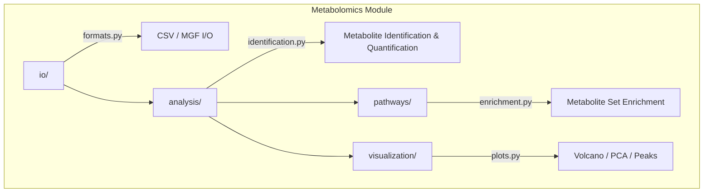

# Metabolomics Module

Metabolomics analysis: mass spectrometry data processing, metabolite identification, pathway mapping, and metabolite-gene integration.

## Overview

Metabolomics analysis: mass spectrometry data processing, metabolite identification, pathway mapping, and metabolite-gene integration.


## Table of Contents

- [Architecture](#architecture)
- [Submodules](#submodules)
- [Quick Start](#quick-start)
- [Related](#related)

## Architecture



## Submodules

| Module | Purpose |
|--------|---------|
| [`io/`](io/) | Intensity-matrix CSV I/O and MGF (Mascot Generic Format) spectrum reading/writing, spectra filtering, extracted-ion chromatograms |
| [`analysis/`](analysis/) | Metabolite identification (`identify_metabolites`, `identify_with_adducts`), normalization, fold change, differential abundance, imputation, spectral similarity |
| [`pathways/`](pathways/) | Over-representation analysis (`metabolite_set_enrichment`), Benjamini-Hochberg FDR, pathway activity scoring |
| [`visualization/`](visualization/) | Volcano plot data, PCA ordination, heatmap data, chromatographic peak detection, spectrum plot prep, RT alignment |

## Quick Start

```python
import numpy as np
from metainformant.metabolomics.io import formats
from metainformant.metabolomics.analysis import identification
from metainformant.metabolomics.pathways import enrichment

# Load an intensity matrix (first column = metabolite IDs, first row = samples)
data = formats.read_csv("metabolomics_data.csv")

# Identify metabolites by matching observed m/z against a reference of exact masses
database = {"glucose": 180.0634, "citrate": 192.0270, "lactate": 90.0317}
identified = identification.identify_metabolites(
    np.array([180.0641, 192.0279]), database, ppm_tolerance=10.0
)

# Over-representation analysis against a pathway database
pathway_db = {"glycolysis": ["glucose", "lactate"], "TCA_cycle": ["citrate"]}
enriched = enrichment.metabolite_set_enrichment(["glucose", "lactate"], pathway_db)
```

## Input handling

The readers and matchers report bad input instead of repairing it silently.

- `formats.read_csv`: a blank cell or `NA` / `N/A` / `#N/A` / `NaN` / `null` / `None` (any case) is returned as
  `NaN` (never `0.0`); any other non-numeric cell, including a decimal comma, raises `ValueError` naming the line,
  metabolite and sample, and a row whose width differs from the header raises `ValueError` naming the line.
  Columns before `data_start_col` other than `metabolite_col` fill `MetabolomicsDataset.metadata` as
  `{metabolite: {column: value}}`.
  `missing_value_imputation` treats `NaN` and zero as missing, so the two compose. Impute before
  `normalize_intensities(method="total_ion_count" | "median")`, which raises on `NaN` because one missing value
  would distort the scale of its whole sample; `method="log2"` keeps a `NaN` in place and `fold_change` returns
  `NaN` (not a floored value) for a metabolite with a missing value in either group.
- `formats.read_mgf`: peak lines are read whatever their first character (`.5 99`, `+200.0 20`), comment lines
  (`#`, `;`, `!`, `/`) are skipped, and an empty or non-numeric `PEPMASS`, `RTINSECONDS` or `SCANS` value or a
  malformed peak line raises `ValueError` naming the spectrum. `BEGIN IONS` / `END IONS` are recognised as whole
  lines; a block that is not closed by `END IONS` before the next `BEGIN IONS` or the end of the file (for example
  the last spectrum of a truncated file), and an `END IONS` outside a block, raise `ValueError` naming the
  spectrum (counted from 1, with its `TITLE` when it has one) and the line. A spectrum without `RTINSECONDS` has a
  `NaN` retention time, not `0.0` (`filter_spectra(rt_range=...)` then drops it, and `write_mgf` leaves the line
  out). `MassSpectrum.total_ion_current` is computed from the intensities when it is not given.
- `formats.extract_chromatogram` / `visualization.plots.prepare_spectrum_plot`: `ppm_tolerance` must be a finite
  number >= 0 (zero keeps only an exact match; a negative or NaN window used to return an all-zero chromatogram
  or no annotation), `target_mz` a positive finite number, `top_n` a positive integer, and the two spectrum
  arrays 1D and of one length. An empty spectrum has a `NaN` base peak, not an invented `0.0`.
- `visualization.plots.volcano_plot_data` / `pca_metabolomics`: a p-value outside [0, 1] (NaN is allowed and never
  significant) and a `n_components` beyond `min(n_samples, n_metabolites)` or non-finite intensities raise
  `ValueError` instead of being clipped, truncated or left to an obscure SVD failure.
- `identification.identify_metabolites` / `identify_with_adducts`: `ppm_tolerance` must be a positive finite
  number and every observed m/z positive and finite; in `identify_with_adducts`, `ion_mode` is `"positive"` or
  `"negative"` in any case and anything else raises `ValueError`, even when `adducts` is given.
- `identification.differential_abundance`: Welch's test needs at least two samples per group; fewer raises
  `ValueError` (one observation per group used to give `p = 0.0`). `missing_value_imputation(method="knn")` only
  averages metabolites that share at least two observed samples with the one being filled.
- `enrichment.metabolite_set_enrichment`: a `background_size` smaller than the query or a pathway raises
  `ValueError`, because it cannot be a universe that contains them.
- `visualization.plots.detect_chromatographic_peaks` integrates peaks with the trapezoidal rule and runs on
  every supported NumPy (>= 1.24).

## Related
- [API Reference](SPEC.md) — Type signatures, error codes, data structures

- [metainformant.multiomics](../multiomics/) - Multi-omic integration
- [metainformant.protein](../protein/) - Protein-metabolite interactions
- [metainformant.visualization](../visualization/) - General plotting
