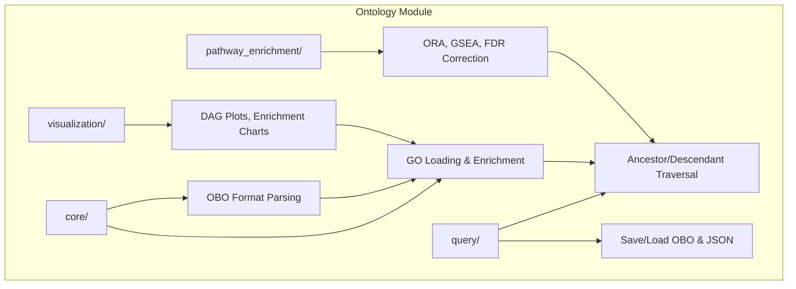

# Ontology Module

Gene ontology parsing, querying, enrichment analysis, and visualization for METAINFORMANT.

## Overview

Gene ontology parsing, querying, enrichment analysis, and visualization for METAINFORMANT.


## Table of Contents

- [Architecture](#architecture)
- [Key Capabilities](#key-capabilities)
  - [GO Loading & Enrichment](#go-loading--enrichment)
  - [Querying and Traversal](#querying-and-traversal)
  - [Serialization & Visualization](#serialization--visualization)
- [Submodules](#submodules)
- [Quick Start](#quick-start)
- [Integration](#integration)
- [Related](#related)

## Architecture



## Key Capabilities

### GO Loading & Enrichment

```python
from metainformant.ontology.core.obo import parse_obo
from metainformant.ontology.core.go import load_go_obo, enrich_genes, semantic_similarity

go = load_go_obo("data/go-basic.obo")
results = enrich_genes(genes=target_genes, background=all_genes, annotations=go_annotations)
sim = semantic_similarity("GO:0008150", "GO:0003674", term_ic=ic_map, hierarchy=hierarchy, method="resnik")
```

| Function | Description |
|----------|-------------|
| `load_go_obo` | Load and validate GO ontology from OBO file |
| `enrich_genes` | Fisher exact / hypergeometric ORA with Bonferroni-adjusted p-values and a boolean `significant` column (`alpha`); only genes in the background count |
| `semantic_similarity` | Resnik (information content in bits, not bounded by 1), Lin and Jiang-Conrath (0-1) similarity between terms |
| `calculate_term_ic` | Information content from annotation frequency |

### Querying and Traversal

```python
from metainformant.ontology.query.query import ancestors, descendants, shortest_path

anc = ancestors(go, "GO:0008150")                           # All ancestor term IDs
path = shortest_path(go, "GO:0008150", "GO:0003674")        # Shortest connecting path
```

| Function | Description |
|----------|-------------|
| `ancestors` / `descendants` | Traverse `is_a` or custom relation types |
| `common_ancestors` / `most_informative_common_ancestor` | Shared ancestors, MICA |
| `shortest_path` / `distance` | Path length between terms |
| `get_roots` / `get_leaves` | Terminal nodes in the DAG |
| `find_terms_by_name` / `subgraph` | Pattern search, subontology extraction (with the parent/child links among the kept terms) |
| `filter_by_namespace` / `get_subontology` | Namespace filter, root-and-descendants extraction (both keep the induced hierarchy, so `get_roots` and `ancestors` work on the result) |

### Serialization & Visualization

```python
from metainformant.ontology.query.serialize import save_ontology, load_ontology, ontology_to_graph
from metainformant.ontology.visualization.visualization import plot_go_dag

save_ontology(go, "output/ontology.json", format="json")
reloaded = load_ontology("output/ontology.json", format="json")  # OBO-parsed ontologies load with every is_a link once
plot_go_dag(ontology_to_graph(go), terms=["GO:0008150"], output_path="output/dag.png", layout_seed=0)
```

`plot_go_dag` takes a `networkx.DiGraph` (convert an ontology with `ontology_to_graph`). The layout functions
`plot_go_dag`, `plot_ontology_network` and `create_interactive_go_network` of `visualization.visualization` take a
`layout_seed` (default `None`, unseeded); `pathway_network_plot` of `visualization.plots` takes one too (default 42).

## Submodules

| Module | Purpose |
|--------|---------|
| [`core/`](core/) | GO ontology loading (`load_go_obo`), OBO parsing (`parse_obo`), `Ontology`/`Term`/`Relationship` types |
| [`query/`](query/) | Graph traversal (`ancestors`, `descendants`, `shortest_path`), serialization (`save_ontology`, `merge_ontologies`) |
| [`pathway_enrichment/`](pathway_enrichment/) | Over-representation analysis, GSEA, FDR correction, pathway networks |
| [`visualization/`](visualization/) | GO DAG plotting, enrichment bar/dot charts, semantic similarity matrices |
| [`annotation/`](annotation/) | GWAS hit genes to GO annotations bridge (`gwas_hits_to_genes`, `genes_to_go_annotations`, GAF loading) |
| [`workflow/`](workflow/) | Stage-10 GWAS ontology pipeline (`run_ontology`); the `ontology.random_state` configuration key seeds its GSEA permutations |

## Quick Start

```python
from metainformant.ontology.core.go import load_go_obo, enrich_genes
from metainformant.ontology.query.query import ancestors, descendants
from metainformant.ontology.query.serialize import save_ontology

# Load Gene Ontology
go = load_go_obo("data/go-basic.obo")

# Traverse the hierarchy
bio_process_ancestors = ancestors(go, "GO:0008150")
children = descendants(go, "GO:0003674", relation_type="is_a")

# Run enrichment
results = enrich_genes(genes=target_genes, background=all_genes, annotations=go_annotations)

# Export as JSON
save_ontology(go, "output/ontology/go_subset.json", format="json")
```

## Integration

- Gene lists from [`metainformant.rna`](../rna/) expression analysis feed into `enrich_genes`
- Network analysis in [`metainformant.networks`](../networks/) uses ontology-derived pathway graphs
- Visualization outputs integrate with [`metainformant.visualization`](../visualization/) themes

## Related
- [API Reference](SPEC.md) — Type signatures, error codes, data structures

- [`metainformant.networks`](../networks/) -- Biological network analysis
- [`metainformant.rna`](../rna/) -- RNA expression for enrichment inputs
- [`metainformant.information`](../information/) -- Information-theoretic metrics
- [`docs/ontology/`](../../../docs/ontology/) -- Ontology documentation
- [`config/`](../../../config/) -- Configuration files
