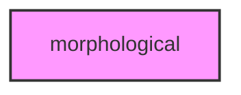

# MORPHOLOGICAL

## Overview
Morphological phenotype analysis module.

## Contents
- [__init__.py](__init__.py)
- [measurement.py](measurement.py)
- [profile.py](profile.py)

## Structure



## Usage
Import module:
```python
from metainformant.phenotype.morphological import ...
```

## Unit Conversion

`Measurement.convert(target_unit)` converts the value and its `uncertainty` between the length units `um`, `mm`, `cm` and `m`, in any direction. The micrometre may be written `um`, `µm` (micro sign) or `μm` (Greek mu); symbols are case-sensitive. The conversion is exact arithmetic: each result is the correctly rounded value, so 1 mm converts to exactly 1000.0 um, not 1000.0000000000001. Converting to the measurement's own unit returns the measurement itself, and a measurement unit or `target_unit` that is not supported raises `ValueError`.
