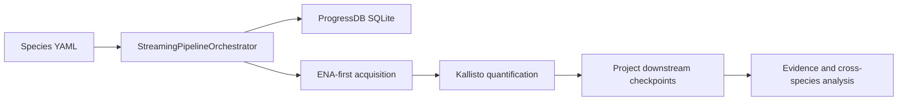

# RNA module

This package provides the pinned Amalgkit (0.16.108) execution and analysis
interfaces used by the Hymenoptera project. Large inputs and outputs live
under the explicitly selected `AMALGKIT_DATA_ROOT`, never in the repository.

## Current execution architecture



The producer owns acquisition and quantification and records resumable
sample state. In frozen-cohort mode (`--cohort`, the launcher's only mode) it
runs from the cohort's frozen `metadata_selected.tsv`:

`getfastq → integrate → quant`

`metadata` and `select` run only without `--cohort` and with
`--refresh-metadata`.

The project checkpoint runner owns the deterministic downstream stages:

`merge → wsfilter → finalize → sanity`

The two phases are separated by a lock and an evidence contract. Downstream
work may start only after the producer has stopped and the current cohort
database, metadata, quantification sidecars, and raw-input receipts pass
validation.

## Stable Python interfaces

| Interface | Responsibility |
|---|---|
| `metainformant.rna.engine.streaming_orchestrator.StreamingPipelineOrchestrator` | Bounded multi-species acquisition and quantification |
| `metainformant.rna.engine.progress_db.ProgressDB` | SQLite-backed sample state and resume queries |
| `metainformant.rna.engine.workflow` | Typed configuration, planning, and step execution |
| `metainformant.rna.engine.provenance` | Hash-bound metadata, quantification, and downstream receipts |
| `metainformant.rna.engine.preflight` | Mandatory start-of-run campaign preflight: data-root write probe, Amalgkit CLI resolution, producer tools (`kallisto`, `fasterq-dump`, `prefetch`, `vdb-validate`, `pigz`), kallisto compatibility, free-space floors and the optional reuse dry-run (`run_campaign_preflight`; also `python -m metainformant.rna.engine.preflight`) |
| `metainformant.rna.engine.cohort` | Frozen, hash-verified cohort (`load_frozen_cohort`, `verify_cohort_configs`) and the producers' `--cohort` options |
| `metainformant.rna.engine.campaign_lock` | Single writer per data root: `flock` on `<data-root>/.campaign.flock` (`acquire`; `python -m metainformant.rna.engine.campaign_lock status` / `run`) |
| `metainformant.rna.analysis.cohort_accounting` | Fail-closed cohort funnel over the progress DB (`build_cohort_funnel`): configured → with_progress → quantified/failed/excluded/pending/active with durable failure classes |
| `metainformant.rna.analysis.statistics_contract` | Inferential contract: Benjamini–Hochberg FDR, validated `AnalysisProvenance`, and the `SensitivityAnalysis` registry rendered as `analysis_provenance_sensitivity_*` lines |
| `metainformant.rna.amalgkit` | Version-pinned Amalgkit command registry and wrappers |
| `metainformant.rna.analysis` | Expression, QC, cross-species, and validation analyses |
| `metainformant.rna.steps` | Registry of workflow step runners (`STEP_RUNNERS`) |

## Command-line entrypoints

Inspect the configured cohort without modifying data:

```bash
export AMALGKIT_DATA_ROOT=/Volumes/external_drive/Data/amalgkit
uv run python scripts/rna/run_all_species.py \
  --config-dir projects/hymenoptera_amalgkit/config/amalgkit \
  --data-root "$AMALGKIT_DATA_ROOT" --dry-run
```

Run one cohort species through the shared producer (a diagnostic; production
runs use the launcher below):

```bash
env -u VIRTUAL_ENV uv run --frozen --no-sync python scripts/rna/process_species.py \
  --species apis_mellifera \
  --config-dir projects/hymenoptera_amalgkit/config/amalgkit \
  --data-root "$AMALGKIT_DATA_ROOT" \
  --cohort "$AMALGKIT_DATA_ROOT/cohort/hymenoptera27-20261005"
```

Run the complete lock-owned project campaign:

```bash
bash projects/hymenoptera_amalgkit/scripts/run_full_campaign.sh
```

See the [Hymenoptera execution guide](../../../projects/hymenoptera_amalgkit/doc/00_setup/04_running_the_pipeline.md)
for storage, resume, evidence, and cross-species gates.

## Download and evidence boundary

ENA is the primary public-read path. The configured SRA fallback is used only
when the ENA path cannot complete. A metadata row, downloaded FASTQ, or
readable abundance table is not completion evidence by itself. A sample is
eligible for raw-input reclamation only after its current quantification
provenance sidecar validates the exact abundance file and the project receipt
records the same decision.

## Related documentation

- [RNA workflow documentation](../../../docs/rna/README.md)
- [Configuration FAQ](../../../projects/hymenoptera_amalgkit/config/amalgkit/amalgkit_faq.md)
- [Storage contract](../../../projects/hymenoptera_amalgkit/doc/01_infrastructure/02_storage_contract.md)
- [Reproducibility checklist](../../../projects/hymenoptera_amalgkit/docs/manuscript/reproducibility_checklist.md)
