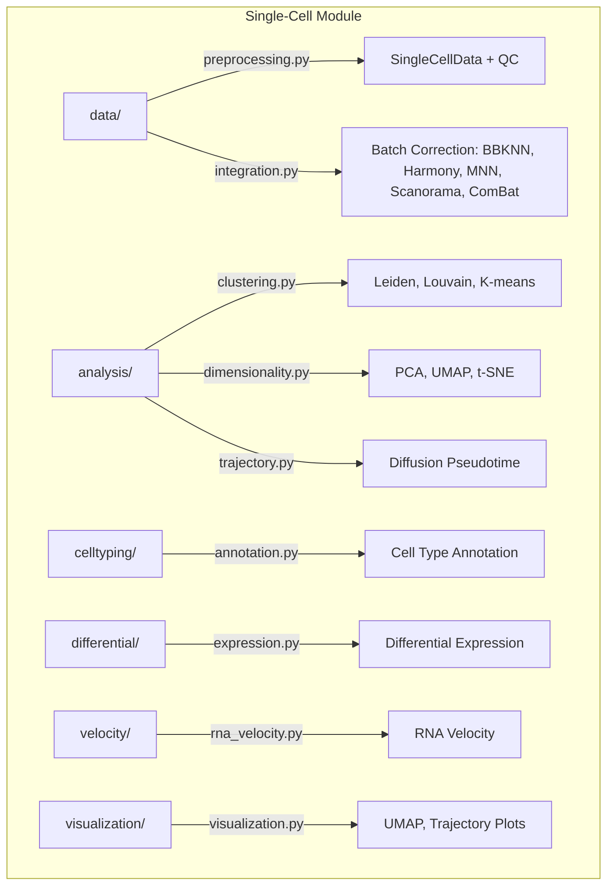

# Single-Cell Module

Single-cell RNA-seq analysis: preprocessing, dimensionality reduction, clustering, trajectory inference, and visualization for METAINFORMANT.

## Overview

Single-cell RNA-seq analysis: preprocessing, dimensionality reduction, clustering, trajectory inference, and visualization for METAINFORMANT.


## Table of Contents

- [Architecture](#architecture)
- [Submodules](#submodules)
- [Key Capabilities](#key-capabilities)
  - [Preprocessing and QC](#preprocessing-and-qc)
  - [Dimensionality Reduction](#dimensionality-reduction)
  - [Clustering and Trajectory](#clustering-and-trajectory)
- [Quick Start](#quick-start)
- [Related](#related)

## Architecture



## Submodules

| Module | Purpose |
|--------|---------|
| [`data/`](data/) | `SingleCellData` container, `load_count_matrix`, QC (`calculate_qc_metrics`), filtering (`filter_cells`, `filter_genes`), normalization (`normalize_counts`, `log_transform`, `scale_data`), HVG selection (`identify_highly_variable_genes`), batch integration (`bbknn_integration`, `harmony_integration`, `mnn_integration`, `scanorama_integration`, `combat_integration`) |
| [`analysis/`](analysis/) | `leiden_clustering`, `compute_pca`, `compute_umap`, `compute_diffusion_pseudotime` |
| [`celltyping/`](celltyping/) | Automated cell type annotation from marker genes |
| [`differential/`](differential/) | Differential expression testing between clusters |
| [`doublet/`](doublet/) | Simulation-based doublet detection (Scrublet-style KNN scoring) |
| [`velocity/`](velocity/) | RNA velocity estimation for dynamic trajectories |
| [`visualization/`](visualization/) | `plot_umap`, trajectory plots, QC visualizations |
| [`io.py`](io.py) | GEO/SRA downloads (`download_geo_supplementary`, `download_sra_fastqs`, `fetch_atlas_datasets`) and Salmon alevin quantification (`run_salmon_alevin`); `fetch_atlas_datasets` raises `NotImplementedError` for the ArrayExpress dataset (`Li-2022`) and creates nothing. The nine helpers for R and pySCENIC tools (`run_seurat_integration`, `run_differential_expression`, `run_scenic_grnboost2`, `run_scenic_cistarget`, `run_scenic_aucell`, `filter_regulons_post_scenic`, `run_pseudotime_trajectory`, `run_go_enrichment`, `run_shinycell_export`) are not implemented: they raise `NotImplementedError` and create no files |

## Key Capabilities

### Preprocessing and QC

```python
from metainformant.singlecell.data.preprocessing import SingleCellData
import numpy as np

# Create or load single-cell dataset
X = np.random.rand(500, 2000)  # 500 cells x 2000 genes
data = SingleCellData(X=X)
print(f"{data.n_obs} cells, {data.n_vars} genes")
```

### Dimensionality Reduction

| Function | Description |
|----------|-------------|
| `pca_reduction` / `compute_pca` | Principal component analysis |
| `compute_umap` / `run_umap` | UMAP embedding |
| `compute_tsne` / `run_tsne` | t-SNE embedding |
| `compute_diffusion_map` | Diffusion map coordinates |
| `select_hvgs` | Highly variable gene selection |

```python
from metainformant.singlecell.analysis.dimensionality import compute_pca, compute_umap

data = compute_pca(data, n_components=50)
data = compute_umap(data, n_neighbors=15)
```

### Clustering and Trajectory

```python
from metainformant.singlecell.analysis.clustering import leiden_clustering
from metainformant.singlecell.analysis.trajectory import compute_diffusion_pseudotime

# Leiden needs networkx, igraph and leidenalg (the `singlecell` extra); it raises ImportError without them
data = leiden_clustering(data, resolution=1.0, n_neighbors=15)
# Diffusion pseudotime (Haghverdi et al. 2016): scaled to [0, 1], `inf` for cells not connected to the root
data = compute_diffusion_pseudotime(data, root_cell=0, n_components=10)
```

Analysis functions return a modified copy and leave their input untouched; `select_hvgs`, `compute_neighbors` and `compute_diffusion_map` take a keyword-only `inplace=True` to write into the argument instead. See [docs/singlecell/](../../../docs/singlecell/) for details.

## Quick Start

```python
from metainformant.singlecell.data.preprocessing import SingleCellData
from metainformant.singlecell.analysis.dimensionality import compute_pca, compute_umap
from metainformant.singlecell.analysis.clustering import leiden_clustering
from metainformant.singlecell.visualization.visualization import plot_umap
import numpy as np

# End-to-end single-cell workflow
data = SingleCellData(X=np.random.rand(1000, 3000))
data = compute_pca(data, n_components=50)
data = compute_umap(data, n_neighbors=15)
data = leiden_clustering(data, resolution=0.8)   # needs networkx, igraph and leidenalg
fig = plot_umap(data, color="leiden_cluster")    # the label column written by leiden_clustering
```

## Related
- [API Reference](SPEC.md) — Type signatures, error codes, data structures

- [metainformant.rna](../rna/) - Bulk RNA-seq expression analysis
- [metainformant.epigenome](../epigenome/) - Epigenomic assays for single-cell
- [metainformant.visualization](../visualization/) - General plotting utilities
- [docs/singlecell/](../../../docs/singlecell/) - Single-cell module documentation
