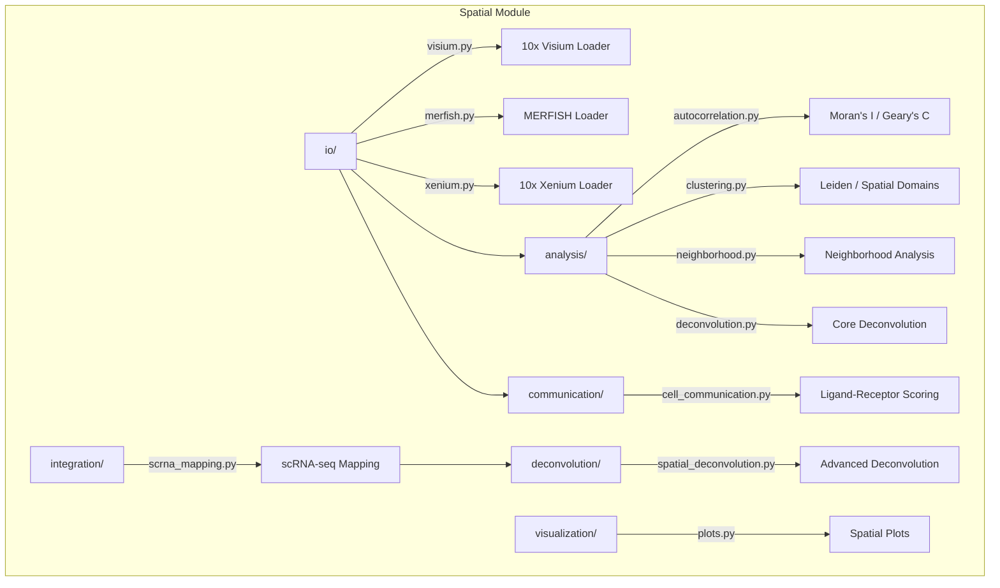

# Spatial Transcriptomics Module

Spatial transcriptomics analysis: platform I/O (Visium, MERFISH, Xenium), spatial statistics, cell-cell communication, deconvolution, and scRNA-seq integration.

## Overview

Spatial transcriptomics analysis: platform I/O (Visium, MERFISH, Xenium), spatial statistics, cell-cell communication, deconvolution, and scRNA-seq integration.


## Table of Contents

- [Architecture](#architecture)
- [Submodules](#submodules)
- [Key Capabilities](#key-capabilities)
  - [Platform I/O](#platform-io)
  - [Spatial Statistics](#spatial-statistics)
  - [Spatial Clustering](#spatial-clustering)
  - [Cell-Cell Communication](#cell-cell-communication)
  - [Deconvolution & Integration](#deconvolution--integration)
- [Quick Start](#quick-start)
- [Related](#related)

## Architecture



## Submodules

| Module | Purpose |
|--------|---------|
| [`io/`](io/) | Platform loaders for Visium, MERFISH, and Xenium data formats |
| [`analysis/`](analysis/) | Spatial autocorrelation, clustering, neighborhood analysis, deconvolution |
| [`communication/`](communication/) | Ligand-receptor interaction scoring and communication networks |
| [`deconvolution/`](deconvolution/) | Advanced cell type deconvolution with reference profiles and niche ID |
| [`integration/`](integration/) | scRNA-seq to spatial mapping, label transfer, gene imputation |
| [`niche/`](niche/) | Tissue niche identification via spatial smoothing and K-Means clustering |
| [`visualization/`](visualization/) | Spatial scatter plots, tissue overlays, expression maps |

## Key Capabilities

### Platform I/O

| Class/Function | Description |
|----------------|-------------|
| `load_visium` | Load 10x Visium spatial dataset (MEX or HDF5) |
| `load_xenium` | Load a 10x Xenium dataset; `cells.csv(.gz)` with the cell centroids is required |
| `load_merfish` | Load a MERFISH dataset; `cell_metadata.csv` (or `.tsv`, the delimiter follows the extension) with the cell positions is required |
| `SpatialDataset`, `XeniumDataset`, `MERFISHDataset` | Dataset containers with `expression`, `coordinates` and a `coordinate_order` constant (`"row_col"` for Visium, `"xy"` for Xenium and MERFISH) |
| `TissuePosition` | Single Visium spot position with tissue membership |
| `read_tissue_positions` | Parse tissue position CSV files |

The Xenium and MERFISH loaders raise `FileNotFoundError` or `ValueError` when the cell positions, their columns or the row of any cell are missing; they never fill in `[0, 0]`. `load_visium` raises `ValueError` when no barcode of the matrix has a tissue position.

### Spatial Statistics

| Class/Function | Description |
|----------------|-------------|
| `morans_i` | Global Moran's I spatial autocorrelation |
| `gearys_c` | Geary's C spatial autocorrelation |
| `local_morans_i` | Local Moran's I (LISA) for hotspot detection |
| `getis_ord_g` | Getis-Ord G* statistic for local clustering |
| `spatial_variogram` | Spatial variogram estimation |
| `spatial_weights_matrix` | Build spatial weight matrices (KNN or distance) |

### Spatial Clustering

| Function | Description |
|----------|-------------|
| `spatial_cluster` | Unified interface for spatial clustering methods; `graph_method='radius'` needs `radius=` |
| `leiden_clustering` | Leiden community detection on spatial graph (`n_iterations=-1` runs until convergence, `0` is rejected) |
| `louvain_clustering` | Louvain community detection on spatial graph |
| `spatial_domains` | Identify spatially coherent tissue domains; without `n_domains` the number (2 to 15) is chosen with the gap statistic and recorded in `metadata["n_domains_selection"]` |
| `build_spatial_graph` | Construct KNN, Delaunay or radius-based spatial graph (the KNN graph is symmetrised with the entrywise maximum) |

`leiden_clustering` and `louvain_clustering` fall back to a built-in greedy modularity routine when `leidenalg` or `python-louvain` is missing; the returned `(labels, modularity)` does not say so.

### Cell-Cell Communication

| Function | Description |
|----------|-------------|
| `compute_ligand_receptor_interactions` | Score LR interactions between cell types with a permutation test; `seed=None` (the default) gives different p-values on every call. Ligand and receptor symbols are matched to the expression columns by exact, case-sensitive name from `gene_names=` (or from a dataset or DataFrame that carries its own); pairs with an absent gene are skipped and counted in `summary` |
| `spatial_interaction_score` | Distance-weighted interaction scoring |
| `build_communication_network` | Build cell-type communication graph |
| `communication_pattern_analysis` | NMF-based communication pattern discovery |

### Deconvolution & Integration

| Function | Description |
|----------|-------------|
| `deconvolve_spots` | Estimate cell type proportions per spot (NNLS) |
| `build_reference_profiles` | Build reference profiles from scRNA-seq |
| `niche_identification` | Identify tissue niches by composition clustering; `seed=None` (the default) can give different niches on every call |
| `map_scrna_to_spatial` | Map scRNA-seq cells to spatial coordinates |
| `impute_spatial_genes` | Impute unmeasured genes from scRNA-seq data |

## Quick Start

```python
from metainformant.spatial.io.visium import load_visium
from metainformant.spatial.analysis.autocorrelation import morans_i, spatial_weights_matrix
from metainformant.spatial.communication.cell_communication import compute_ligand_receptor_interactions

# Load Visium data
dataset = load_visium("/path/to/spaceranger/output")

# Compute spatial autocorrelation (dataset.coordinates holds [pixel_row, pixel_col] per spot)
W = spatial_weights_matrix(dataset.coordinates, method="knn", k=6)
result = morans_i(gene_expression_vector, W)   # one value per spot
print(f"Moran's I = {result.I:.3f}, p = {result.p_value:.4f}")

# Cell-type level ligand-receptor analysis: genes are matched to the columns by name
# (a dataset or DataFrame can carry the names instead), and seed= makes the p-values reproducible
lr_results = compute_ligand_receptor_interactions(
    expression=expression_matrix,
    cell_types=cell_type_labels,
    gene_names=gene_names,
    seed=42,
)
print(lr_results["summary"]["n_pairs_scored"], "of", lr_results["summary"]["n_pairs_in_database"], "database pairs scored")
```

Plot with the order that matches the platform: functions that take a dataset read its `coordinate_order`, and functions that take a bare coordinate array default to `"row_col"` (Visium), so pass `coordinate_order="xy"` for Xenium and MERFISH arrays.

## Related
- [API Reference](SPEC.md) — Type signatures, error codes, data structures

- [docs/spatial/](../../../docs/spatial/) - Platform guides, autocorrelation, clustering docs
- [metainformant.singlecell](../singlecell/) - scRNA-seq analysis for integration workflows
- [metainformant.visualization](../visualization/) - General-purpose plotting utilities
